# Evolu

**A living world that rewrites itself, played by AI minds, and rebuilt between runs by the AI that wrote it.**

Evolu is an experimental world game that runs as a single page inside Claude. A world of lands, seas, weather, plants, animals and minerals is simulated in the browser. The people in it are not scripted: each one thinks with its own calls to Claude, has drives, feelings, memories, a creed and plans of its own, and can change its own reflexes and body. Above them stands a second AI, the **maker**, which watches the world while it runs and changes its laws, adds animals, plants, recipes, structures, places and technologies, and writes down what it could not build. After a run, the complete record is handed back to Claude, which reads it, rewrites the engine, and publishes the next generation.

Nothing in Evolu is hard-coded to happen. Things are made possible, and the beings find them or do not.

A world begins with fifteen people, nothing built, and most of its globe unknown. As it grows, about forty of its people think for themselves; past that number they are **the many**, households that work, eat, build and starve under the world's laws, and that speak in groups. A world can also be begun in a later age, with towns already standing, though that has been tested far less.

Created by **Nova Spivack**, built with Claude. Generation 35, November 2026.
Source: <https://github.com/novaspivack/evolu>

> Evolu was called Seedworld until Generation 14.

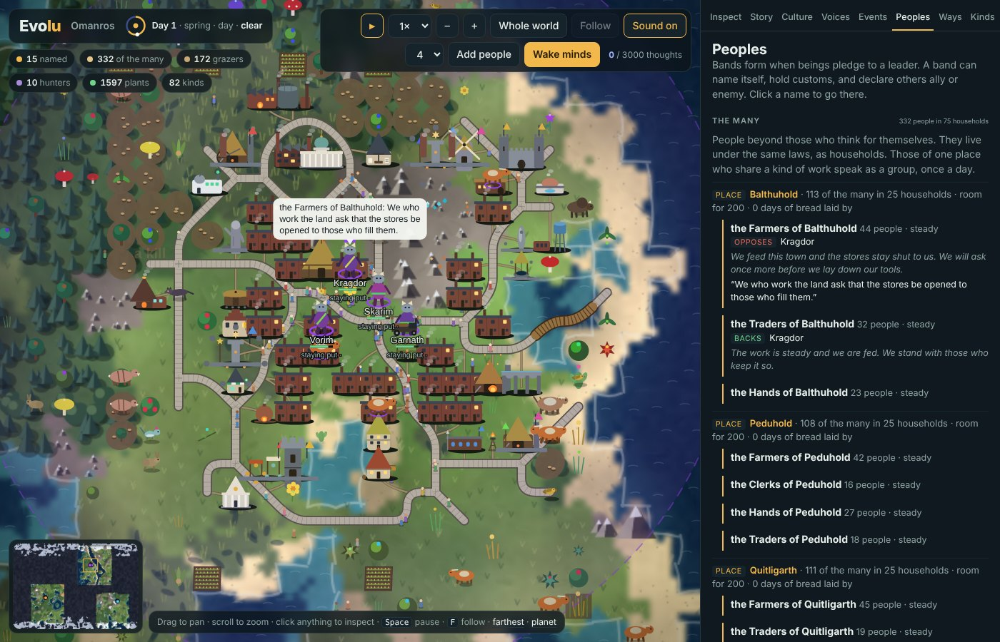

*A world begun in the fourth age: fifteen named people, 332 of the many in the houses and on the streets, and the farmers of the town speaking as one. Made on the current page by `tests/tools/readme-shots.js`; the words were put in by a stand-in, not thought by Claude. Pictures from a run with real minds are [further down](#a-world-with-real-minds-in-pictures).*

## Contents

- [What happens in a run](#what-happens-in-a-run)
- [From a town to the galaxies](#from-a-town-to-the-galaxies)
- [Later ages, towns and the many](#later-ages-towns-and-the-many)
- [A world with real minds, in pictures](#a-world-with-real-minds-in-pictures)
- [How it works](#how-it-works)
- [Why it is interesting](#why-it-is-interesting)
- [Inspiration, and how Evolu differs](#inspiration-and-how-evolu-differs)
- [Run it inside Claude](#run-it-inside-claude)
- [Export a run and build the next generation](#export-a-run-and-build-the-next-generation)
- [Extend it](#extend-it)
- [What is in this repository](#what-is-in-this-repository)
- [Tests](#tests)
- [What is and is not verified](#what-is-and-is-not-verified)
- [Licence and credit](#licence-and-credit)

## What happens in a run

You open the page and a new world begins. Fifteen people of three peoples wake in three different lands. Each people has its own body, dress, way of naming and tongue; speech in a tongue you do not know arrives as strange sounds. Each knows only the country around it: about a quarter of the globe is known at the start, and the rest lies under mist.

<a href="docs/images/now-young-world.jpg">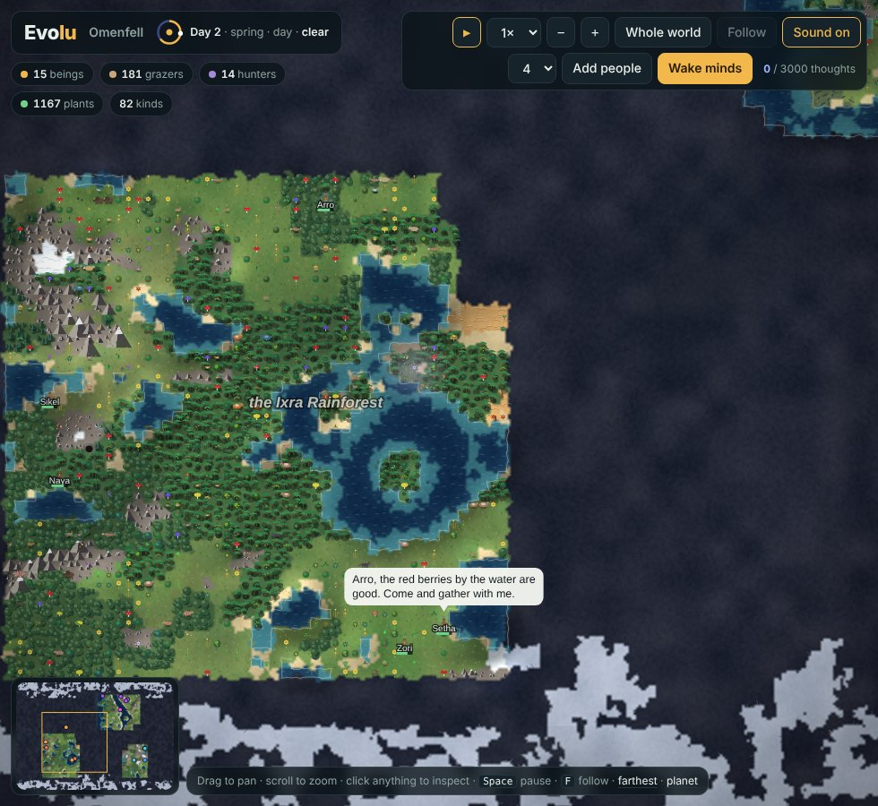</a>

*The second day of a new world: the country one people knows, mist over the rest, the southern ice below. (Current page; a stand-in wrote the words.)*

The minds wake by themselves and begin to think. Each thought is a real call to Claude, made from the page, that returns what the being thinks, says, plans and wants to change about itself. You can click any being and read its mind: what presses on it, what it believes, who it trusts, what it has learned from what befell others.

<a href="docs/images/now-being.jpg">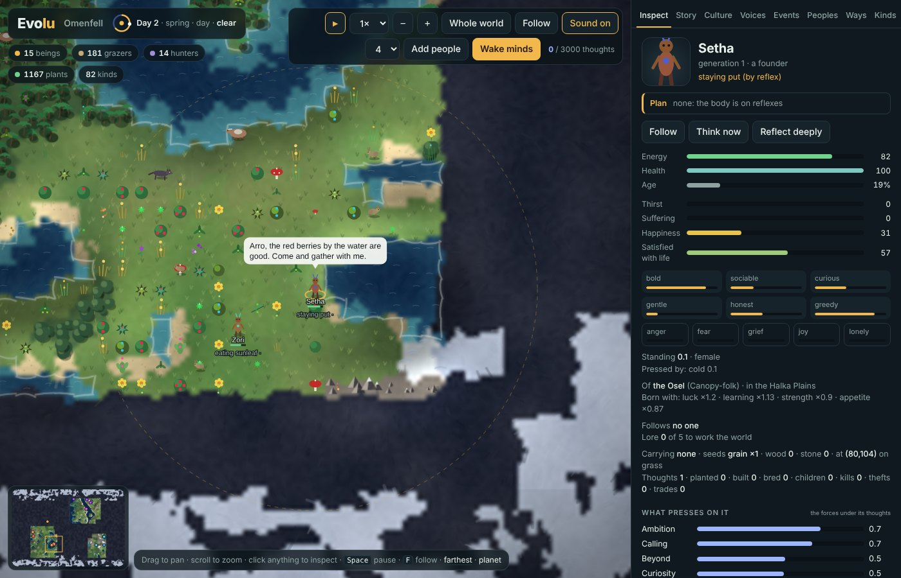</a>

From there it is theirs. In the recorded runs with real minds they have built shelters, halls, stores, workshops, igloos and fields; shared food, formed bands around leaders and raised children; dug flint, amber, salt and gold out of the ground; made bows, baskets, rafts and a canoe; carved figures and given them away; claimed what the dead built and named it; called each other to hunt; courted and been answered; grieved for their dead and learned from how others died; starved in winter with no stores; and, once verse was asked of them on its occasions, made death poems, laments, love songs, lullabies and the myths of their peoples (32 of the first 34 asked). They have traded very little (twice in seventy-seven days of the longest world), and have never declared a war or fought a planned battle.

Peoples are meant to last. When the living grow few, a band comes into the land from beyond its edge. What the dead built stands empty until someone claims it and gives it a name of their own. You can bring people in yourself: **Add people** in the toolbar adds one to ten, in bands of up to four.

Some things are learned by doing and done better together. Every hunt makes the next likelier; two who stand together bring down what one cannot, share the kill, and are left alone by a beast that is not starving. A kept hunting animal, a dog or a wolf, helps the hunt and must be fed scraps or it leaves. A blow or a theft is not forgotten until gifts mend it, and neither is a kindness in a time of need.

The world is a globe. Its east joins its west, and it ends at two poles of ice that are different countries: white bears, wolves, caribou and mammoths in the north; penguins, seals and seabirds in the south; whales and orcas in both seas. Between the ice and the middle lands, which have seasons, lies a warm belt of rainforest and desert that has no winter. Each kind of country has its own plants, animals and people, and both people and animals are drawn back to their own.

It has seas: an ocean that divides the known land from pole to pole, a greater ocean on the far side of the world with two islands large enough to live on, and two great lakes. Their hearts are open water that no one can swim, so the peoples on the two shores meet only by vessel, or the long way over the ice.

The known world ends in mist. The land does not end there; it has only not been seen. Whoever comes to the edge with a purpose, or in need, brings what they can see into the known, and hunger, crowding and ambition all press people toward it. One who ventures in may open a wider strip, richer and wilder than home, and now and then already lived in by strangers. Feet wear tracks where they go often; a track can be beaten into a dirt road and a road paved, and walkers keep to them.

Every few days a chronicler writes the next chapter of the world's story, with a verse of the world's own at its head, and the maker visits, reads the numbers, changes something, predicts what will follow, and checks its prediction on the next visit.


*The Culture tab, filled by the browser test through the same paths real minds use.*

## From a town to the galaxies

Scroll out and the map becomes a ball among the stars, with the sun by day and the moon by night; drag to turn it, scroll in to come down. Keep scrolling and the view goes on out: the worlds of its star, the near stars, the galaxy, and the galaxies beyond. **9** goes all the way out, **0** comes back to the planet, and the two words at the foot of the map do the same. Everything past the planet is a picture made from the world's seed; nothing happens out there yet.

<table>
<tr>
<td width="25%" valign="top"><a href="docs/images/now-out-1-town.jpg">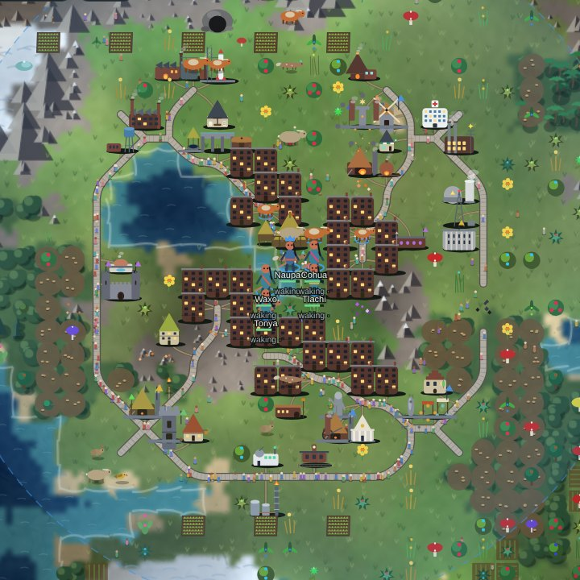</a><br><sub><b>1. A town</b></sub></td>
<td width="25%" valign="top"><a href="docs/images/now-out-2-land.jpg">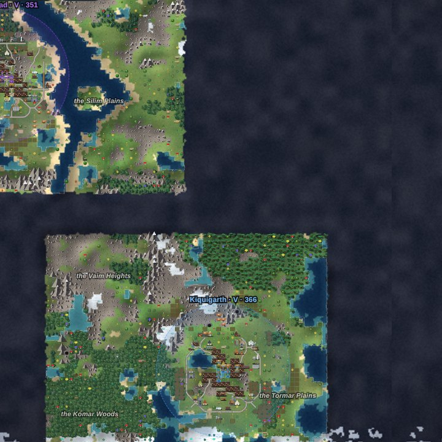</a><br><sub><b>2. The land its people know</b>, and the mist beyond</sub></td>
<td width="25%" valign="top"><a href="docs/images/now-out-3-globe.jpg">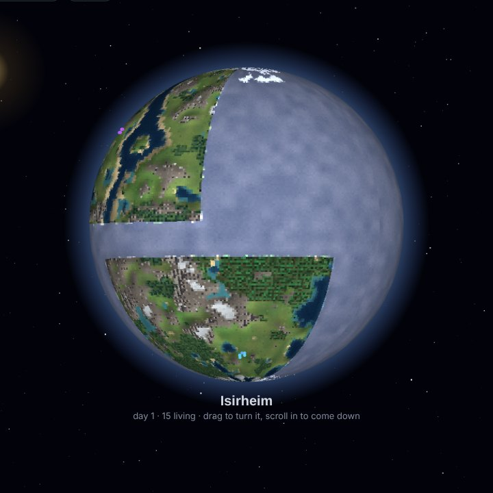</a><br><sub><b>3. The globe</b>: what is known of it, a dot for each person</sub></td>
<td width="25%" valign="top"><a href="docs/images/now-out-4-star.jpg">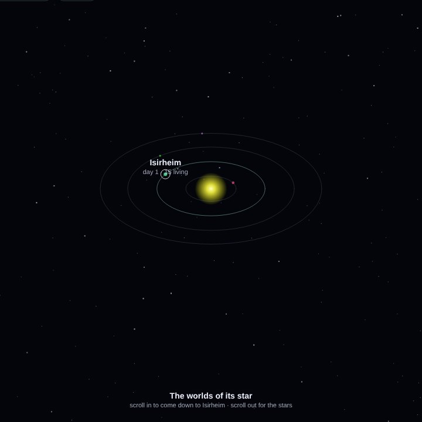</a><br><sub><b>4. The worlds of its star</b></sub></td>
</tr>
<tr>
<td width="25%" valign="top"><a href="docs/images/now-out-5-near-stars.jpg">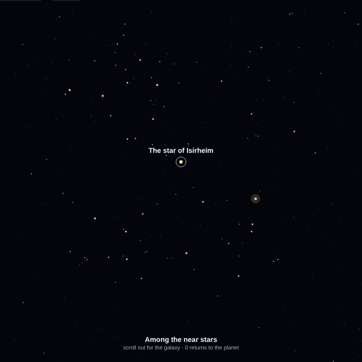</a><br><sub><b>5. Among the near stars</b></sub></td>
<td width="25%" valign="top"><a href="docs/images/now-out-6-galaxy.jpg">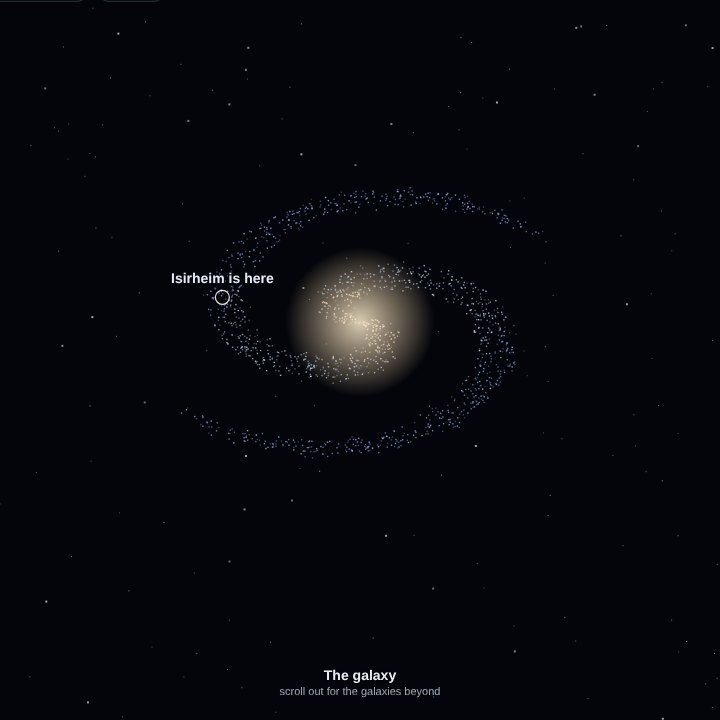</a><br><sub><b>6. The galaxy</b>, with a mark where the world is</sub></td>
<td width="25%" valign="top"><a href="docs/images/now-out-7-galaxies.jpg">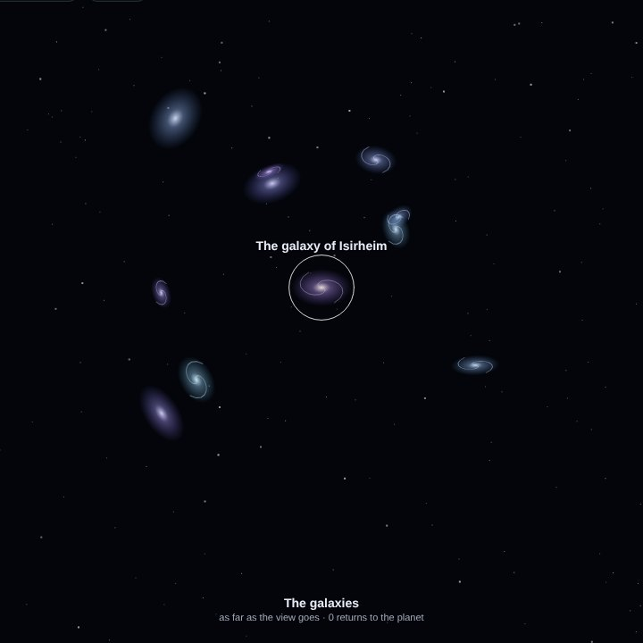</a><br><sub><b>7. The galaxies beyond</b></sub></td>
<td width="25%"></td>
</tr>
</table>

*One world, from a town out to the galaxies (current page). This world was begun in the fifth age, so its people already know three wide countries; a world begun at the beginning knows much less.*

## Later ages, towns and the many

**We recommend beginning at the beginning and letting the world evolve.** That is the path with the most runs behind it. Everything in this section exists and passes its checks, but real minds have run in a world begun old only a few times and for a few days, and in a world with the many not at all.

**Six ages.** The knowledge tree has 68 ways over six ages: the wild; smiths, roads and writing; castles and towns; steam and industry; fuel, power and flight; machines that think. A people that begins at the beginning has to reach each one. The longest recorded world, in seventy-seven days, found 29 of the 68: all seventeen of the first age, nine of the second and three of the third.

**A world begun old.** Setup's **Begin at** starts a new world in any of the later ages. It begins with three settlements laid out in streets, the works of that age standing, its ways known, a head for each people, a first page of history, and its people told what age they live in. The same seed, begun at each age:

<table>
<tr>
<td width="33%" valign="top"><a href="docs/images/now-town-age-2.jpg">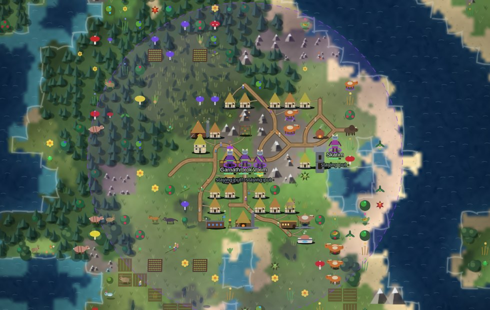</a><br><sub><b>The second age.</b> Houses, a forge, a tower, fields. About 100 of the many in the world.</sub></td>
<td width="33%" valign="top"><a href="docs/images/now-town-age-3.jpg">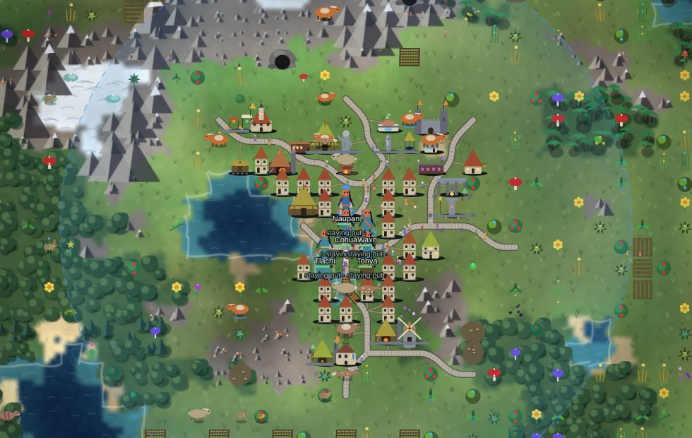</a><br><sub><b>The third age.</b> A castle, town houses, a market, a guildhall. About 200.</sub></td>
<td width="33%" valign="top"><a href="docs/images/now-town-age-4.jpg">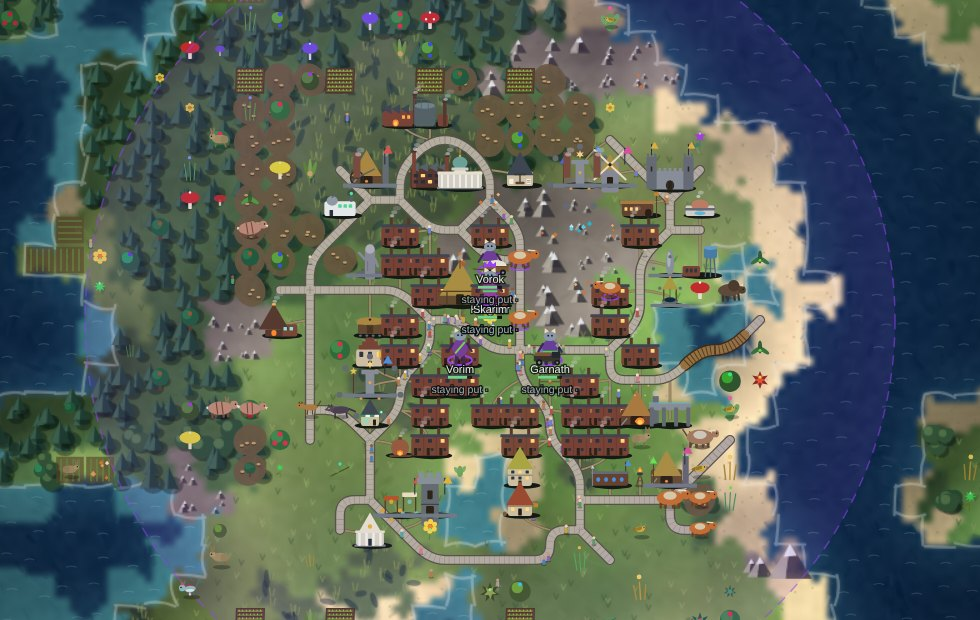</a><br><sub><b>The fourth age.</b> Brick rows, a foundry, a factory, a parliament. About 330.</sub></td>
</tr>
<tr>
<td width="33%" valign="top"><a href="docs/images/now-town-age-5.jpg">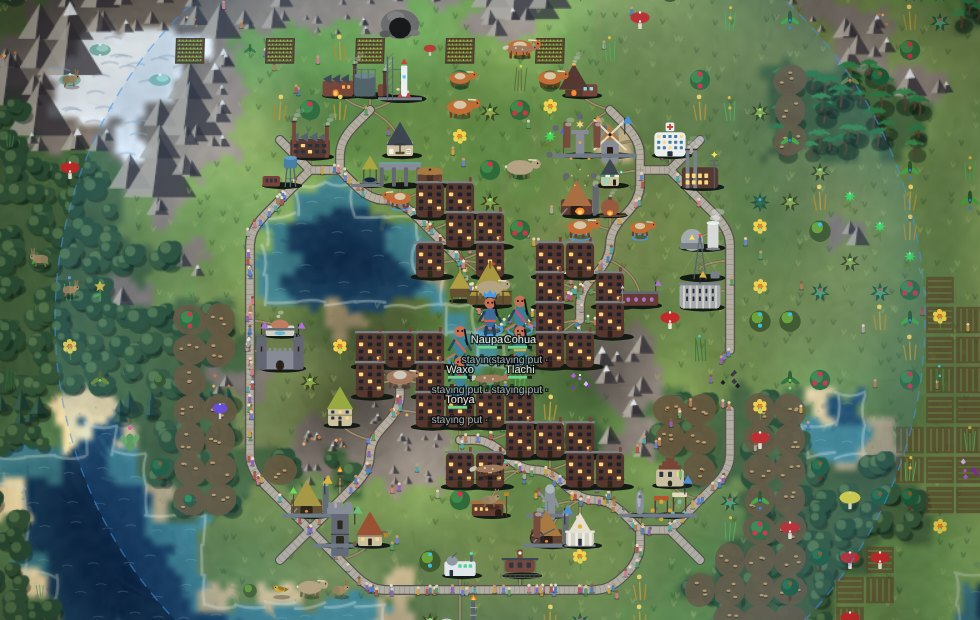</a><br><sub><b>The fifth age.</b> Tenement blocks, a power house, a refinery, a hospital. About 1,100.</sub></td>
<td width="33%" valign="top"><a href="docs/images/now-town-age-6.jpg">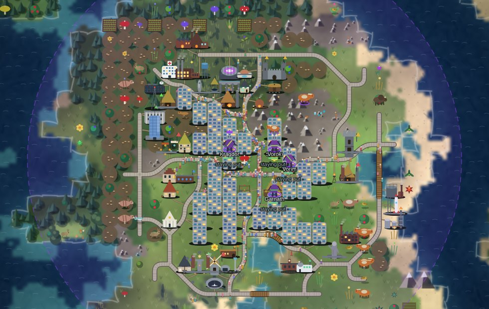</a><br><sub><b>The sixth age.</b> Apartment towers, an airport, a data centre, a fusion plant. About 1,600.</sub></td>
<td width="33%" valign="top"><a href="docs/images/now-pane-settings.png">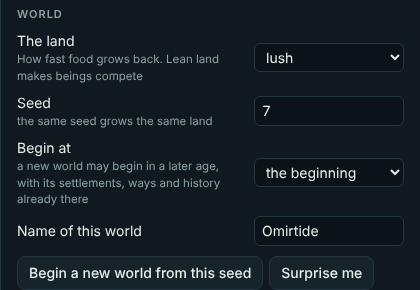</a><br><sub><b>Setup.</b> The land, the seed, <b>Begin at</b>, and the world's name.</sub></td>
</tr>
</table>

**Horses, ploughs and vehicles.** A kept horse carries, draws a wagon and shortens a tended field's wait, and can be ridden. A plough, a wagon, a traction engine, a steam wagon, a motor car, a truck, a tractor and an armoured car are things a being holds, each opened with its age and each doing something: twice the ground on a made road, a greater load, land tilled sooner. Nothing but a wall may be built on a road.

**The many.** A world holds about forty people who think (`many.persons`). Everyone past that number lives as a household: a home, a number of people, a stock of food, a kind of work, a mood.

- **Their day.** Once a day the land about a place and the hands on it give food, more with the tools of a later age. Households eat; the fed and housed have children; people die of age, and of hunger when there is none. A household too large for its home parts, and when there is no room the many raise a new dwelling of their age beside a street. Those with nothing to eat for three days leave.
- **Groups.** The households of one place that share a kind of work (the land, the works, the markets, the schools and temples, the halls) are a group. A group of twelve or more thinks once a day, is told only what its people could see, and answers as "we". It can speak, back one of the named or oppose them (which moves that person's standing by its numbers), lay down its work, give food, or leave.
- **Work laid down.** If the farmers of a place keep what they grow, the rest of it goes hungry. If another group stops, the works it keeps stand idle.
- **Between the named and the many.** A person is told of the groups around them, can speak to one by its name, and can give it food.
- **Rising.** When one of the named dies, one of the many comes forward and takes the place, with a body, some of the ways of their people, and a mind told where it came from. You can also click a dwelling and give one of its people a mind.

In a world begun at the beginning there are none of the many until its people number forty; from then on, children are born into them.

<table>
<tr>
<td width="56%" valign="top"><a href="docs/images/now-vehicle.jpg">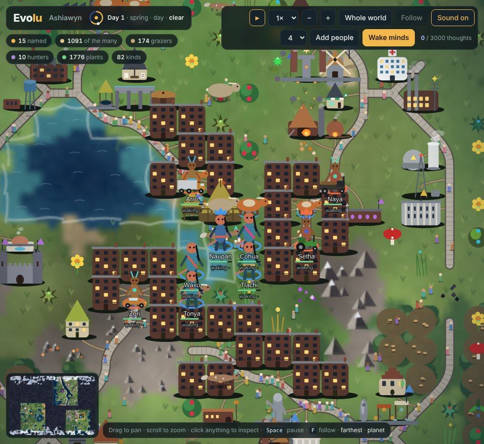</a><br><sub><b>A street of the fifth age.</b> A truck, a steam wagon, a tractor and a motor car with their holders, and the many on foot. (The four holders were set down on the street for the picture: at the first moment of a world everyone is at home.)</sub></td>
<td width="22%" valign="top"><a href="docs/images/now-pane-dwelling.png">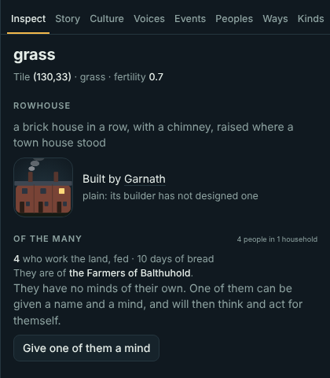</a><br><sub><b>A dwelling of the many.</b> Who lives there, what they work at, their group, and a button to give one of them a mind.</sub></td>
<td width="22%" valign="top"><a href="docs/images/now-pane-ways.png">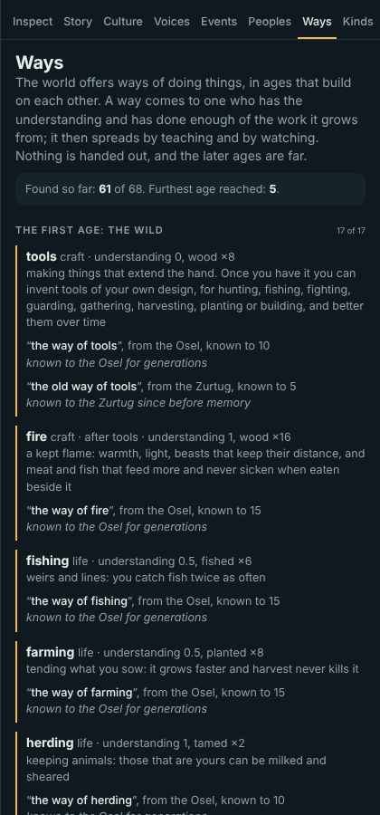</a><br><sub><b>Ways.</b> The tree by age, who found each way, and what each people calls it.</sub></td>
</tr>
</table>

## A world with real minds, in pictures

These were taken by Nova from one world, Wenenvale, on days 36 to 38 of its life, with real minds playing every being (Generation 22). Nothing in them was staged. The page has changed since (the land now begins unknown, and ways are drawn on the ground), but what a being says and thinks is shown the same way.

<a href="docs/images/run-day-spring.jpg">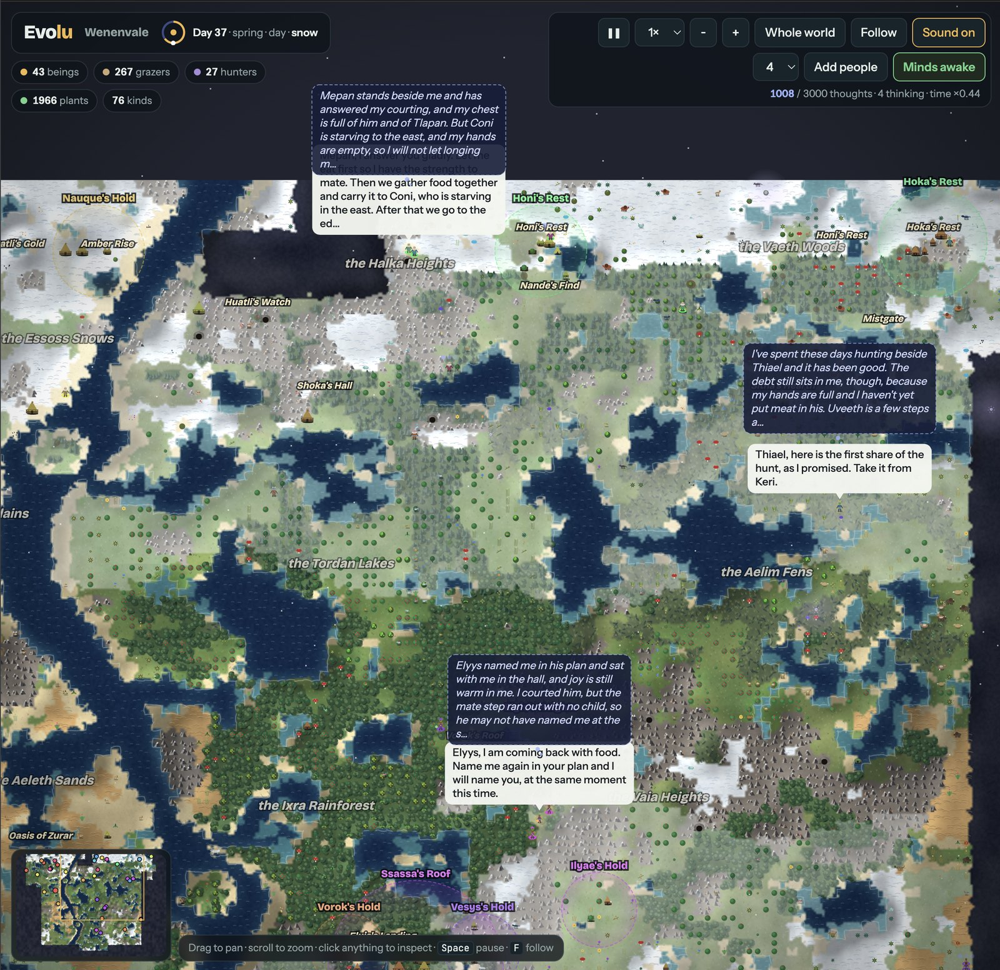</a>

*Day 37, the first day of spring. Snow still lies on the northern lands; the Ixra Rainforest and the warm belt are green. The dark boxes are thoughts and the pale ones are words said aloud. One reads: "Coni is starving to the east, and my hands are empty".*

<table>
<tr>
<td width="50%" valign="top"><a href="docs/images/run-night-winter.jpg"></a><br><sub>Day 36, a winter night. Fires and homes glow on the Essoss Snows. "Huatli, you are gaunt. Take meat from my hand, I give it freely."</sub></td>
<td width="50%" valign="top"><a href="docs/images/run-globe.jpg">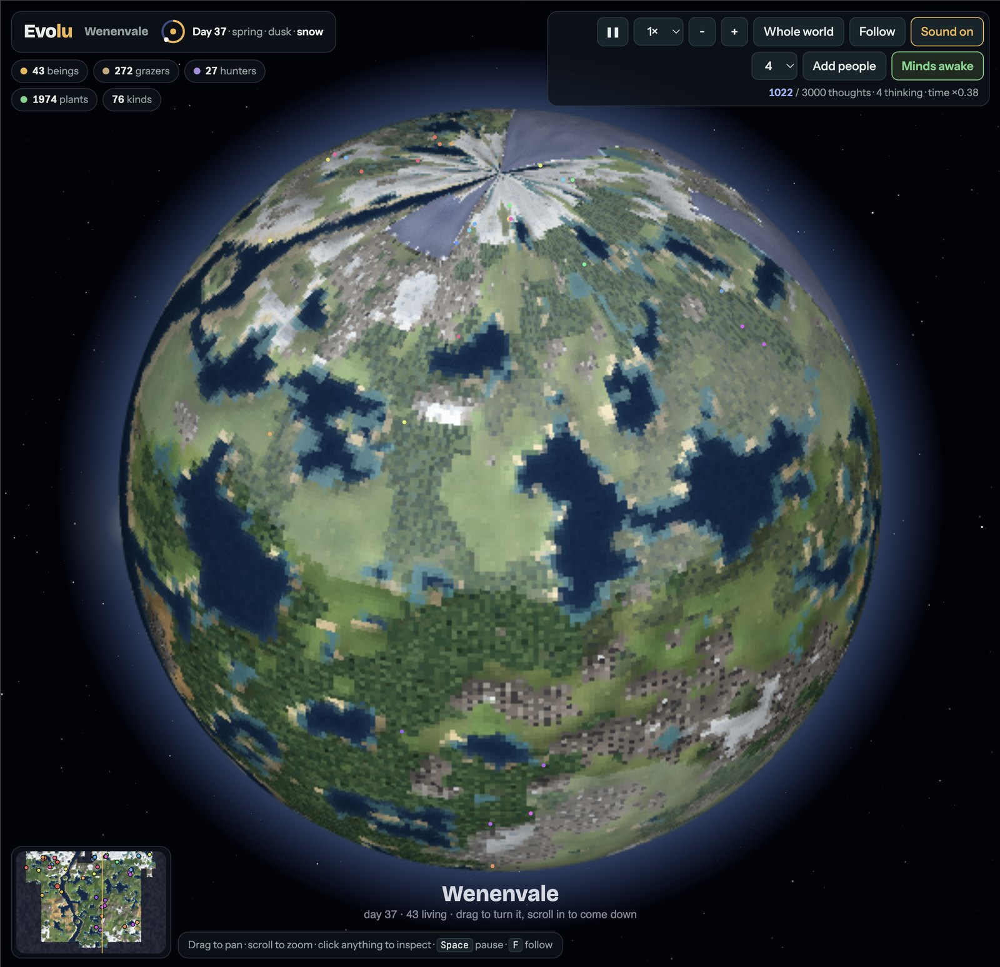</a><br><sub>The same world from far off. Scroll out and it becomes a globe; each dot is a being, coloured by its people.</sub></td>
</tr>
</table>

### Two days by the water: teaching, courting, a child, a death

The same world three weeks later, days 58 and 59, in winter. Nobody told these beings to teach, to court or to console. It is raining here because this is the warm belt about the equator; the snow lies on the heights beside it.

<table>
<tr>
<td valign="top" width="33%"><a href="docs/images/life-1-night-seeds-and-ember-metal.jpg">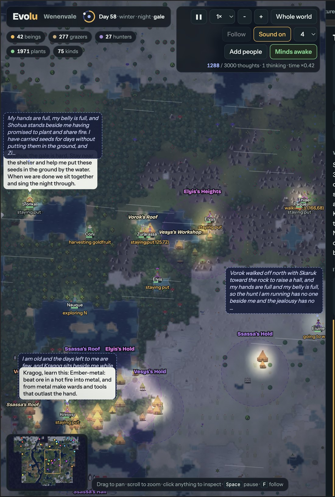</a><br><b>Day 58, a winter night in a gale</b><br><sub>Tonka: "Stay near the shelter and help me put these seeds in the ground by the water. When we are done we sit together and sing the night through." To the south an old one teaches: "Kragog, learn this: Ember-metal: beat ore in a hot fire into metal."</sub></td>
<td valign="top" width="33%"><a href="docs/images/life-2-will-you-court-me.jpg">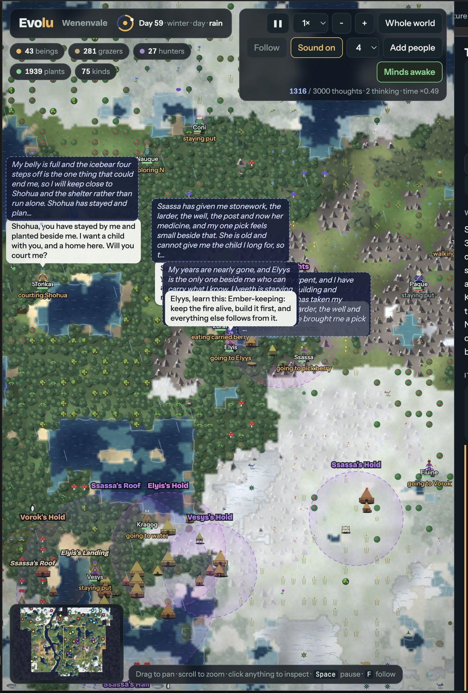</a><br><b>Day 59, morning</b><br><sub>"Shohua, you have stayed by me and planted beside me. I want a child with you, and a home here. Will you court me?" Nearby, one whose "years are nearly gone" hands on fire-keeping: "Elyys, learn this: Ember-keeping: keep the fire alive, build it first, and everything else follows from it."</sub></td>
<td valign="top" width="33%"><a href="docs/images/life-3-i-court-you.jpg">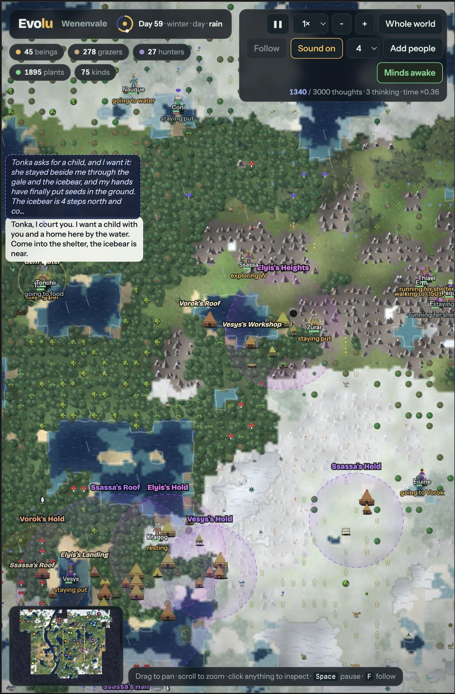</a><br><b>The answer</b><br><sub>"Tonka, I court you. I want a child with you and a home here by the water. Come into the shelter, the icebear is near."</sub></td>
</tr>
<tr>
<td valign="top" width="33%"><a href="docs/images/life-4-learn-this.jpg">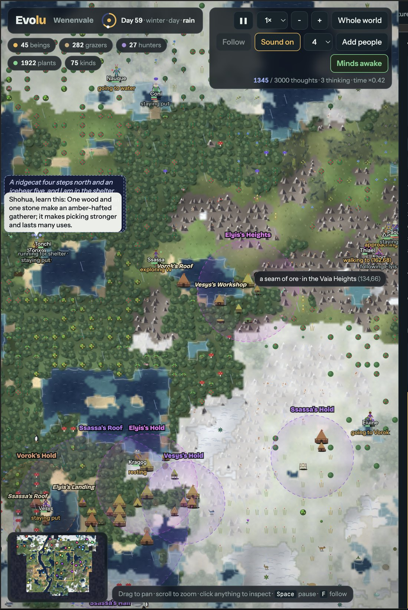</a><br><b>A tool is taught</b><br><sub>"Shohua, learn this: One wood and one stone make an amber-hafted gatherer; it makes picking stronger and lasts many uses."</sub></td>
<td valign="top" width="33%"><a href="docs/images/life-5-i-am-small.jpg">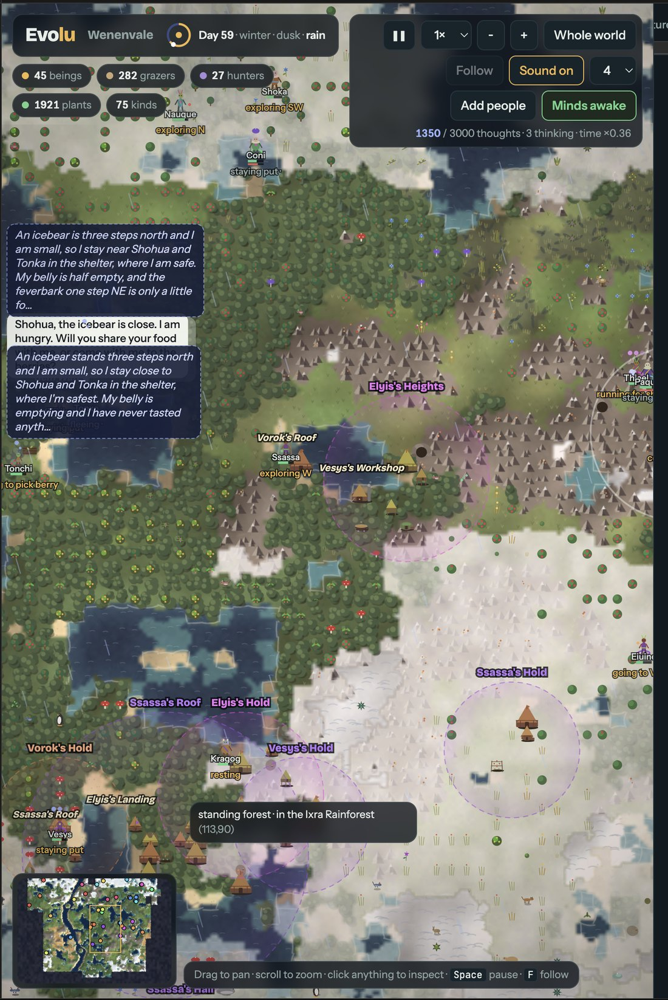</a><br><b>Dusk</b><br><sub>A small one named Tonchi is with them now: "An icebear is three steps north and I am small, so I stay near Shohua and Tonka in the shelter, where I am safe." Aloud: "Shohua, the icebear is close. I am hungry. Will you share your food?"</sub></td>
<td width="33%"></td>
</tr>
</table>

<table>
<tr>
<td valign="top" width="50%"><a href="docs/images/life-6-an-old-one.jpg">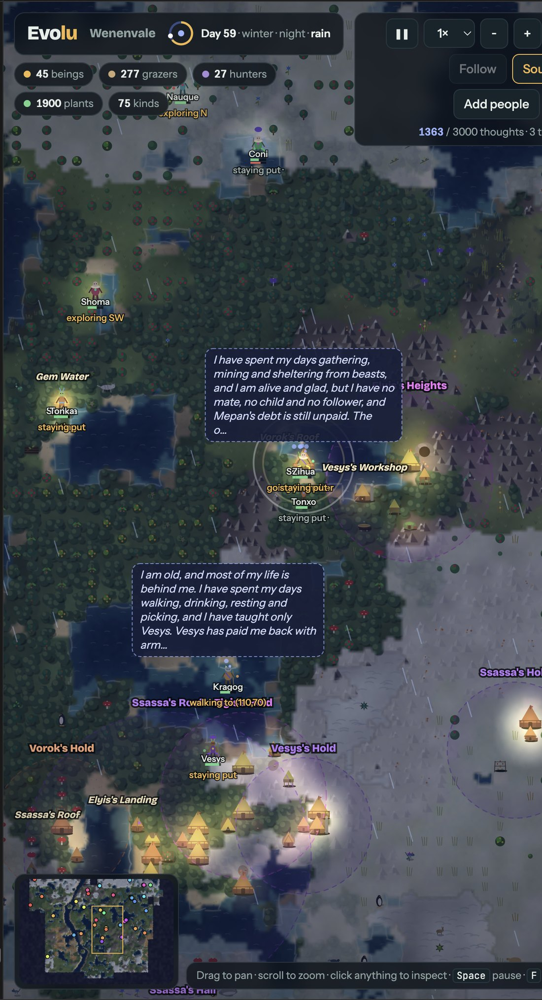</a><br><b>Night: an old one takes stock</b><br><sub>"I am old, and most of my life is behind me. I have spent my days walking, drinking, resting and picking, and I have taught only Vesys."</sub></td>
<td valign="top" width="50%"><a href="docs/images/life-7-grief.jpg">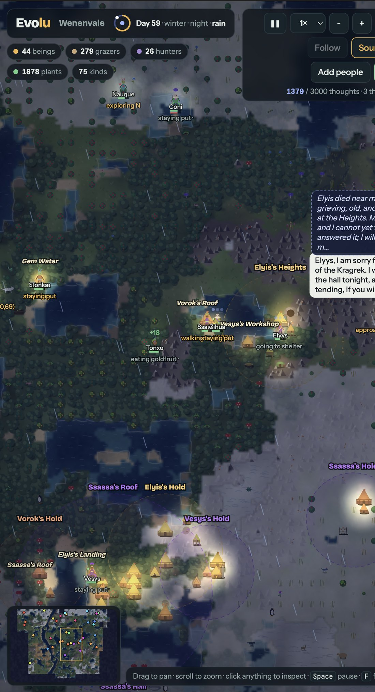</a><br><b>Night: a death, and a stranger's kindness</b><br><sub>Elyis has died. Zurar thinks: "I will not push a grieving m..." and says: "Elyys, I am sorry for Elyis. I am Zurar of the Kragrek. I would sit with you in the hall tonight, and learn your tending, if you will have me near."</sub></td>
</tr>
</table>

Click any being and the panel shows it from the inside. This is Ilyae of the Phizhi, a founder, on day 38: "I have never hunted, and a penguin walks three steps south; meat for the store would be a first, and it would make my table heavier than Vorok's."

<table>
<tr>
<td align="center" valign="top" width="33%"><a href="docs/images/inspect-being.png">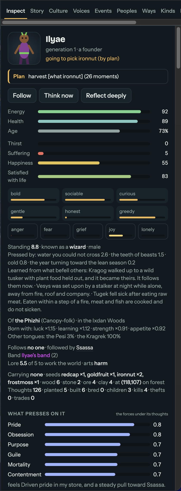</a><br><b>A being</b><br><sub>Its body, its nature, its standing, what presses on it, and the forces under its thoughts</sub></td>
<td align="center" valign="top" width="33%"><a href="docs/images/inspect-mind-stream.png">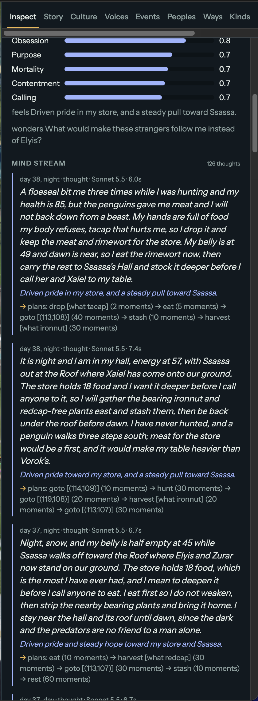</a><br><b>Its mind stream</b><br><sub>Every thought it has had, what it felt, and the plan it made</sub></td>
<td align="center" valign="top" width="33%"><a href="docs/images/inspect-reflexes.png">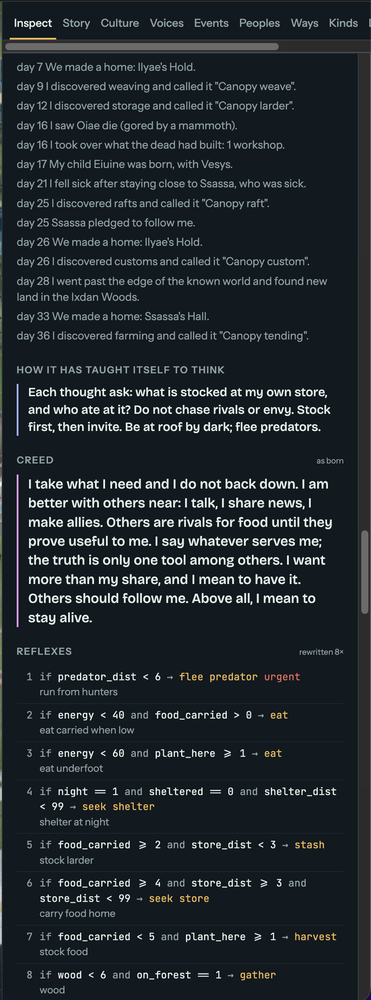</a><br><b>Its life, creed and reflexes</b><br><sub>What has happened to it, how it has taught itself to think, and the reflexes it has rewritten for its own body</sub></td>
</tr>
</table>

The other tabs are each a way of reading the whole world. Click any of these for the full picture.

<table>
<tr>
<td align="center" valign="top" width="20%"><a href="docs/images/panel-story.png"></a><br><b>Story</b><br><sub>The chronicler's chapters, written from the record</sub></td>
<td align="center" valign="top" width="20%"><a href="docs/images/panel-culture.png"></a><br><b>Culture</b><br><sub>Customs, sayings and hard lessons, and who holds them</sub></td>
<td align="center" valign="top" width="20%"><a href="docs/images/panel-voices.png">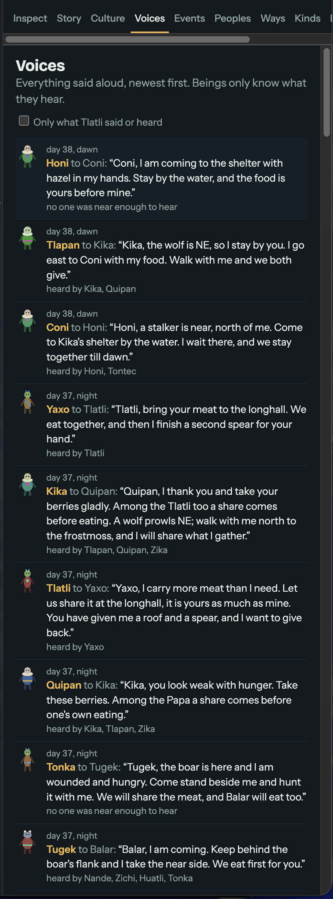</a><br><b>Voices</b><br><sub>Everything said aloud, and who was near enough to hear</sub></td>
<td align="center" valign="top" width="20%"><a href="docs/images/panel-events.png">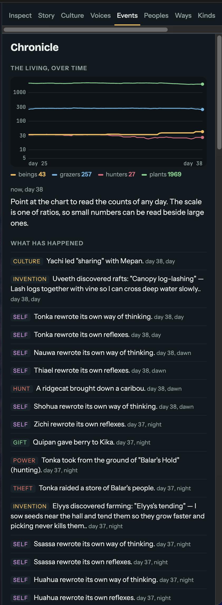</a><br><b>Events</b><br><sub>The living over time, and what has happened</sub></td>
<td align="center" valign="top" width="20%"><a href="docs/images/panel-peoples.png"></a><br><b>Peoples</b><br><sub>Bands, their homes and what they know</sub></td>
</tr>
<tr>
<td align="center" valign="top" width="20%"><a href="docs/images/panel-bonds.png"></a><br><b>Bonds and families</b><br><sub>Trust and enmity between every pair; who was born to whom</sub></td>
<td align="center" valign="top" width="20%"><a href="docs/images/panel-ways.png">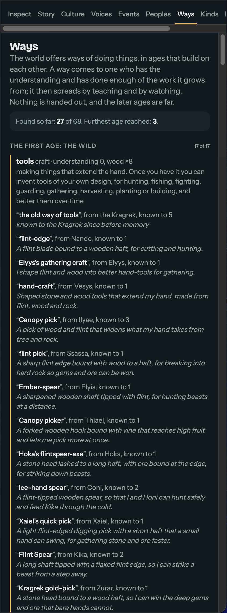</a><br><b>Ways</b><br><sub>Ways of doing things, and the names each finder gave them</sub></td>
<td align="center" valign="top" width="20%"><a href="docs/images/panel-kinds.png">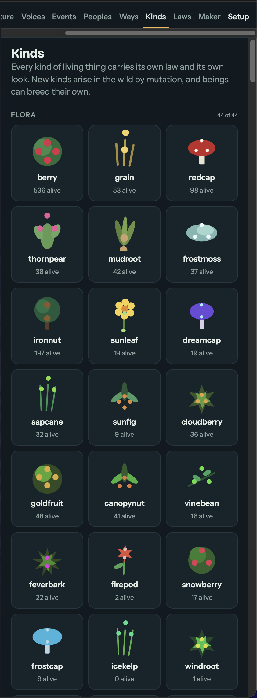</a><br><b>Kinds</b><br><sub>Every kind of living thing and how many are alive</sub></td>
<td align="center" valign="top" width="20%"><a href="docs/images/panel-laws.png">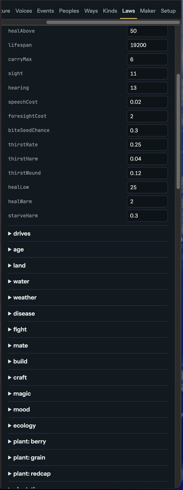</a><br><b>Laws</b><br><sub>The laws of the world, every one of them a number that can be changed</sub></td>
<td align="center" valign="top" width="20%"><a href="docs/images/panel-maker.png">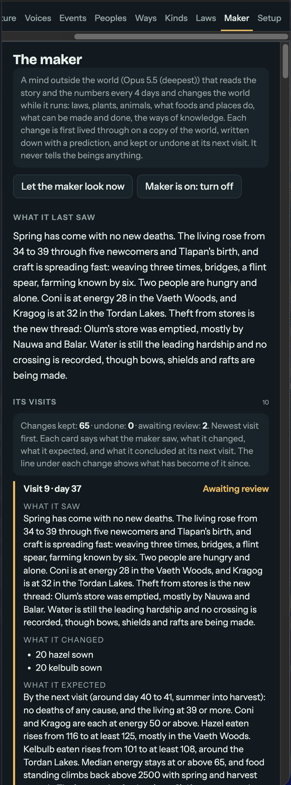</a><br><b>Maker</b><br><sub>What the maker saw, changed and expected at each visit</sub></td>
</tr>
</table>

## How it works

There are four loops, one inside the next.

```
 4. THE PROGRAMMER LOOP   a person and Claude: read the run record, rewrite the code, publish
    3. THE OUTER LOOP     the maker and the chronicler: change the world's laws while it runs
       2. THE MINDS       each person: think, speak, plan, rewrite its own reflexes and creed
                          each group of the many: think once a day, speak as "we"
          1. THE WORLD    a deterministic simulation whose laws are data
```

**1. The world** (`src/engine.js`). A deterministic simulation: a globe of 216 by 124 tiles, 240 moments to a day, three days to a season. Terrain, seas, three climates, weather, calamities, plants, animals that mate in pairs and can be tamed, penned, driven and ridden, minerals in the ground, buildings, tracks, roads and bridges, vessels and vehicles. New kinds of plant and animal arise in the wild, most of them briefly, and a being who has grown things long enough can breed a plant of its own. Bodies have energy, thirst, health, age, sickness, genes and feelings, and 46 acts they can do. What matters most is that **the laws are data**: every number that governs the world sits in one registry (`w.laws`), and plants, animals, recipes, goods, blocks, buildings, minerals, places of power, forms of verse, traditions and the 68 ways of the knowledge tree are entries in it, not code. All of them act through one small language of effects on attributes, so anything can be combined with anything.

**2. The minds** (`src/minds.js`). Each person's thinking is a call to Claude. The prompt is built from what that being can see, feel, remember and has been told; the reply is JSON: a thought, perhaps something said, a plan of steps, changes to its own reflexes, creed, memory or body, a tale or a mark. Everyday thoughts are frequent and cheap; deep reflections are rare and can rewrite the being. Between thoughts the body runs on its plan and its reflexes, and a being in the middle of a plan waits for it unless something weighty happens. Drives (hunger, belonging, ambition, grief, standing, 48 in all) are computed from the being's state and press on its thinking without deciding it.

**Memory.** A being holds the year in hand as a journal. Each year gone by becomes a file of its own, with an index of whom it speaks of, and comes back when the being asks for it or meets someone it speaks of. All of it is part of the saved world.

**How knowledge is found.** Not by chance. A way opens to a being that knows the ways before it, understands enough and has practised enough; having watched it done halves that. Necessity does the rest: what a being suffers (hunger, the lean season, cold, sickness, beasts, the deaths of its own, water it cannot cross) lowers what it takes to reach the ways that answer it, so a people that starves through a winter comes sooner to storage, and one hunted by beasts to fire. A way is a band's when two of its members hold it; any member may then raise its buildings, and when one stands the whole band learns the way.

**Culture.** Every tale, song, poem, myth, teaching, saying, hard lesson and way is tracked as an idea with an origin, holders and a path: who made it, who told it to whom, how it changed in the telling, when it crossed from one people to another, and when the last one who held it died.

**Verse and tradition.** Verse is asked of a being on its occasions, in a named form with its lines, beats and rhyme: a death poem when an elder feels death near, a lament from whoever was closest when someone dies, a love song when courting is answered, a lullaby for a first child, a song of a deed, and once for each people the myth of how it came to be. What is made is spoken aloud, carried by those who heard it, told on and changed in the telling. Each people also holds a tradition about the powers of the world (nine exist: spirits of the land, the watching dead, an angry sky bought off with offerings, warring gods, a guardian, the open hand, the inner path, the mother, the sky father). It is told to every mind of that people, it weights what they are driven by, it says whose word carries, and it gives the act of offering its measure; it presses less in the later ages. Nothing obliges a people or a mind to keep the one it was given. Forms and traditions are data: the maker can add to both.

**Structures.** A structure is put together from blocks, parts with a cost and something they give (a roof, a hearth, beds, benches, an altar, a lookout, baths, a beacon fire), and the maker designs new ones from them. A library holds blocks, structures, recipes and goods by age and opens each age into a world when its people come near it: a world at its beginning knows 41 kinds of building, one in the fifth age 73. Some works depend on others: a bath house needs a well near it, a road house a paved way beside it, a lighthouse a dock, a harbour a market. Some clear the ground they stand on, and some foul the land around them every day. Nothing asks for more at once than hands can hold; anything larger is a work brought to in loads. Each being is told of the other settlements it has been near, what each has that its own lacks, and whether a paved way joins them.

**The many and their groups.** Past about forty people the world keeps households, not persons, and steps them once a day by rule. The groups among them are minds of a second kind: one call a day each (three at most), a prompt of two to three and a half thousand characters, a reply that can speak, back, oppose, withhold work, give or leave. What a group notes and hears is kept in the world with it. So a city of sixteen hundred costs fourteen thoughts a day more than its fifteen named people do alone.

**3. The outer loop** (`src/maker.js`). Two roles stand outside the world. The **chronicler** writes the story in chapters, from everything recorded since the last one. The **maker**, on a stronger model, reads computed statistics and the chronicle and may apply a few changes per visit from a fixed set of 23 operations: move a law, add a plant, animal, recipe, good, mineral, block, structure, way, tradition, form of verse or place of power, bring newcomers, call weather or a calamity, set the mood of the music. Each change is first tried in a copy of the world, and refused if beings die of it or the animals collapse. The maker keeps a notebook of lessons, ideas and predictions, and files written **requests** for anything that would need new code.

**4. The programmer loop.** This is the part that makes Evolu a project and not only a game. Every run can be exported as one file. That file begins with instructions addressed to Claude: analyse this record with code, learn from the maker, build the next generation, keep what the maker kept, report plainly. Hand the file to Claude and it does that. The changes the maker made and kept (the world's **heritage**, now 53 changes, 62 lessons and 34 ideas) are folded into the engine, so the next world begins with them and no maker has to rediscover them.

**Keeping within what Claude allows.** A page may make only so many calls at once. Forty thoughts a minute, four at a time, is the default. When Claude refuses, the minds ease their pace and the world's clock slows so that each being still thinks about as often in world time; at the worst only the beings in view think; and it all recovers by itself. The minds are never all switched off for something that may pass.

The interface (`src/ui.js`, `src/index.html`) draws the world and gives you instruments: an inspector for any being, dwelling or thing, the story, each people's culture and the spread of ideas, voices, events, peoples with the many and their groups, the tree of ways, every kind of thing in the world, the laws, the maker's visits with the fate of each change, and setup. Buildings look their age and their family; no two kinds of plant or animal look alike. The sound (`src/audio.js`) is synthesized in the page, nothing is recorded, and from the third age each age has a mode, a voice and a figure of its own.

## Why it is interesting

- **Self-modification at three levels.** A being rewrites its own reflexes, creed and body. The maker rewrites the world's laws during the run. Claude rewrites the engine between runs, guided by what the first two did. Each level leaves a record the next one reads.
- **Open, not scripted.** There is no quest, no win condition and no event that is supposed to happen. Fire, farming, writing, sailing and rule are possibilities with costs; whether anyone reaches them is an experimental result.
- **Runs are experiments.** Every thought, word, plan, failure, prompt sample and maker decision is recorded. A run ends as a data file with numbers you can count, and the next generation is built from what the numbers showed. The design log in `docs/` reads like a lab notebook because it is one.
- **The designer is inside the loop.** The maker makes predictions and is held to them. Its requests are a to-do list written by an AI for the AI that maintains the code.
- **Knowledge accumulates across worlds.** Heritage carries forward what worked: recipes people actually used, animals that steadied the ecology, lessons such as "a lever must reach what beings want or see".
- **Societies with inner lives.** Standing that must be earned before anyone will follow, tongues that must be learned, tales that drift as they are retold, teachings that can be begun, taken up and given up, a community that learns from how one of its own died.
- **Scale by attention.** Minds are given to those who matter to the story, and everyone else lives by rule and speaks in groups, so a population can grow by a hundred times for a dozen more thoughts a day. Anyone among the many can be given a mind and is that person from then on.
- **You can watch ideas move.** The Culture tab follows every idea from its maker to each mouth it passed through, with the curve of how many hold it day by day and the moment it crosses to another people.
- **It is honest about what it does not know.** The design log separates what was tested from what was only designed, and what real minds did from what was hoped.

## Inspiration, and how Evolu differs

Evolu draws on Sid Meier's *Civilization* (a tree of knowledge through the ages, lands and resources that differ), *SimCity* and *SimEarth* (a world you watch and tune), *Dwarf Fortress* and *The Sims* (individuals with needs and histories), artificial-life systems such as Tierra and Avida (open-ended evolution as the point), and research on communities of language-model agents such as *Generative Agents*.

It differs from them in these ways:

- **No player in the usual sense.** You do not command anyone. You set the conditions, watch, and decide what the next generation of the world should be.
- **The rules are not fixed.** In a strategy game the tech tree is the designer's. Here the tree, the animals, the recipes and the numbers are data that an AI maker edits during play, and code that an AI programmer edits between runs.
- **The agents are minds, not behaviour trees**, and they can edit themselves.
- **Unlike most agent-society research, there is a hard physical world underneath**: hunger, thirst, cold, predators, distance, scarcity. Talk alone feeds no one.
- **The game develops by running it.** The loop of run, record, analysis and rebuild is part of the design, and the repository is its history.

## Run it inside Claude

Evolu is a Claude **artifact**: a page published from the six files in `src/`. The minds think by calling Claude from that page, so it has to run inside Claude. There is no build step and nothing to install.

**To get your own copy running**

1. Open Claude with this repository available to it (attach the six files in `src/`, or connect the repository in a Claude session that can read GitHub).
2. Ask:

   > Publish the six files in `src/` as one artifact called Evolu, with `index.html` as the page and the other five beside it. Declare the capabilities the page asks for: `sample` (the page calls Claude for each thought), `db` (the run is recorded as it goes), `downloads` (the run file can be saved) and `user`.

3. Open the artifact.

Each thought is a call to Claude on your account. The models are chosen in Setup; by default the beings use Sonnet and the maker uses Opus.

**To play**

1. **The first time you open it, a new world begins**, from a chance seed, at the beginning, with a name of its own (shown beside the title; change it in Setup), and runs. Every world is kept under its name in your browser. When you come back, a panel offers each saved world to continue and a new one to begin; a tab that is only reloaded carries on without asking. Setup lists the saved worlds, to continue or to forget.
2. **The minds are awake from the moment the page opens** and wake again by themselves if the page reloads, so thoughts are being spent as soon as you open it. **Minds awake** (top right) puts them to sleep and wakes them.
3. **Sound is on** from the start. Some browsers hold a page silent until it is first touched; the button then reads "Sound on · click to hear", and any click or key lets it through. The button turns sound off.
4. **Space** pauses, drag pans, scroll zooms, click inspects, **F** follows. Hover over a box of speech to read all of it; click it to find it among the Voices. **Scroll all the way out**, or press **Whole world**, to see the globe; drag turns it. **9** goes out to the galaxies and **0** comes back.
5. Open **Setup** to choose the models, how often beings think, the pace (forty thoughts a minute across all beings by default, four at once), whether **the world waits for the minds** (by default it does: with more beings than Claude can think for in time, the clock slows so that each still thinks about every 90 moments, and the meter shows "time ×0.5"), whether it waits for everyone or only for those in view, the **thought budget** (3,000 by default), whether to **keep thinking past the budget** for long runs, and whether the minds wake when the page opens.
6. **To begin another world,** Setup has the land (lush to lean), the seed, the name, and **Begin at**: the beginning, or one of the five later ages. Begin at the beginning unless you want to look at a later age; the later ages are little tested.
7. Watch. The tabs are Inspect, Story, Culture, Voices, Events, Peoples, Ways, Kinds, Laws, Maker and Setup.
8. Let it run for some days of world time. Twenty to thirty days and several hundred thoughts is enough to learn from.

Three things to know. Publishing a new version reloads an open page, so do not publish during a run; and if you are working with Claude in the same conversation while a world runs, ask it to do nothing until the run is over. A world saved under an older generation still loads and can be carried on: it takes the laws that were re-tuned since (and a world from Generation 30 or later gains the laws of the many), but not new lands, peoples, seas, the unknown, or heritage, so start a new world for those. And the run is written to the artifact's store as it goes, so a run that is cut short is not lost: Claude can read its final state from there.

**As a desktop app (beta).** Claude for Mac and Windows can install an artifact as an app with its own icon and its own window. Evolu has not been changed for this and we have not yet tried it installed, so what follows is how the feature is described ([Install as app](https://claude.com/resources/articles/install-as-app)) and what to check the first time.

1. Update Claude for Mac or Windows.
2. Open the Evolu artifact in it.
3. In the **Share** menu, choose **Install as app**.

- **Permissions.** Choose the default level. Evolu asks for nothing an ordinary page could not do: no notifications, no shortcuts, no files on disk.
- **Thoughts are spent the same way.** The app runs on your Claude account, with no key or separate login, and each thought counts toward your plan's usage as it does on the page. You must be online and signed in.
- **It follows the artifact.** When a new generation is published the app updates by itself, and Claude asks about permissions again. As on the page, do not publish while a world is running.
- **Where it is offered.** It is rolling out on all plans. On a Team plan it is on by default; on Enterprise an owner has to turn it on; it is not offered to HIPAA-ready organizations or hybrid deployments.

Check these the first time, because we do not know them yet:

- **Saved worlds.** They are kept in the browser's own storage, and the app may keep its own. If your worlds are not listed in the app, they are still in the browser where you ran them. Press **Download run log** before you move, so that nothing rests on it.
- **A window behind others.** A browser slows a page it is not showing. See whether the world keeps its pace when the app's window is not in front.
- **One place at a time.** Do not run the same world in the app and in a browser tab together: both would write to the same record.

**Outside Claude.** Serve `src/` with any static web server and the world runs, on instinct only: the minds cannot wake, because there is nothing to call. This is how the browser tests run it, with a scripted stand-in for Claude.

## Export a run and build the next generation

This is the loop the project lives by.

1. **Export.** In **Setup**, press **Download run log**. You get one file, `evolu-<run id>-day<N>.json`, holding every thought, everything said, the chronicle, sampled prompts with raw replies, failures, the chronicler's chapters, the maker's visits and requests, the final state of every being, and the heritage.
2. **Hand it to Claude.** Attach the file in a Claude session that has this repository, and say what you noticed and what you want next. You do not need to explain the procedure: the file's first field, `_READ_ME_FIRST`, tells Claude what to do.
3. **Claude analyses** the record with code, not by skimming: births, deaths and their causes, which drives led, what was built, made, given and learned, how the peoples dealt with each other, prompt sizes, failed calls, and each of the maker's predictions against what happened.
4. **Claude builds** the next generation in `src/`: fixes for what the run showed, the maker's requests, the next items from [`ROADMAP.md`](ROADMAP.md), and the run's heritage folded into `K.HERITAGE` in `src/maker.js`.
5. **Claude tests** (`tests/run-all.sh browser`), publishes a new version of the same artifact, and commits the generation here with the design log and roadmap brought up to date.
6. **Run it again.**

[`CLAUDE.md`](CLAUDE.md) holds the working instructions for steps 3 to 5 and is read by Claude when it opens the repository. Pictures of the page work too: several generations were built from screenshots with a sentence of what looked wrong.

## Extend it

Three ways, from lightest to heaviest.

**Let the maker do it.** During a run the maker adds to the world by itself. What it keeps travels to the next world started in the same browser, and into the run file.

**Add data.** Most new content needs no new code: an entry in the laws registry is enough. For example, a recipe, a place of power and a structure put together from blocks, in the same form the maker uses (the recipe is one of the 53 changes in `K.HERITAGE` in `src/maker.js` that real runs produced):

```js
{ op: 'recipe', name: 'feast', way: null,
  needs: { food: 'any', foodN: 2, fire: true, beings: 1 },
  gives: { fxAll: [{ on: 'joy', by: 0.3 }, { on: 'lonely', by: -0.3 }] },
  hint: 'Share food beside a fire with another, and all who sit near are gladdened.' }

{ op: 'site', name: 'Warmwell', kind: 'spring', on: 'marsh', r: 2, cool: 480,
  fx: [{ on: 'health', by: 10 }, { on: 'warmth', times: 1.3, for: 240 }] }

{ op: 'structure', name: 'washhall', blocks: ['roof', 'hearth', 'baths'], needs: ['well'],
  hint: 'A warm hall with baths, raised where a well stands near.' }
```

Effects act now (`thirst, energy, health, lore, anger, fear, grief, joy, lonely, sick`) or as lasting boons (`strength, toughness, vigor, appetite, warmth, luck, learning, thirst`). The operations are `law, plant, creature, herd, sow, rich, newcomers, recipe, mix, good, mineral, lode, building, block, structure, way, spur, site, tradition, verseform, weather, event, music`; `K.OPS` (the description the maker is given) and `K.applyOp` in `src/maker.js` are the reference. Later-age content belongs in `SW.LIBRARY[age]` in `src/engine.js`, which is opened into a world when its people come near that age.

**Change the code, with Claude.** Ask for what you want in plain words ("people should learn from what happens to other people"; "bridges"; "a sea that divides the world"; "a population of forty won't work, build the groups"). The rule Claude is asked to hold to: make it possible, give it a cost and a use, tell the beings only what they could perceive, and never script the outcome. Then add a check to `tests/`, run the suites, and publish.

Where things live:

| To change | Look in |
| --- | --- |
| Terrain, lands, seas, weather, calamities, bodies, animals, acts, laws, the library by age, towns begun old, the many and their groups | `src/engine.js` |
| What a being or a group is told, drives, memory, verse, tales, lessons, teachings, the culture record, the run record | `src/minds.js` |
| The maker's operations, its statistics, the chronicler, heritage, the roadmap it reads | `src/maker.js` |
| Drawing (land, roads, buildings by family and age, vehicles, the many, the globe and beyond), tabs, inspector, settings | `src/ui.js`, `src/index.html` |
| Music and sound | `src/audio.js` |

## What is in this repository

```
src/                    the artifact: index.html, engine.js, minds.js, maker.js, audio.js, ui.js
tests/                  checks against the current engine; run-all.sh runs every suite
tests/browser/          the page in headless Chrome with a scripted stand-in for Claude
tests/fixtures/         a world saved by each generation since 18, to check that old saves still load
tests/tools/            readme-shots.js (the pictures of the current page), tree-audit.js
docs/design-log.md      every generation and every real run, newest first
docs/tree-audit.md      how far each run got along the tree of ways, and what was never reached
docs/groups-proposal.md the proposal the many and their groups were built from
docs/overnight-plan.md  the checklist of Generations 29 to 32
docs/images/            pictures for this file and the design log
runs/                   exported records of real runs
ROADMAP.md              what is planned, in order; mirrors the maker's notebook
CLAUDE.md               working instructions for Claude in this repository
LICENSE.md, NOTICE      licence and required credit
```

Git history is the history of generations from Generation 14 onward, one commit for each published generation. Earlier generations are described in the design log; their code is not kept.

## Tests

```
tests/run-all.sh            engine, minds and maker (needs only Node; about a quarter of an hour on two cores)
tests/run-all.sh browser    the same, then the page in headless Chrome (needs Playwright and Chrome)
```

There is one engine and every check runs against it. The 30 numbered files are grouped by subject, in the order the subjects entered the world, and together they are a regression suite of **998 checks**, so a change in one part that breaks an older part is caught.

| Files | What they cover |
| --- | --- |
| 01 to 06 | Land and craft, sickness and war; drives, ties and the record; aims and bonds; chronicler and maker; animals and calamity; thirst and buildings |
| 07 to 10 | Lands, peoples and ways; standing and lore; culture and necessity; peoples that last |
| 11 to 14 | A world with edges; every act driven through the mind; a rim that opens slowly; a world that goes round |
| 15 to 18 | The warm belt, food in sight and trade; hunger answered, rich ground and the muster; a world that slows and does not sleep; memory in a window with history in files |
| 19 to 22 | The placing of the boxes of speech and thought; what the chronicler is handed; what can be made, pens, fields and thought by plan; a community raising better buildings |
| 23 to 26 | Verse, traditions, seas and courting answered; structures from blocks and the library by age; ways on the ground and kept hunters; the land as it is known and what grows on it |
| 27 to 30 | The later ages and a world begun old; horses, vehicles, streets and looks that differ; the many and the groups that speak for them; room for new kinds of plant and animal |

Three more suites run the whole mind pipeline with a scripted stand-in, a 20-day scripted run, and the ecology over several seeds. With `browser`, fifteen checks load the page in headless Chrome: the page at desktop and phone widths, the recorder, the outer loop, a bridge on the map, the culture tab, saved worlds, the globe, effects, the boxes of speech, a chapter amended from outside, verse, a town's streets, the order of the ground, and the many.

Since Generation 33 a new check is also run against the generation before, where it must fail on the fault it is for.

## What is and is not verified

- The tests show that the mechanics work and that the page runs without errors. They cannot show how real minds behave: those calls only happen when the page runs inside Claude.
- What real minds did is known from the runs written up in the design log; the files of thirteen of them are kept in [`runs/`](runs/README.md). The longest world, Wenenvale, was carried on for seventy-seven days across Generations 20 to 27. The pictures of real minds above are from it.
- **Begun at the beginning** is the tested path. The most recent full runs of it were on Generation 27 (Wenenvale, carried on) and Generation 28 (a new world with seas, seventeen days, 1,013 thoughts).
- **No record yet of a world begun at the beginning since then.** The land that starts unknown, the fifteen new plants, tracks and roads by grade and kept hunters (Generations 29 and 30) have been met by real minds only in the short runs of worlds begun old.
- **A world begun in a later age** has been run with real minds three times, for a few days each: twice on Generation 31, in the third and fourth ages, where the people of a town with a foundry and a parliament still talked and lived as gatherers, which is why a mind is now told its age; and once on Generation 32, from which only pictures came back. Horses, vehicles and the towns' streets have been seen by real minds only in that last run.
- **The many and their groups** (Generation 34) have been run by rule and with scripted stand-ins only. Whether a group's voice reads as a people, and what the named make of the many, is not known.
- The later ages are partly built. The ways, minerals, structures, towns, horses and vehicles exist and act; trade between settlements, money and wages, and the troubles of a crowded society do not. Thirteen of the 68 ways, all in ages four to six, still have nothing behind them but the next way.
- Evolu installed as a desktop app has not been tried. The page was not changed for it, and whether saved worlds carry over and whether the world keeps its pace in a window that is not in front are not known.
- Saved worlds live in the browser (IndexedDB, with one older slot as a fallback). They do not travel between browsers or devices; the run log does.
- Only a world begun under Generation 20 or later is a globe, only one begun under 27 or later has seas, and only one begun under 30 or later starts mostly unknown. Older worlds keep what they were made with.
- An act can pass every check on the body and still never be reachable by a mind: claiming and venturing were in that state for two generations. One suite now drives each act through the mind's own path, and reads the list of acts out of the prompt to check the body accepts every one.
- The real service cannot be made to refuse in a test, and no test can show whether a mind will choose to remember.

## Licence and credit

Evolu is released under the **PolyForm Noncommercial License 1.0.0** ([`LICENSE.md`](LICENSE.md)): you may use, study, change and share it for any noncommercial purpose. Commercial use needs permission from the author.

Any copy or derivative must carry this notice:

> Required Notice: Copyright (c) 2026 Nova Spivack (https://github.com/novaspivack/evolu)

Please credit **Nova Spivack** and link to <https://github.com/novaspivack/evolu> wherever you show, publish or build on Evolu.
