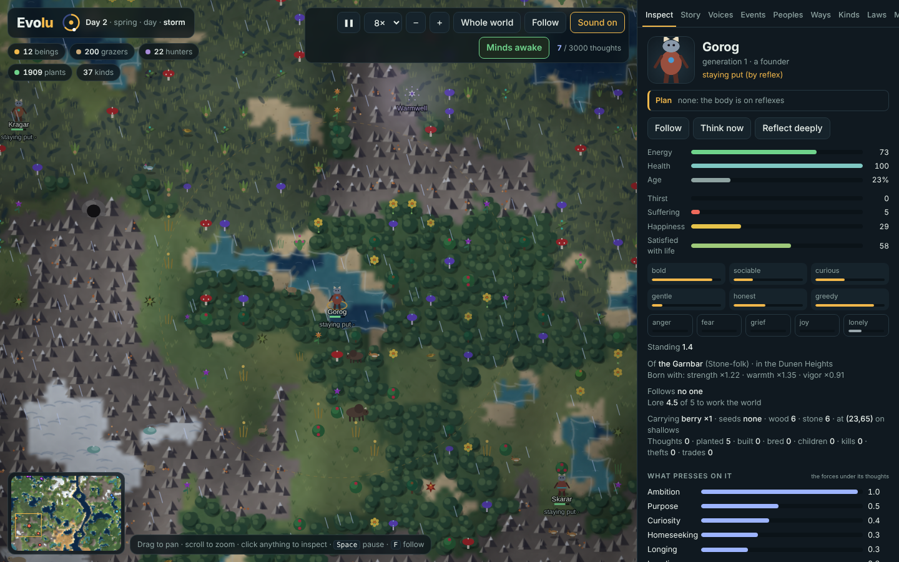
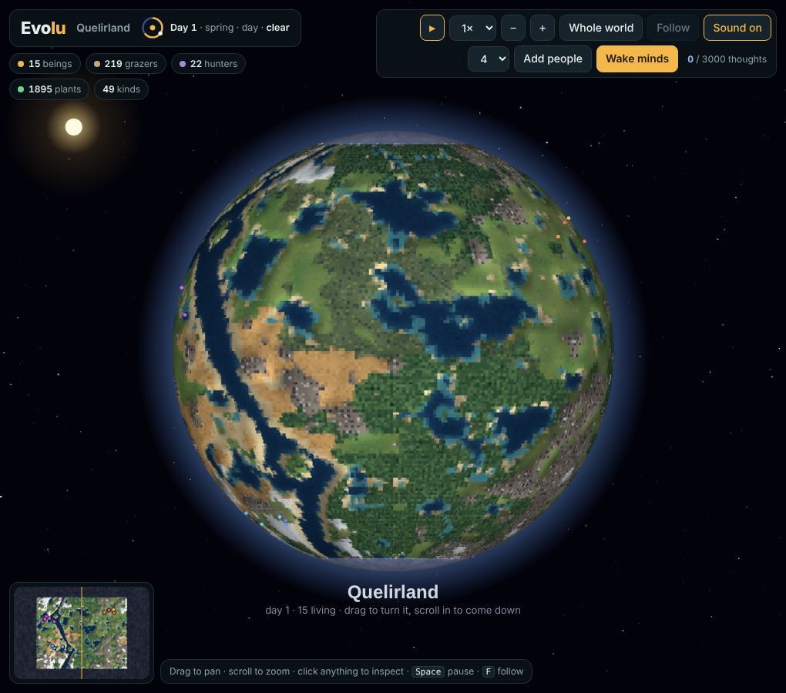
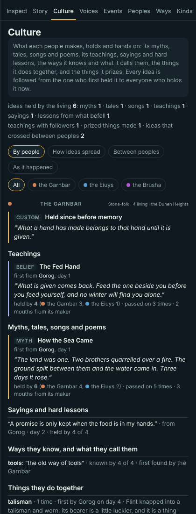
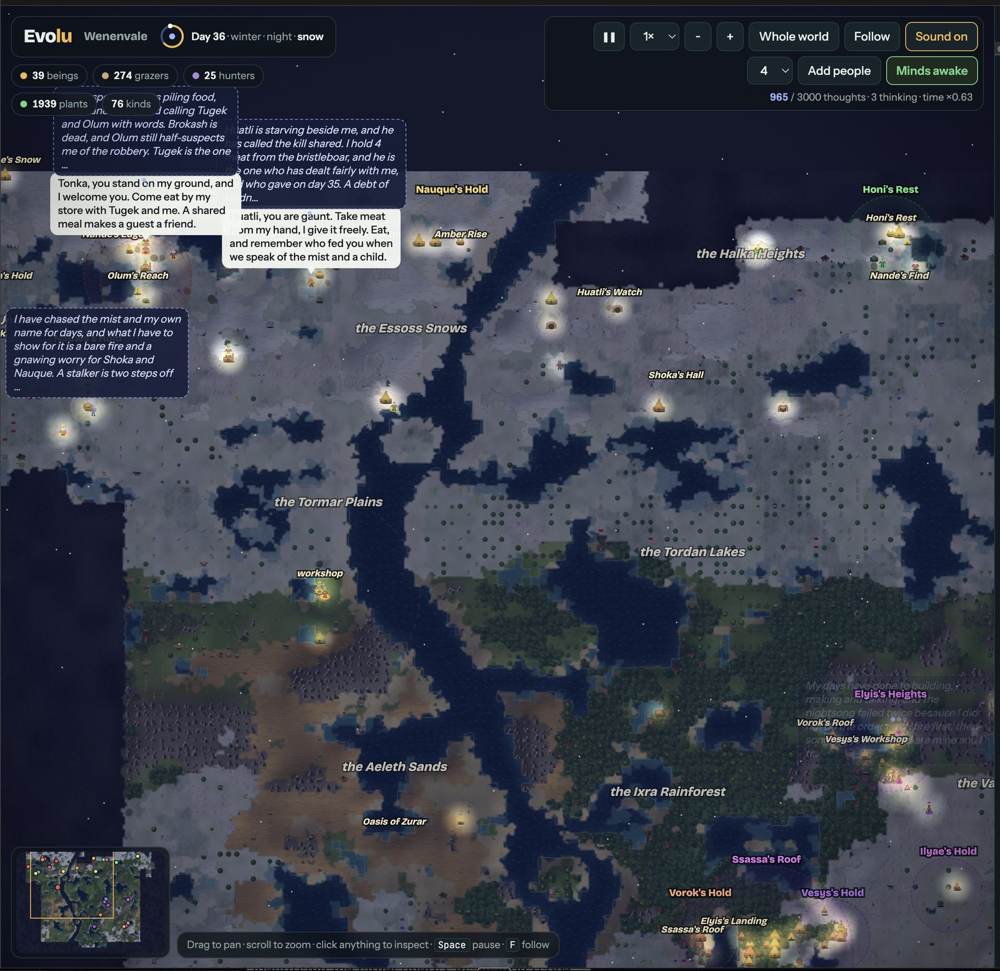
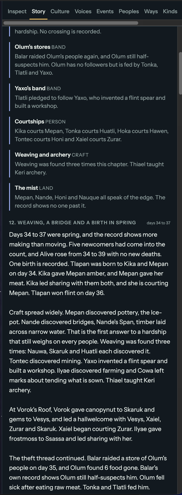
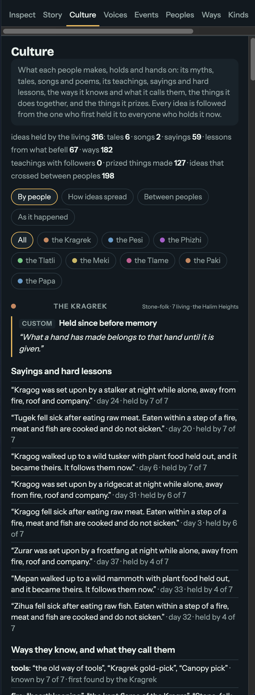
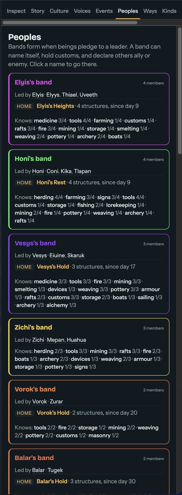
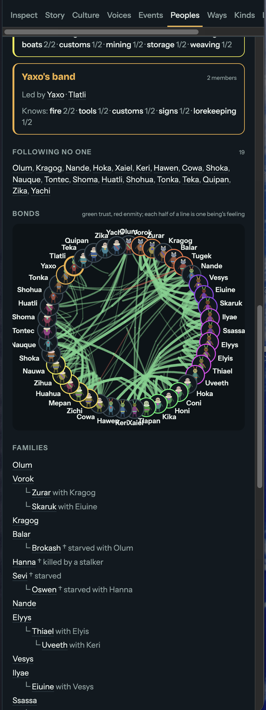

# Evolu

**A living world that rewrites itself, played by AI minds, and rebuilt between runs by the AI that wrote it.**

Evolu is an experimental world game that runs as a single page inside Claude. A small world of lands, weather, plants, animals and minerals is simulated in the browser. The people in it are not scripted: each one thinks with its own calls to Claude, has drives, feelings, memories, a creed and plans of its own, and can change its own reflexes and body. Above them stands a second AI, the **maker**, which watches the world while it runs and changes its laws, adds animals, plants, recipes, places and technologies, and writes down what it could not build. After a run, the complete record is handed back to Claude, which reads it, rewrites the engine, and publishes the next generation.

Nothing in Evolu is hard-coded to happen. Things are made possible, and the beings find them or do not.

Created by **Nova Spivack**, built with Claude. Generation 22, November 2026.
Source: <https://github.com/novaspivack/evolu>

> Evolu was called Seedworld until Generation 14.



*Taken by the browser test (a scripted stand-in plays the minds there).*

## Contents

- [What happens in a run](#what-happens-in-a-run)
- [A world in pictures](#a-world-in-pictures)
- [How it works](#how-it-works)
- [Why it is interesting](#why-it-is-interesting)
- [Inspiration, and how Evolu differs](#inspiration-and-how-evolu-differs)
- [Run it inside Claude](#run-it-inside-claude)
- [Export a run and build the next generation](#export-a-run-and-build-the-next-generation)
- [Extend it](#extend-it)
- [What is in this repository](#what-is-in-this-repository)
- [Tests](#tests)
- [What is and is not verified](#what-is-and-is-not-verified)
- [Licence and credit](#licence-and-credit)

## What happens in a run

You open the page and see a world of nine lands divided by a sea: woods, desert, lakes, highlands, marsh, steppe and tundra, each with its own plants, animals and minerals. Fifteen people of three peoples wake in three different lands. Each people has its own body, dress, way of naming and tongue; speech in a tongue you do not know arrives as strange sounds.

The minds wake by themselves and begin to think. Each thought is a real call to Claude, made from the page, that returns what the being thinks, says, plans and wants to change about itself. You can click any being and read its mind: what presses on it, what it believes, who it trusts, what it has learned from what befell others.

From there it is theirs. In real runs so far they have built shelters and halls, shared food, formed bands around leaders, raised children, mined and smelted, carved figures, grieved for their dead, learned from how others died, tamed their first animals by an offered handful, had a first child of two peoples, and starved in winter with no stores. They have not yet told a tale, hunted much, traded, or fought a planned battle.

Peoples are meant to last. When the living grow few, a band comes into the land from beyond its edge. What the dead built stands empty until someone claims it and gives it a name of their own. You can bring people in yourself: **Add people** in the toolbar adds one to ten, in bands of up to four.

Some things are learned by doing and done better together. Every hunt makes the next likelier; two who stand together bring down what one cannot, share the kill, and are left alone by a beast that is not starving. A blow or a theft is not forgotten until gifts mend it, and neither is a kindness in a time of need.



The world is a globe. Its east joins its west, and it ends at two poles of ice that are different countries: white bears, wolves, caribou and mammoths in the north; penguins, seals and seabirds in the south; whales and orcas in both seas. Between the ice and the middle lands, which have seasons, lies a warm belt of rainforest and desert that has no winter. Each kind of country has its own plants, animals and people, and both people and animals are drawn back to their own. Scroll out and the map becomes a ball among the stars, with the sun by day and the moon by night; drag to turn it, scroll in to come down.

The known world ends in mist. The land does not end there; it has only not been seen. Whoever stands at the edge can venture in, and sometimes a wide strip of new country opens, continuing the rivers and shores it joins, richer and wilder than home, and now and then already lived in by strangers. Every few days a chronicler writes the next chapter of the world's story, and the maker visits, reads the numbers, changes something, predicts what will follow, and checks its prediction on the next visit.



*The Culture tab, filled by the browser test through the same paths real minds use.*

## A world in pictures

These were taken by Nova from one world, Wenenvale, on days 36 to 38 of its life, with real minds playing every being (Generation 22). Nothing in them was staged.

<a href="docs/images/run-day-spring.jpg"></a>

*Day 37, the first day of spring. Snow still lies on the northern lands; the Ixra Rainforest and the warm belt are green. The dark boxes are thoughts and the pale ones are words said aloud. One reads: "Coni is starving to the east, and my hands are empty".*

<table>
<tr>
<td width="50%" valign="top"><a href="docs/images/run-night-winter.jpg"></a><br><sub>Day 36, a winter night. Fires and homes glow on the Essoss Snows. "Huatli, you are gaunt. Take meat from my hand, I give it freely."</sub></td>
<td width="50%" valign="top"><a href="docs/images/run-globe.jpg"></a><br><sub>The same world from far off. Scroll out and it becomes a globe; each dot is a being, coloured by its people.</sub></td>
</tr>
</table>

The panel beside the map has a tab for each way of reading the world. Click any of these for the full picture.

<table>
<tr>
<td align="center" valign="top" width="20%"><a href="docs/images/panel-story.png"></a><br><b>Story</b><br><sub>The chronicler's chapters, written from the record</sub></td>
<td align="center" valign="top" width="20%"><a href="docs/images/panel-culture.png"></a><br><b>Culture</b><br><sub>Customs, sayings and hard lessons, and who holds them</sub></td>
<td align="center" valign="top" width="20%"><a href="docs/images/panel-voices.png"></a><br><b>Voices</b><br><sub>Everything said aloud, and who was near enough to hear</sub></td>
<td align="center" valign="top" width="20%"><a href="docs/images/panel-events.png"></a><br><b>Events</b><br><sub>The living over time, and what has happened</sub></td>
<td align="center" valign="top" width="20%"><a href="docs/images/panel-peoples.png"></a><br><b>Peoples</b><br><sub>Bands, their homes and what they know</sub></td>
</tr>
<tr>
<td align="center" valign="top" width="20%"><a href="docs/images/panel-bonds.png"></a><br><b>Bonds and families</b><br><sub>Trust and enmity between every pair; who was born to whom</sub></td>
<td align="center" valign="top" width="20%"><a href="docs/images/panel-ways.png"></a><br><b>Ways</b><br><sub>Ways of doing things, and the names each finder gave them</sub></td>
<td align="center" valign="top" width="20%"><a href="docs/images/panel-kinds.png"></a><br><b>Kinds</b><br><sub>Every kind of living thing and how many are alive</sub></td>
<td align="center" valign="top" width="20%"><a href="docs/images/panel-laws.png"></a><br><b>Laws</b><br><sub>The laws of the world, every one of them a number that can be changed</sub></td>
<td align="center" valign="top" width="20%"><a href="docs/images/panel-maker.png"></a><br><b>Maker</b><br><sub>What the maker saw, changed and expected at each visit</sub></td>
</tr>
</table>

## How it works

There are four loops, one inside the next.

```
 4. THE PROGRAMMER LOOP   a person and Claude: read the run record, rewrite the code, publish
    3. THE OUTER LOOP     the maker and the chronicler: change the world's laws while it runs
       2. THE MINDS       each being: think, speak, plan, rewrite its own reflexes and creed
          1. THE WORLD    a deterministic simulation whose laws are data
```

**1. The world** (`src/engine.js`). A deterministic simulation: a known world of 144 by 96 tiles inside a veiled rim that can be explored, 240 moments to a day, three days to a season. Terrain, water, weather, calamities, plants, animals that mate in pairs and can be tamed, minerals in the ground, buildings, roads, bridges, vessels. Bodies have energy, thirst, health, age, sickness, genes and feelings. What matters most is that **the laws are data**: every number that governs the world sits in one registry (`w.laws`), and plants, animals, recipes, goods, buildings, minerals, places of power and the 68 "ways" of the knowledge tree are entries in it, not code. All of them act through one small language of effects on attributes, so anything can be combined with anything.

**2. The minds** (`src/minds.js`). Each being's thinking is a call to Claude. The prompt is built from what that being can see, feel, remember and has been told; the reply is JSON: a thought, perhaps something said, a plan of steps, changes to its own reflexes, creed, memory or body, a tale or a mark. Everyday thoughts are frequent and cheap; deep reflections are rare and can rewrite the being. Between thoughts the body runs on its plan and its reflexes. Drives (hunger, belonging, ambition, grief, standing, 43 in all) are computed from the being's state and press on its thinking without deciding it.

**How knowledge is found.** Not by chance. A way opens to a being that knows the ways before it, understands enough and has practised enough; having watched it done halves that. Necessity does the rest: what a being suffers (hunger, the lean season, cold, sickness, beasts, the deaths of its own, water it cannot cross) lowers what it takes to reach the ways that answer it, so a people that starves through a winter comes sooner to storage, and one hunted by beasts to fire.

**Culture.** Every tale, song, poem, myth, teaching, saying, hard lesson and way is tracked as an idea with an origin, holders and a path: who made it, who told it to whom, how it changed in the telling, when it crossed from one people to another, and when the last one who held it died.

**3. The outer loop** (`src/maker.js`). Two roles stand outside the world. The **chronicler** writes the story in chapters. The **maker**, on a stronger model, reads computed statistics and the chronicle and may apply a few changes per visit from a fixed set of operations: move a law, add a plant, animal, recipe, good, mineral, building, way or place of power, call weather or a calamity, set the mood of the music. Each change is first tried in a copy of the world, and refused if beings die of it or the animals collapse. The maker keeps a notebook of lessons, ideas and predictions, and files written **requests** for anything that would need new code.

**4. The programmer loop.** This is the part that makes Evolu a project and not only a game. Every run can be exported as one file. That file begins with instructions addressed to Claude: analyse this record with code, learn from the maker, build the next generation, keep what the maker kept, report plainly. Hand the file to Claude and it does that. The changes the maker made and kept (the world's **heritage**) are folded into the engine, so the next world begins with them and no maker has to rediscover them.

The interface (`src/ui.js`, `src/index.html`) draws the world and gives you instruments: an inspector for any being, the story, each people's culture and the spread of ideas, voices, events, peoples and their bonds, the tree of ways, every kind of thing in the world, the laws, the maker's visits with the fate of each change, and setup. The sound (`src/audio.js`) is synthesized in the page; nothing is recorded.

## Why it is interesting

- **Self-modification at three levels.** A being rewrites its own reflexes, creed and body. The maker rewrites the world's laws during the run. Claude rewrites the engine between runs, guided by what the first two did. Each level leaves a record the next one reads.
- **Open, not scripted.** There is no quest, no win condition and no event that is supposed to happen. Fire, farming, writing, sailing and rule are possibilities with costs; whether anyone reaches them is an experimental result.
- **Runs are experiments.** Every thought, word, plan, failure, prompt sample and maker decision is recorded. A run ends as a data file with numbers you can count, and the next generation is built from what the numbers showed. The design log in `docs/` reads like a lab notebook because it is one.
- **The designer is inside the loop.** The maker makes predictions and is held to them. Its requests are a to-do list written by an AI for the AI that maintains the code.
- **Knowledge accumulates across worlds.** Heritage carries forward what worked: recipes people actually used, animals that steadied the ecology, lessons such as "a lever must reach what beings want or see".
- **Societies with inner lives.** Standing that must be earned before anyone will follow, tongues that must be learned, tales that drift as they are retold, teachings that can be begun, taken up and given up, a community that learns from how one of its own died.
- **You can watch ideas move.** The Culture tab follows every idea from its maker to each mouth it passed through, with the curve of how many hold it day by day and the moment it crosses to another people.
- **It is honest about what it does not know.** The design log separates what was tested from what was only designed, and what real minds did from what was hoped.

## Inspiration, and how Evolu differs

Evolu draws on Sid Meier's *Civilization* (a tree of knowledge through the ages, lands and resources that differ), *SimCity* and *SimEarth* (a world you watch and tune), *Dwarf Fortress* and *The Sims* (individuals with needs and histories), artificial-life systems such as Tierra and Avida (open-ended evolution as the point), and research on communities of language-model agents such as *Generative Agents*.

It differs from them in these ways:

- **No player in the usual sense.** You do not command anyone. You set the conditions, watch, and decide what the next generation of the world should be.
- **The rules are not fixed.** In a strategy game the tech tree is the designer's. Here the tree, the animals, the recipes and the numbers are data that an AI maker edits during play, and code that an AI programmer edits between runs.
- **The agents are minds, not behaviour trees**, and they can edit themselves.
- **Unlike most agent-society research, there is a hard physical world underneath**: hunger, thirst, cold, predators, distance, scarcity. Talk alone feeds no one.
- **The game develops by running it.** The loop of run, record, analysis and rebuild is part of the design, and the repository is its history.

## Run it inside Claude

Evolu is a Claude **artifact**: a page published from the six files in `src/`. The minds think by calling Claude from that page, so it has to run inside Claude. There is no build step and nothing to install.

**To get your own copy running**

1. Open Claude with this repository available to it (attach the six files in `src/`, or connect the repository in a Claude session that can read GitHub).
2. Ask:

   > Publish the six files in `src/` as one artifact called Evolu, with `index.html` as the page and the other five beside it. Declare the capabilities the page asks for: `sample` (the page calls Claude for each thought), `db` (the run is recorded as it goes), `downloads` (the run file can be saved) and `user`.

3. Open the artifact.

Each thought is a call to Claude on your account. The models are chosen in Setup; by default the beings use Sonnet and the maker uses Opus.

**To play**

1. **The first time you open it, a new world begins**, from a chance seed, with a name of its own (shown beside the title; change it in Setup), and runs. Every world is kept under its name in your browser. When you come back, a panel offers each saved world to continue and a new one to begin; a tab that is only reloaded carries on without asking. Setup lists the saved worlds, to continue or to forget.
2. **The minds are awake from the moment the page opens** and wake again by themselves if the page reloads, so thoughts are being spent as soon as you open it. **Minds awake** (top right) puts them to sleep and wakes them.
3. **Sound is on** from the start. Some browsers hold a page silent until it is first touched; the button then reads "Sound on · click to hear", and any click or key lets it through. The button turns sound off.
4. **Space** pauses, drag pans, scroll zooms, click inspects, **F** follows. **Scroll all the way out**, or press **Whole world**, to see the globe; drag turns it.
5. Open **Setup** to choose the models, how often beings think, the pace (forty thoughts a minute across all beings by default, four at once; if Claude refuses for too many calls at once the minds ease off by themselves), whether **the world waits for the minds** (by default it does: with more beings than Claude can think for in time, the clock slows so that each still thinks about every 90 moments, and the meter shows "time ×0.5"), the **thought budget** (3,000 by default), whether to **keep thinking past the budget** for long runs, and whether the minds wake when the page opens. A new world can be started from a seed there.
6. Watch. The tabs are Inspect, Story, Culture, Voices, Events, Peoples, Ways, Kinds, Laws, Maker and Setup.
7. Let it run for some days of world time. Twenty to thirty days and several hundred thoughts is enough to learn from.

Three things to know. Publishing a new version reloads an open page, so do not publish during a run; and if you are working with Claude in the same conversation while a world runs, ask it to do nothing until the run is over. A world saved under an older generation still loads and can be carried on: it takes the laws that were re-tuned since, but not new lands, peoples, heritage or the veiled rim that lets the world grow, so start a new world for those. And the run is written to the artifact's store as it goes, so a run that is cut short is not lost: Claude can read its final state from there.

**Outside Claude.** Serve `src/` with any static web server and the world runs, on instinct only: the minds cannot wake, because there is nothing to call. This is how the browser tests run it, with a scripted stand-in for Claude.

## Export a run and build the next generation

This is the loop the project lives by.

1. **Export.** In **Setup**, press **Download run log**. You get one file, `evolu-<run id>-day<N>.json`, holding every thought, everything said, the chronicle, sampled prompts with raw replies, failures, the chronicler's chapters, the maker's visits and requests, the final state of every being, and the heritage.
2. **Hand it to Claude.** Attach the file in a Claude session that has this repository, and say what you noticed and what you want next. You do not need to explain the procedure: the file's first field, `_READ_ME_FIRST`, tells Claude what to do.
3. **Claude analyses** the record with code, not by skimming: births, deaths and their causes, which drives led, what was built, made, given and learned, how the peoples dealt with each other, prompt sizes, failed calls, and each of the maker's predictions against what happened.
4. **Claude builds** the next generation in `src/`: fixes for what the run showed, the maker's requests, the next items from [`ROADMAP.md`](ROADMAP.md), and the run's heritage folded into `K.HERITAGE` in `src/maker.js`.
5. **Claude tests** (`tests/run-all.sh browser`), publishes a new version of the same artifact, and commits the generation here with the design log and roadmap brought up to date.
6. **Run it again.**

[`CLAUDE.md`](CLAUDE.md) holds the working instructions for step 3 to 5 and is read by Claude when it opens the repository.

## Extend it

Three ways, from lightest to heaviest.

**Let the maker do it.** During a run the maker adds to the world by itself. What it keeps travels to the next world started in the same browser, and into the run file.

**Add data.** Most new content needs no new code: an entry in the laws registry is enough. For example, a recipe and a place of power, in the same form the maker uses (see `K.HERITAGE` in `src/maker.js` for some twenty that real runs produced):

```js
{ op: 'recipe', name: 'feast', way: null,
  needs: { food: 'any', foodN: 2, fire: true, beings: 1 },
  gives: { fxAll: [{ on: 'joy', by: 0.3 }, { on: 'lonely', by: -0.3 }] },
  hint: 'Share food beside a fire with another, and all who sit near are gladdened.' }

{ op: 'site', name: 'Warmwell', kind: 'spring', on: 'marsh', r: 2, cool: 480,
  fx: [{ on: 'health', by: 10 }, { on: 'warmth', times: 1.3, for: 240 }] }
```

Effects act now (`thirst, energy, health, lore, anger, fear, grief, joy, lonely, sick`) or as lasting boons (`strength, toughness, vigor, appetite, warmth, luck, learning, thirst`). The operations are `law, plant, creature, herd, sow, recipe, mix, good, mineral, lode, building, way, spur, site, weather, event, music`; `K.OPS` (the description the maker is given) and `K.applyOp` in `src/maker.js` are the reference.

**Change the code, with Claude.** Ask for what you want in plain words ("people should learn from what happens to other people"; "bridges"; "a sea that divides the world"). The rule Claude is asked to hold to: make it possible, give it a cost and a use, tell the beings only what they could perceive, and never script the outcome. Then add a check to `tests/`, run the suites, and publish.

Where things live:

| To change | Look in |
| --- | --- |
| Terrain, lands, weather, calamities, bodies, animals, actions, laws | `src/engine.js` |
| What a being is told, its drives, memory, tales, lessons, teachings, the culture record, the run record | `src/minds.js` |
| The maker's operations, its statistics, the chronicler, heritage, the roadmap it reads | `src/maker.js` |
| Drawing, tabs, inspector, settings | `src/ui.js`, `src/index.html` |
| Music and sound | `src/audio.js` |

## What is in this repository

```
src/                 the artifact: index.html, engine.js, minds.js, maker.js, audio.js, ui.js
tests/               checks against the current engine; run-all.sh runs every suite
tests/browser/       the page in headless Chrome with a scripted stand-in for Claude
docs/design-log.md   every generation and every real run, newest first
runs/                exported records of real runs
ROADMAP.md           what is planned, in order; mirrors the maker's notebook
CLAUDE.md            working instructions for Claude in this repository
LICENSE.md, NOTICE   licence and required credit
```

Git history is the history of generations from Generation 14 onward. Earlier generations are described in the design log; their code is not kept.

## Tests

```
tests/run-all.sh            engine, minds and maker (about three minutes, needs only Node)
tests/run-all.sh browser    the same, then the page in headless Chrome (needs Playwright and Chrome)
```

There is one engine and every check runs against it. The numbered files are grouped by subject, in the order the subjects entered the world: land and craft, drives and the record, aims and bonds, chronicler and maker, animals and calamity, thirst and buildings, lands and peoples, standing and lore, culture and necessity, peoples that last, a world with edges, what a mind is offered, a rim that opens slowly, a world that goes round, the warm belt with food in sight and trade, and hunger answered with rich ground and the muster. Together they are a regression suite of 532 checks, so a change in one part that breaks an older part is caught. The remaining suites run the whole mind pipeline with a scripted stand-in, a 20-day scripted run, and the ecology over several seeds.

## What is and is not verified

- The tests show that the mechanics work and that the page runs without errors. They cannot show how real minds behave: those calls only happen when the page runs inside Claude.
- What real minds did is known from thirteen recorded runs, described in the design log. The globe has been run for twenty-five days, the last thirteen under Generation 21; Generation 22 (a slow collapse from hunger, feeding one's own, rich ground, the muster, herds that follow) was in its first run with real minds when this was written: the pictures above are from it, and its record has not yet been analysed.
- Saved worlds live in the browser (IndexedDB, with one older slot as a fallback). They do not travel between browsers or devices; the run log does.
- Only a world begun under Generation 20 or later is a globe. Older worlds keep their edges.
- An act can pass every check on the body and still never be reachable by a mind: claiming and venturing were in that state for two generations. The last suite now drives each act through the mind's own path, and reads the list of acts out of the prompt to check the body accepts every one.
- A world made before Generation 17 has no veiled rim and cannot grow at its edges; only a new world can.
- The later ages of the knowledge tree (roughly the fourth onward) are sketched: the ways, minerals and buildings exist, but few have mechanics behind them yet.
- The sound has been written without being heard by its author.

## Licence and credit

Evolu is released under the **PolyForm Noncommercial License 1.0.0** ([`LICENSE.md`](LICENSE.md)): you may use, study, change and share it for any noncommercial purpose. Commercial use needs permission from the author.

Any copy or derivative must carry this notice:

> Required Notice: Copyright (c) 2026 Nova Spivack (https://github.com/novaspivack/evolu)

Please credit **Nova Spivack** and link to <https://github.com/novaspivack/evolu> wherever you show, publish or build on Evolu.
