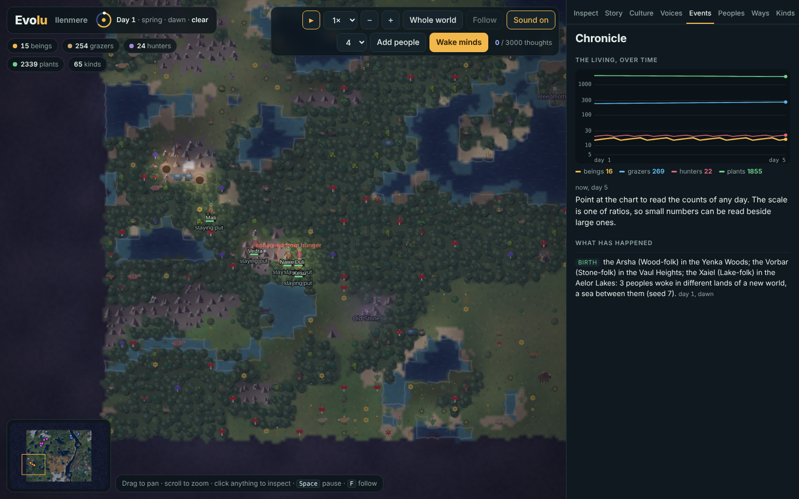
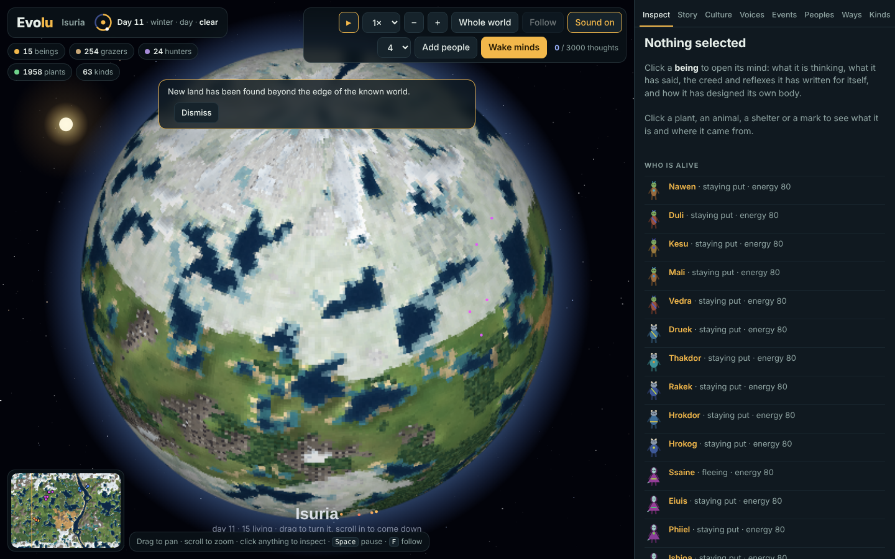

# Evolu: design log

Kept by Claude for Nova Spivack while the world was built, generation by generation. Newest first. Each generation is one cycle of the loop described in the README: a real run, an analysis of its record, a new build.

The world was called Seedworld until Generation 14 (22 Nov 2026) and was renamed because a game of that name already exists. Older entries are left as they were written, apart from the name. They speak to Nova ("your run") because that is who they were written for.

What is planned is in [`ROADMAP.md`](../ROADMAP.md), not here.

## How to read this

- **Built** means it is in the published world and passed my tests.
- **My tests** are three things: the ecology run headless across several seeds; the whole mind pipeline run against a *scripted stand-in* for Claude; and the page loaded in headless Chrome at desktop and phone widths with no errors.
- **What my tests cannot show** is how real Claude minds behave. Those calls only happen on your account when you open the page. Everything about mind behaviour below is either from your one reported run or untested.

## Generation 29 (built, not yet run with real minds): ways on the ground, kept hunters, names of their own, speech that opens

Nova, 23 November, late, with the first run of a new world (Nimenvale, seas, 17 days) and a long list for the night, kept in full in `docs/overnight-plan.md`. This is the first wave of it.

### What the nineteenth run showed (Generation 28, a new world with seas, days 1 to 17)

1,013 thoughts, no call refused. Counted from `runs/generation-28-run-r5614-mwu324lo-day17.json`.

- **The people grew:** fifteen founders and three bands of newcomers became 38 alive (29 grown, 9 children), with 13 births and two deaths (one starved on day 6, one killed by a wolf on day 10). Ten courtings were answered.
- **Verse from the first day:** 28 made (ten love songs, ten lullabies, six myths, two laments). No death poems yet: no one is old.
- **No one crossed the ocean** in 17 days, though 24 came to the way of rafts. Six times someone went past the edge of the known land instead.
- **The maker designed a structure from blocks on day 5** (an ember hall: roof, hearth, gathering) and one was raised. Its lesson: "A building offered to a people is not raised just because it is better. The beings keep raising the kinds they already know."
- **The third age of the library opened** by day 17. 205 insights in 17 days; 93 ways were found alone, 26 from parents, 2 taught.
- **Builds:** 16 shelters, 9 halls, 8 fires, 5 stores, 2 longhalls, 2 fields, a weir, an ember hall. One trade (stone for gold).
- **27% of thoughts came in the middle of a plan,** and now the record says why: an insight (21), a stranger coming onto one's ground (17), words said to everyone nearby (16), starving (8), a child born (7), being spoken to by name (6). The first three should not break a plan.
- **Prompts:** a middle of 27,500 characters, a longest of 42,800.
- **The maker asked four things:** that ideas carried from earlier worlds be marked, since they name beings who are not here; that stores be filled (it then saw them fill by themselves once ten knew storage, and wrote that down as a lesson); whether a trade can be offered to a stranger with no shared tongue; and where animals come in and how far from anyone.

### Built

- **Ways on the ground by grade.** A track wears in where feet keep passing (ten passes) and fades when unused; anyone can beat a dirt road with effort and no stone; the way of roads lays stone on bare ground or over a dirt road. A step on each costs less (measured over seven steps: open ground 0.87 energy, track 0.83, dirt road 0.79, paved 0.73). One who is finding a way now takes a road where it costs no more steps; without a road a walker bows off the straight line, as before. Two settlements count as joined by a dirt road or a paved one, not by a track. The page draws each grade differently.
- **A kept hunter.** A tamed dog, or any tamed beast that hunts, that walks with its keeper makes the hunt surer and stands with them, so that a beast that is not starving will not come at the two. Once a day it takes one food from the keeper's hands, meat first; three days with nothing and it leaves and is wild again. The keeper is told each of these things.
- **A settlement has a name of its own,** made in the tongue of its people, never the name of a place inside it. "Balul's Hall" stood twice because the settlement took the name of the hall.
- **Speech and thought boxes open.** Hovering over one shows the whole of what was said and holds it up; a click on speech opens Voices at that line, and on a thought opens the being's thoughts.
- **The poles.** They were never a gap in the map: the top row of the map is the pole itself. They were blank because the fourteen rows at each end start unknown, and the ice lands lie inside those rows. The ice is now painted as ice seen from afar, on the map and the globe. It can be reached as any unknown land is, by going past the edge of the known (`venture`).
- **The maker** can make a block of its own (op `block`, within bounds) and build from it; ideas inherited from another world are marked as such; it reads where the last animals came in and how far that was from anyone, and the ways and kept hunters of the world.
- **What no longer breaks into a plan:** an insight, a stranger on one's ground, a word said to everyone. They are still told and still bring the next thought nearer.
- **Minds are told** that a trade needs no shared tongue.
- **Heritage:** the ember hall and the shubbock (a woolly beast the maker made) are folded in with three lessons; two sites bound to an earlier world are again left out. 53 changes, 61 lessons, 34 ideas.

### Measured

- **Balance on instinct, twelve seeds, forty days,** against Generation 28 in the same sitting: 15.2 alive against 15.1; 0.5 deaths a world against 0.3 (0.2 starved and 0.3 to beasts, against 0.3 and 0.0); plants 2,504 against 2,545. Tracks now form under bodies on instinct too, which moves where they walk.
- **Speed:** 2.59 ms a moment against 2.48 (about 4% more: every search now looks at road neighbours first when there are any ways on the ground).

### Tested

- **840 checks in 25 numbered files, the two mind pipelines, the long ecology run and 12 checks of the page in headless Chrome: all pass.** The new file (`tests/25`, 25 checks) goes through the mind: a track wears in under a being walking to and fro by its plans, with each arrival asserted, and fades in nine days unused; a plan step `pave` makes a dirt road for one who knows nothing of roads and a paved one for one who does; a walker keeps to a road laid along its line and bows off the line without one; a dog takes meat from its keeper's hands, the keeper is warned when it goes unfed, and it leaves on the third day.
- **Controls:** the cost of seven steps on each grade of way against open ground; the same hunt in forty worlds with and without a dog (24 kills against 8); a settlement around a named hall takes another name and keeps it.
- **On the page:** a long thing said is cut in its box; the box under the pointer is found with the whole text; a click opens Voices at that line.
- **Older checks moved** (three): the paving check now expects a dirt road where it expected a refusal; one check placed a builder again before its plan, since a body between plans may drift a step. The new animal folded from the heritage first moved four files of older checks by standing in every world at its birth; it is now folded as a kind that comes in later, placed by a chance of its own, and that is the rule for folded heritage from here on.
- **Not tested:** the hover itself (a pointer moving over a box) is exercised through the function it calls, not with a real pointer; the ice at the poles was not looked at in a picture.

### Not built, and not known

- **Vehicles and craft that move, and goods carried between settlements:** moved to the wave of the ages (Generation 31), where stations, harbours and airfields are built out.
- **The ocean was not crossed in the new world.** Nothing was changed for it; the people are seventeen days old.
- **Stores:** nothing changed; the maker saw them fill.
- The hunt with a dog came out three times as sure in the check (24 of 40 against 8), more than the law's 0.4 would give alone; I did not find the rest of the cause.
- What the tests cannot show is how real minds behave.

## Generation 28 (built, not yet run with real minds): structures from blocks, a library by age, works that depend on one another

Nova, 23 November, with the run file of day 77 ("looks better"): analyse it, go on with the plan for the next generation, and the next run will be a new world. The plan agreed for this generation: more kinds of structure; the maker composing structures from building blocks with attributes; libraries that load at the right ages; roads, vehicles and transport by sea and air; settlements whose works depend on one another.

### What the eighteenth run showed (Generation 27, Wenenvale carried on, days 72 to 77)

429 thoughts in five days, no call refused. Counted from `runs/generation-27-run-r5614-mwsokxmr-day77.json`.

- **Verse was written.** 34 asked, 32 made, none lapsed (two were still pending): eight death poems, eight myths (one for each people), six love songs, four laments, four lullabies, two songs of a deed. Seventeen runs before had none. Vorok, dying: "Rain on the Vaia stone / what a hand teaches outlives the hand / I set the hammer down". Zurar's lament for him two days later: "Vorok, you lit the fire on Vaia stone / You dug the ore and taught us not to grieve alone / Your hammer rests, the rain falls on the hall / Your teaching lives in us, and we keep it all". The death poems keep their form (an image of the season, what life taught, a letting go); the rhymed forms mostly rhyme; the beats are uneven. The myths follow the traditions and name their own powers (Sulaq the Ice Mother, Gor the Hammer and Vael the Wind, Vaorun the Guardian). Three peoples of the Watching Dead told nearly the same myth, which is what one would expect of one tradition and is also a sign that the tradition's own words carry most of it.
- **Chapters 17 and 18 are headed by death poems** (Vorok's, Nauwa's), as built.
- **Births outran deaths:** seven born (one pair of twins) against six dead, five of age and one a day-old child gored by a mammoth. Nine courtings were answered. In the ten days before there were two births and nine deaths. 37 alive: 9 elders, 22 grown, 6 children.
- **Water was crossed:** the first crossing on day 72 (Zichi), and 28 in all, most of them two beings going to and fro across the Tordan Lakes. Each was written into the chronicle as a discovery, which is too many.
- **Ways spread at once when the band's practice began to count:** 82 insights in five days, 40 of them on the first day. Alchemy, lost at day 72, was found again (two hold it at day 77). Scholarship is new. 29 of 68 ways are held (27 at day 72), three of the third age.
- **No offering was made, no trade, no forge, nothing raised in place.** Twelve entries under building: six takings-over of what the dead left, four fires, one longhall, one field. Fourteen settlements are listed.
- **A third of thoughts still came in the middle of a plan** (136 of 429). With the sum gone, each of these was let through by one event of urge 6 or more; 233 of 257 things said were said to someone by name, and being spoken to is weighty. I think most of the third is conversation, which is as it should be, but the record did not say what let each one through. It does now.
- **Prompts have grown:** a middle of 34,900 characters and a longest of 48,700 (a deep thought), against 30,700 in the fourteenth run. By section: standing text and the reply format about 13,300, the ways known 4,900, what can be made 1,800. The chronicler's prompt was 110,700 and 117,000.
- **The maker** (one visit, day 74): sowed rimewort and ironnut where people were packed; saw that "the hunger gathered in the most crowded land rather than the barest"; and asked for one thing: for each land, the food bearing now set against the beings there and their median energy.

### Built

**From the plan**

- **Blocks.** A structure is put together from parts with attributes of their own (`laws.blocks`): roof, hearth (warmth), beds (health), benches (craft), gathering (bond), altar (fear and grief), lookout (sight), garden (joy); in the second age baths, shelves, forgefire, beaconfire, courtyard; later vault, great hall, lamp, engine, wire, mast. `SW.compose` adds them: costs add, effects of one kind add, a boon keeps its strongest. **The maker designs with them** (op `structure`: two to five blocks, an optional way, what it grows out of, what it depends on, whether it must stand by water or a road). Anything above six wood or six stone is raised in loads, as since Generation 26.
- **A library by age** (`SW.LIBRARY`, data). The first two ages are open in every world; a later age is opened into a world's laws when someone in it knows a way of the age before, so a world carries only what its people could yet raise. Opening is chronicled and noticed on the page. Ten structures and nineteen blocks are in it across five ages.
- **Works that depend on one another.** A kind of building may ask for another to stand within twelve steps (`needs`) or for a paved way or water beside it. In the library: a guest house needs a store; a bath house a well; a road house a paved way; a lighthouse a dock; a harbour a market (and is raised in place of a dock); a station an engine house and a paved way; a mast a power house; a hangar an airport. A mind is told what each depends on and whether one is here; a plan that ignores it fails with the reason and spends nothing.
- **Transport and signals.** A landing (the way of rafts) at the edge of water; a beacon (signals), a lighthouse and a mast carry a voice two to eight times as far for one who speaks beside them. Roads, carts, sleds, ships and airships were already in the world; nothing new was added to how they move.
- **Settlements that know of one another.** A being is told of the settlements it has been near: where each lies, what stands there that its own lacks, what its own has that the other lacks, and whether a paved way joins them (a search along paved tiles). What it does about it is its own affair.

**From the run**

- **The maker's request:** `landsNow` gives, for each land, the beings there, their median and lowest energy, the food bearing now and food per being, the tightest first.
- **A crossing is news once for each land a being lands in.** Every crossing is still counted and told to the one who crossed.
- **Why a plan was broken is recorded** with the thought (`came.why`).
- **An elder who feels death near is told which ways no one else alive knows,** and to teach them.
- **Heritage:** the maker changed no law in this run. Its one new lesson is folded in without its last sentence ("Raising the lifespan does not save elders already near its end"), which was true of Generation 26 and is not since 27. 51 changes, 58 lessons, 34 ideas.

### Measured

- **Balance on instinct, twelve seeds, forty days,** against Generation 27 in the same sitting: every figure the same (15.1 alive, 0.3 deaths, 2,545 plants). Nothing here touches a body that is given no plan.
- **Speed:** 2.39 ms a moment against 2.47 for Generation 27 in the same sitting (the difference is noise).
- **Prompts:** unchanged at the start of a world; see below for what is added later.

### Tested

- **815 checks in 24 numbered files, the two mind pipelines, the long ecology run and 12 checks of the page in headless Chrome: all pass.** The new file (`tests/24`, 34 checks) goes through the mind: a plan to build a bath house fails where no well stands, with the reason told and nothing spent, and the same plan raises it once one does; a road house likewise by a paved way; a structure the maker designed from blocks is raised by a mind's plan and held to what it depends on; a word spoken beside a beacon is heard at twenty steps and not without it.
- **Settlements:** a being is not told of a settlement it has never been near; once near, it is told what the other has and lacks against its own; a paved way laid between them joins them, and a one-tile gap unjoins them.
- **The library:** a world begins with two ages open; knowing a way of the third age opens the third and makes the fourth ready, and not the fifth; a world saved by Generation 27 is given the library and runs on. The save check's fixture is now Generation 27's.
- **Not tested:** anything a real mind does with any of it. The page was loaded with the new world in the browser checks and shows no error; the look of the new kinds of building is the default one.

### Not built, and not known

- **Vehicles and movement by air:** nothing new. The hangar and the station are places; no craft flies and no train runs.
- **Goods moving between settlements by themselves** (caravans, routes with a yield): not built. Minds are told what another settlement has; carrying it is up to them.
- **The maker adding a block of its own:** not built. It composes from the blocks of the ages open.
- **Offerings:** none was made in the run and nothing was changed. None of that world's five traditions is the Angry Sky, whose text is the only one that speaks of gifts.
- **A newborn can wander:** a day-old child was gored. Not looked into.
- **Prompt size:** not reduced. Generation 28 adds nothing at the start of a world (22,754 characters for an ordinary thought and 29,340 for a deep one, as in 27); later, about 220 characters for each new structure whose way a being knows (nine kinds are shown at a time, as before) and about 450 for one other settlement known, in every deep thought and one ordinary thought in three.
- **Three peoples telling nearly one myth:** left as it is.
- What the tests cannot show is how real minds behave: whether anyone raises a guest house, walks to another settlement for its forge, or paves the way between two.

## Generation 27 (built, not yet run with real minds): verse, traditions, seas, courting answered

Nova, 23 November, with the run file of day 72: he agreed to the audit's proposals, except that the thresholds for riding and currency stay and are watched, and that signals and alchemy should do something and not be folded away. He asked for poems and songs that are really composed (a poem of wisdom from one who is dying, a love poem, a poem by a band for its dead), for myths, fables and stories handed down, for chapter headings in the manner of Dune, for forms with rhyme and metre; for mythologies and religions that differ by people and shape how each lives, the kindly and the hard; for the run's own faults to be mended (mating that does not succeed, no one crossing water); for new worlds to have at least one great ocean, large lakes and islands large enough for a civilisation; and for the "send everything now" button to stop failing. "Make a plan for this big, big iteration, and then do it."

### What the seventeenth run showed (Generation 26, Wenenvale carried on, days 63 to 72)

789 thoughts, no call refused. Counted from the run file with code (`runs/generation-26-run-r5614-mwsokxmr-day72.json`).

- **The people are ageing out.** Forty-five alive became thirty-six: nine deaths, every one of old age, and two births. Of the thirty-six, eleven are elders and two are children. Food is no longer what kills. The maker saw it: "Once food is sound, the population curve is set by the age structure, not by hunger. Many newcomers who arrived together grow old together, so a cluster of deaths from age can undo many seasons of good feeding."
- **Mating did not succeed, and the cause was mine.** Twenty-seven thoughts planned to mate, twelve courtings were recorded, two children came. A child needed each of two minds to plan the same act toward the other within eighty moments of the world. Nothing in the world let one who was willing simply answer.
- **No one crossed water.** Five rafts were made (twenty-three hold the way of rafts and eleven that of boats) and not one crossing. The maker: "Making is not using: four rafts appeared once the way had spread to twenty-two people, yet water is still the heaviest hardship for most peoples. A vessel only matters if the beings' aims carry them to a shore while they hold it." The deeper cause: in that world about 150 of 2,000 tiles of water are more than two steps from a shore. Almost everything can be swum; a vessel has nowhere to matter.
- **No poem, no song, no tale.** Not one record of the kind in ten days, and none in the sixteen runs before. I read the kept prompts: the field is offered once, as `"tale": null or {...}`, among some thirty others, and only in the deep thoughts. Nothing ever asked for one.
- **The waiting bar of Generation 25 did nothing.** A being in the middle of a plan was to wait for it unless something weighty happened. 36% of thoughts still came with a plan in hand, as before. The bar was a sum of urges with a threshold of 3; speech heard (1 to 3 each), hunger and small events filled it within moments. I had told Nova it would save a fifth, then a tenth; in the run it saved nothing.
- **"Send everything now" failed** with `invalid_argument` on every try: the final state was 1,073,127 bytes (ties 402 KB, the year in hand of each memory 328 KB, seventeen dead 250 KB) and the store takes 256 KiB to a document.
- **A way was lost:** alchemy, held by one at day 60, by no one at day 72. Its holder died having taught no one. Signals has one holder.
- **No forge, no well, nothing raised in place, no way held in common made use of,** though nine hold smelting. Ten days is too short to judge Generation 26.
- **No trade** (six thefts). The chronicler was given everything recorded (177 of 177, then 241 of 301 and 241 of 281 by weight and day) and wrote chapters 14 to 16; chapter 13 was replaced from the store on day 63 as arranged. Its prompt is about 100,000 characters.
- **The maker** visited on days 66 and 70. It sowed rimewort three times, eased `mate.minEnergy` from 64 to 61, lengthened `body.lifespan` from 19,200 to 22,000 and raised `drives.desire` to 1.25. It asked twice for the same two things: that one who holds a vessel be told it can cross and what lies across, and that a crossing be recorded so it could see one.

### Built

**From the run**

- **Courting is answered** (`mate.answer`, 0.3). When one courts another who is warm toward them by that much, is not courting someone else and has not just answered, the other answers: both are then courting, and if both are grown and fed a child comes, with one mind having planned. One who is not warm does not answer. In the check, the same pair gives no birth with the law at 0 and a birth with it at 0.3.
- **A crossing is an event** (`crossed`: who, how long afloat, whether over open water, where they landed), counted on the being and in the world; **one who holds a vessel is told** that it carries over any water and what lies over the water in each direction ("to the east, 2 steps off, 16 steps of water (10 of them open water that cannot be swum) and then land (the Halul Woods), where you have not been"). Both are the maker's requests.
- **Seas, for worlds begun from now on.** An ocean runs from ice to ice across the known land, about nineteen steps from shore to shore where I measured it and ten of them open water; a greater ocean, nearly twice as wide, lies on the far side of the world with two islands (178 and 147 tiles of land in seed 7; a founding band holds about thirty); two great lakes have open hearts. In seed 7 the open water in the known land went from 144 tiles to 1,174, and the land left is 86% of what it was. In all six seeds I looked at, the founding peoples begin on both shores, so they meet by vessel or by the long way over the ice. The seas are laid by a chance of their own: the lands, their names and their hearts are the ones the same seed gives without seas, and a world made without the option is tile for tile what it was. A world already begun is not changed.
- **A thought waits for its plan** unless one event of urge 6 or more reaches the being (`M.WEIGHTY`, `m.weightyT`) or `planWait` moments have passed. Nothing is summed.
- **The final state goes in parts:** a head (the world, the tallies, culture, each being in brief) and the beings in full, as many to a document as fit under 180,000 characters. The real 1.07 MB state from this run splits into a head of 74 KB and six parts of at most 177 KB, with all fifty-three beings and nothing trimmed.
- **A change of lifespan reaches the living.** The maker's lengthening applied only to those not yet born, so it did nothing for the elders it was meant for. The op now rescales each living being's span by the same measure.
- **Heritage folded in:** the three laws the maker kept (life 22,000, mating energy 61, desire 1.25) and its three new lessons. Left out again: the stone at "Tlama's Rest" and the spring by a named being, which belong to that world. Diffed against the heritage before: three ops added, one replaced, nothing else moved. It now holds 51 changes, 57 lessons, 34 ideas.

**From the audit of the trees**

- **The practice of a band counts** toward a way for each member, at half (`culture.bandPractice`): one who has tamed nothing, in a band that has tamed six, stands at 3 of 4 before riding.
- **Labour counts as building:** every six units carried to a work under way count as one building raised.
- **Signals carry a voice** two and a half times as far (33 steps for 13): speech, the call to muster and the rally. **Alchemy makes** a tonic (two foods by a fire: mends 35 and breaks a sickness) and a wakefire (ore and wood by a fire: learning half again as fast for two days). Ways with nothing behind them fell from 15 to 13 of 68.
- **How each way was come by** is kept on the being and in the final state (people, parents, taught, found, building).
- **Riding and currency** left as they are. The maker reads at every visit how near anyone is to each.

**Verse and story**

- **Occasions.** A verse is asked of a being by name, at the head of what it is told, in whatever kind of thought comes next, and the asking is weighty enough to break into a plan: a **death poem** when an elder passes nine tenths of its life ("what your whole life has taught you, said so that those who come after can carry it"); a **lament** from whoever was closest when someone dies, kin before others, told what the dead one did in life and their death poem if they left one, "on behalf of all who knew them"; a **love song** when courting is answered; a **lullaby** for a first child; a **song of a deed** for a crossing of open water or a great work raised; and once for each people the **myth** of how the world and they came to be, asked of the one who knows most, out of the tradition they hold.
- **Forms**, as data the maker can add to: death poem (three unrhymed lines: something seen in this season, what life taught, a letting go), lament (four lines of four beats rhymed in pairs, the name in the first), love song (four of three beats rhymed by turns), ballad (four, three, four, three; second and fourth rhyme), lullaby, chant, boast (broken lines that alliterate), saying (two lines, the second turning the first), dread, law. The mind is told to count the beats and mend what limps. A song of a deed takes the form its people's tradition favours.
- **What becomes of it.** It is a tale like any other: kept in the culture with its occasion and form, spoken aloud so that those in earshot who understand the tongue now carry it, told on by teaching and changed in the telling. A verse asked for and not given in three thoughts lapses and is counted. Fables are a kind of tale now.
- **Epigraphs.** Each chapter of the story is headed by a verse or myth the people made in the days it covers (a death poem first, then a lament, a myth, a love song, a song of a deed, a lullaby), with whose it is; if they made none, by a line of the tradition of the most numerous people. Nothing is written for them. The chronicler is also handed up to twelve of their verses and told to quote them exactly and make none of its own.

**Traditions**

- **Nine, as data** (`laws.traditions`; the maker can add one and give it to a people): the Spirits of the Land, the Watching Dead, the Angry Sky (hard powers bought off "with gifts, with obedience, and with the blood of what is hunted"), the Warring Gods, the Guardian, the Open Hand, the Inner Path (mastery of anger, craving and fear; "kindness is the proof of it"), the Mother, the Sky Father. Each people is given one when it comes into being, most often the one that suits its country and about one time in three another; across thirty seeds all nine are held by someone.
- **What a tradition does.** It is told to every mind of the people in every thought, with the words "you may keep it, doubt it, or come to hold something else". It weights what presses on them (the same fear presses 0.52 under the Angry Sky and 0.32 among the Warring Gods; half as much on one who has taken up a teaching). It says whose word carries (mothers, fathers, elders, the strong, teachers, or no one), which adds to standing. It gives the form its songs take.
- **The offering** (act `offer`): a food given up at a fire or a shrine. It is gone; the giver's fear and grief ease by the measure of the tradition (1.8 under the Angry Sky, 0.5 for the Open Hand, whose giving goes to people); those of the same tradition who see it think better of the giver. Nothing in the world says an offering moves the weather, and nothing offers a person: what a hard tradition leads a people to do is left to them.

### Measured

- **Balance on instinct, twelve seeds, forty days,** against Generation 26 in the same sitting: without seas every figure is the same (15.1 alive, 0.3 deaths, 2,545 plants), because nothing here touches a body that is not given a plan. With seas: 15.1 alive, 1.3 deaths (0.7 starved, 0.6 to beasts), plants down 17% with the land.
- **Speed:** 2.21 ms a moment against 2.16 (within the noise of the sitting), with or without seas.
- **Prompts:** the tradition adds 337 characters to every thought (22,417 to 22,754 at the start of a world); an asked verse adds about 1,170 to the thought that carries it.

### Tested

- **781 checks in 23 numbered files, the two mind pipelines, the long ecology run and 12 checks of the page in headless Chrome: all pass.** The new file (`tests/23`, 76 checks) goes through the mind wherever a mind is meant to reach something: a plan to mate written by one mind and nothing by the other; a plan to walk to the far shore, with the arrival asserted and a control without a vessel that does not arrive; a plan step `offer` that fails without a fire with the reason told, then succeeds by one; verse given in a reply's `tale` and found in the culture, on the being and in the heads of those in earshot.
- **Controls:** no birth with `mate.answer` at 0 and a birth at 0.3 from the same pair; no answer from one who is not warm, from a child, from close kin, or where no child can come (I had first put the answering before those bars and moved it behind them on review); the same fear under two traditions; the same seed with and without seas has the same lands and names.
- **A world saved by Generation 26** loads, is given the traditions, the forms and each people its tradition, has no seas, and runs on with its elders asked for their death poems. The fixture for the save check is now Generation 26's.
- **On the page** (`tests/browser/verse.js`): a world begun there has seas (1,174 tiles of open water in the known land for seed 7); an epigraph is set line under line with whose it is, and markup inside a verse is shown as text; "Send everything now" writes a head, the beings in parts and the maker's document, none above 262,144 bytes, and reports no failure. The real 1.07 MB state was split with the same function outside the browser.
- **Older checks moved by the folded heritage** (two): one pinned a life at 19,200 moments and one the mating energy at 64; both now read the law as made and what the maker has since done with it.
- **Not tested:** the verse of a real mind, the look of the seas on the globe beyond the page loading without error, and anything about how thirty-six minds behave when told their traditions.

### Not built, and not known

- **Whether real minds will write verse that keeps its form.** The checks give a stand-in's lines and show the asking, the uptake, the hearing and the keeping. Counting beats is hard for a model; I expect the death poem and the saying to come out best and the rhymed forms to be uneven. What tests cannot show is how real minds behave; that holds for everything above.
- **Whether traditions change how peoples live.** They weight drives and are told in every thought; whether an Angry Sky people come to live differently from an Open Hand people is the thing to watch, and the maker has the figures for it.
- **Whether courting answered is enough.** It removes the coincidence two minds needed. It does not make anyone court.
- **Islands in the near ocean:** not built. The ocean across the known land is narrow enough to cross on a raft and has no islands; the islands are in the far ocean, behind the veil.
- **Seas for a world carried on:** not built. Wenenvale stays as it is.
- **Founders' ages:** not changed. They still begin the same age and grow old together; births and the longer life are the answer for now.
- **Teaching before death:** not built. Alchemy was lost with its one holder.
- **A rite for the dead, sacrifice with a consequence in the world, gods that answer:** not built, by design: an offering eases the one who gives and nothing more.
- **The chronicler's prompt** is still about 100,000 characters.
- Generation 28 (structures, the maker's building blocks, libraries by age, roads and vehicles, settlements that depend on one another) and the groups of 29 and 30 are as planned in `ROADMAP.md`.

## Generation 26 (built, not yet run with real minds): a community raises better buildings; the audit of the trees

Nova, 23 November, after Generation 25: communities should come to better buildings by the tree, when at least two members hold the new knowledge, and the whole community should have it once the building stands. Then a round on the trees themselves, and farther out the sim in groups, peoples and planets. He asked for a plan and for it to be carried out; the plan is in `ROADMAP.md`, and this generation is its first step: his rule for buildings, and the audit that the round on the trees begins with (`docs/tree-audit.md`).

### What the audit found (in full in `docs/tree-audit.md`)

- **Progress so far:** 68 ways in four trees over six ages. After sixty days 28 were held by someone: all 17 of the first age, 9 of 16 of the second, 2 of 11 of the third. One being held 18 ways; the middle being 7.
- **Six kinds of building could never be raised:** forge, mill, well, standing stone, infirmary and barracks ask for eight wood or stone at once where hands hold six, and only a building of more than fourteen in all was a work brought to in loads. **Eight things could never be made:** the boat, every ship, the airship, the ram, the catapult, the cannon. With the lists hidden until Generation 25, no run could have gone past the second age in craft.
- **The line of building is the blockage:** masonry asks for eight things built and one being of 43 had built that many; wheel, monuments and roads ask for 12 and 14.
- **Fifteen ways have nothing behind them,** nearly all from the fourth age on.

### Built

- **A way is a band's when two of its members hold it** (`culture.commonAt`, `SW.heldInCommon`, `SW.commonWays`). Then any member may raise that way's buildings, whether or not it holds the way itself.
- **When the building stands, every member of the band learns the way** (`raised`). A building raised by the only one who knows its way teaches no one: it takes two.
- **Lines of descent between kinds of building** (`from`): shelter to hall to longhall; workshop to forge to factory; tower to observatory; shrine to temple; school to university; infirmary to hospital; mill to windmill. A better building may be raised **in place of** the one it grows out of, by its holder or one of the holder's band: half of what the old one took is used again (`build.reuse`), the old building stands and serves until the new one is finished, and whoever held the old holds the new. A building **serves wherever the kind it grew out of is asked for** (what must be made at a forge can be made at a factory). The forge and the factory now give all a workshop gives and more; before, a forge lost the workshop's help to learning.
- **Whatever takes more than two hands hold is a work brought to in loads:** any building that asks for more than six wood or six stone, and any making (`w.makings`: a boat of ten wood, a ship of twenty-four), by one or by many.
- **A settlement has an age,** the latest age among the ways of its buildings. It is shown beside the settlement's name.
- **Buildings show their age:** a stone footing from the second age, a pennant from the third, a chimney from the fourth, lit windows from the fifth. The pen, the weir and the field have looks of their own.
- **For the maker:** the law `culture.commonAt`, `build.reuse`, `from` on a building it adds, and numbers for settlements by age, what each band holds in common and by one alone, ways learned when a building was raised, buildings raised in place, things made over time.
- **For a mind:** the ways its band holds in common and which of them it does not yet know; that a building it stands in can become a better one, and what that takes; that a thing too big for the hands is made by loads.

### Measured

- **What each better building gives against the one it grows out of** (from the registry): hall over a plain roof, a bond between those gathered and joy; forge over workshop, tools that last longer (craft 1 against 0.6) and the same help to learning; factory over forge, craft 2 and more help to learning. The windmill, the observatory, the temple, the university and the hospital are each richer than what they grow out of. The mill itself still does nothing but serve the making of bread.
- **On instinct, twelve seeds, forty days, against Generation 25:** the same in every figure (alive 15.1, deaths 0.3, starved 0.3, grazers 279, hunters 25.4), since bodies on instinct raise nothing of this. 2.23 ms a moment against 2.18.

### Tested

`tests/22-a-community-raises-better-buildings.js`, 29 checks, each through a plan given to a mind: the six kinds that could not be raised; a forge begun and finished in two loads; a boat made by two; a band in which none, one and then two hold masonry; the third raising the tower and learning the way; one outside the band learning nothing; a lone knower teaching no one; the lines of descent and what each gives; a workshop becoming a forge over two loads while it still stands; a hall in place of a plain roof by one of the band and not by a stranger; a recipe served by the newer kind; the age of a settlement; the maker's numbers and its `from`; a world saved by Generation 25 carried on.

### Not built, and not known

- **The rest of the round on the trees** (practice counted for the band, the empty ways, more structures, the maker composing structures from blocks, libraries by age, roads and transport) waits for Nova's word on the audit's five proposals.
- **Knowledge is the band's, not the settlement's.** Nova said "community"; a band is who lives and builds together, and a settlement is where. If he means everyone who lives in a place whatever their band, that is a small change.
- Whether minds raise forges and wells now that they can, whether bands come to hold ways in common, and whether settlements climb the ages: this needs a run.

## Generation 25 (built, not yet run with real minds): what can be made, pens, weirs and fields, thought by plan

Built on 23 November from the list Nova approved (fewer thoughts; a pen and driven herds; a settlement that feeds itself; why no one crosses water; sea creatures that return), without the flood, which he left out. There was no new run file: the findings below come from the thirteenth and fourteenth runs, read again with these questions.

### Why no vessel was ever made

**The cause was in the prompt, not in the world.** A being was shown the things it knows how to make as the last six recipes in the order they were added to the world (`.slice(-6)`). The maker's deeds are added last (sharing, watchfire, amberknot, fangcharm, hallwelcome, nightsong), so they pushed every older recipe out of sight. In the fourteenth run eighteen of forty-three beings knew the way of rafts; nineteen prompts of such beings were kept and the raft is in the list of none of them. 162 thoughts speak of rafts and boats ("Six wood is not a raft", "I am eighty-three years gone and still talk of a raft while holding six wood"), and of 5,692 plan steps one named a vessel: Zichi's `build [what raft]` on day 33. `build` did not know the word and raised a shelter. What was made in that run is exactly the tail of the list: sharing 223, amberknot 108, nightsong 34, bead 9, watchfire 3, hallwelcome 3, roast 2, fangcharm 1. No cloak, basket, bow, sled, trailcake, saltmeat or raft has ever been made by a mind. It is the same fault as the chronicler's: a list cut to a fixed tail.

**Built.**
- *Everything a being knows how to make is before it* (`M.makeable`): eight in full, each with what it needs and what the being lacks for it this moment ("YOU HAVE ALL IT NEEDS NOW"), the rest by name. First come what it has never made, a vessel when water presses on it and it has none, and what it could make now; what it has made often or already holds comes last (`a.mk` counts what each has made).
- *"build raft" and "craft cloak" make them* (`act`): a thing with a recipe that is neither a building nor a tool is made, whatever word was used.
- *The kinds of building* had the same cut (the last nine). All are now shown in turn, nine at a time, the rest named.
- `SW.lacks(w, a, key)` is the one place that says what a making lacks, for the body and for the mind.

**A second finding, not changed:** inside the known land almost all water can be swum. Of about 2,000 water tiles in a new world some 150 are open water (the heart of a lake); the rest lie within two steps of a shore or of shallows. A vessel spares the strength of swimming, carries cargo, reaches what swims far out and the heart of a lake, and will matter at the sea when the mist opens on it. Whether that is enough reason for beings to make one, a run will show.

### Fewer thoughts

**Measured, and smaller than I first said.** By the time a plan was given, 61% and 64% of thoughts came before it had run out. But steps finish early, so that overstates it: of the prompts kept in three runs, 32%, 35% and 37% show a plan still in hand, about half of them on its last step. Only 5% to 6% of thoughts changed nothing. If every thought that came in the middle of a plan had waited, thoughts would be at most a third fewer; some of those answered something real, so the saving is likely 10% to 15% at the plans minds write now, and more if they plan further ahead, which the prompt now asks.

**Built.** While steps of a plan are still ahead, it takes a stronger wish to bring a thought (`M.WEIGHTY`, 3, against 1 for a being with no plan) and the wish grows by itself only fast enough to reach that after `settings.planWait` moments (180; 0 turns it off). Being spoken to, hurt, a first taste, a meeting bring a thought at once; small things bring it nearer; a plan that runs out brings one at once. The clock of the world waits only for those who are waiting (`M.ready`, `M.pace`). The mind is told when its next thought will come. Each thought's record now says how much plan was ahead and how strong the wish was (`came`), so the next run file answers this directly.

### A pen, and herds that are driven

- **A pen** is a building of the way of herding (5 wood). With kept animals beside it, the plan step `pen` shuts them in: they stay within `ecology.penReach` (3) of it, no longer trail the keeper, and a pair breeds sooner (`penBreed` 1.4). Whoever holds the pen keeps the herd, so a herd outlives the one who tamed it. They graze what grows within reach; one that finds nothing for long breaks out and its keeper is told why. A penned animal is a sure kill for its own people.
- **Drive** (way of herding): the wild herd within `driveReach` (8) moves toward the nearest pen of the driver or the driver's band, each animal with a chance (`driveChance` 0.55, more for each other driving beside); those that reach the pen are kept.

### A settlement that feeds itself

- **Works that yield.** A building with `yields: { food, every, tend, holds, seasons }` lays food by while someone has tended it lately (plan step `tend`): into the nearest store within eight steps that belongs to its holder or one of the holder's band, or a little at the work itself. Two are in the registry: a **weir** (way of fishing, 4 wood, at the edge of water: a fish every 60 moments) and a **field** (way of farming, 2 wood: grain every 80 moments in summer and autumn). Untended for two days they stop. They are data, so the maker can make more.
- **The larder.** A store kept by one's own is eaten from when hungry (`home.larder`, energy 35), not only when starving; a stranger still takes only when starving.

### Sea creatures return

A kind of the sea that has fallen below its least number comes in again on open water (`ecology.seaReturn`), as land herds do from the rim.

### Measured

- **On instinct, twelve seeds, forty days, against Generation 24:** alive 15.1 (14.7), deaths 0.3 (0.3), starved 0.3 (0.3), grazers 279 (279), hunters 25.4 (22.0, the sea's hunters coming back), plants 2,545 (2,472). With the sea's return switched off the two generations are the same world moment for moment (it draws on a chance of its own), so nothing else moved. Bodies on instinct build no pens, weirs or fields, so this says nothing of those.
- **Speed:** 2.28 ms a moment against 2.20 for Generation 24 in the same sitting (2.24 with the sea's return off).
- **Prompt:** the list of what can be made is 1,700 characters where it was about 1,050, and the note on when the next thought comes is some 150 longer.

### Tested

`tests/21-what-can-be-made-pens-fields-thought-by-plan.js`, 48 checks, through the mind's own path (a plan given to a mind, never the body called directly): the fault and its cure for what can be made; make, build and craft of a recipe; a raft carrying one to the heart of a lake where one without never comes; waiting for a plan, weighty and small events, the plan running out, the clock, the setting at 0, the record, settings carried from the generation before; raising a pen, penning, the keeper walking away against one left loose, the pen passing to another, the keeper dying, breeding, breaking out; driving against a herd left alone; the weir away from water and at it, untended, tended with and without a store, left untended; the larder for one's own and for a stranger; a field in summer and in winter; the sea with the law at nothing and not.

Two of my own checks passed for the wrong reason before I caught them: the raft crossing sent the being to (0,0) because a plan step `goto` takes `x` and `y`, not `target`, and the water I had chosen could be swum. Both now fail if the crossing does not happen. A third froze the animals it was meant to watch (`calm`), which also showed that a driven or penned animal standing calm would not have moved; the engine now moves it. Four older checks were steadied: two that rested on how the wish to think grows, one on the old wording of the prompt, one on the settings version.

### Not built, and not known

- **The heritage of the short sitting of Generation 24** (days 61 to 63 of Nova's world) is not folded in: there is no run file, and the store's copy is too large to read whole. It comes with the next file.
- No picture of its own for a pen, a weir or a field on the page: each is drawn as a plain roof.
- Whether minds will make rafts now that they are told they can, whether they pen and drive, whether a weir and a field change who starves, and how many thoughts the waiting saves: none of this can be shown without real minds.

## After Generation 24: the chronicler is handed the whole span

Nova, with his world at day 63, asked why chapter 13 (days 37 to 61) said "the record for days 37 to 61 is thin until days 59 and 60, when almost everything it holds took place", and whether the memory files of Generation 24 had caused it. They had not; the chronicler's code was as it had been since Generation 20.

**What the record shows.** Half of the sentence is true. From day 40 to day 57 the minds were asleep after the refusals of the fourteenth run, and the world's chronicle holds 2 to 14 entries a day there (103 in eighteen days) against 55 to 68 a day before and 84 to 115 after. The other half is a fault. No chapter was written between day 37 and day 61 (the minds slept, and the one attempt on day 58 was refused and never tried again in Generation 22), so chapter 13 had 569 entries to cover. The chronicler was handed the last 140 of them, and all 140 fall on days 59 and 60. Days 37 to 39 (181 entries: a band of the Papa arriving, two births, new land found twice, farming, rafts, boats, wells, smelting and sailing discovered) and day 58 (115 entries) were never before it. Two more limits stood behind the first: memory held the last 300 entries and a saved world the last 120, so each reload dropped what was older.

**It is not only a fault of long gaps.** Forty-five beings record about 95 entries a day and a chapter covers three days: about 285 entries against 140. In ordinary running the chronicler was seeing the second half of every span. The limit was set when the world was a third of this size.

**Built.**

- *Nothing since the last chapter is let go before that chapter is written* (`M.kept`, `M.CHRON`): memory keeps everything recorded since the chapter before, to 1,200 entries; a saved world keeps the same, and what was said aloud, and the last twelve reflections (the record of a run does not come back with a reloaded world). Once the chapter is written, memory goes back to 300 and a save to 120, as before.
- *The chronicler is handed the whole span* (`K.span`). Up to 240 entries, all of them. Beyond that: every death, birth, discovery, trade, theft, war and dying-out; of the rest a share from every day in proportion to what the day held and never fewer than three; within a day the weightier kinds first, each further line of a kind counting for less, so that a being rewriting its own thinking (a quarter of all entries) does not crowd out the rest; and a count of everything each day held, with the instruction to judge busy and quiet days from the counts.
- *A chapter comes early* when 600 entries are waiting, never twice in a day (`K.pending`). At today's size that does not happen; it is a guard for a larger world.
- *A chapter can be written again from outside* (`K.amend`, `amendCheck` on the page): a correction laid in the store at `runs/<run id>/state/amend` is taken up once when the world is opened. Only the title and text of a chapter that exists change; the first writing is kept beside it; the Story marks the chapter as rewritten; what comes from the store is shown as text.
- The record of a run now says of each chapter how much was recorded, how much was shown, and how long the prompt was.

**Chapter 13 written again.** I ran the 569 entries of the run file through the new `K.span` (255 lines, every one of the 24 days present) and wrote the chapter from that and from what the first writing says of days 59 to 61, under the chronicler's own rules. It is in the store for Nova's world and replaces the first writing when the world is next opened. It was written by me, not by the page's chronicler.

**Measured.** On the real record of days 37 to 60: before, 140 lines (8,850 characters) from two days; after, 255 lines and 24 count lines (18,964 characters) from all 24 days. The chronicler's prompt grows by about 10,000 characters where a span is long and by about 7,000 in ordinary running, one call every three days. Its whole prompt is dominated by the numbers of the world, sent twice at about 24,000 characters each; that is the place to cut if it must be cut.

**Tested.** `tests/20-the-chronicler-sees-the-whole-span.js`, 27 checks: the fault itself, the share of every day, the weighty in full, no kind crowding, the counts, the chapter and its record, memory and save before and after a chapter, reflections across a reload, the early chapter, the rewriting of a chapter and its refusal of a correction that is malformed, repeated or for a chapter that does not exist, and a save of the generation before. `tests/browser/amend.js`, 6 checks with a stand-in store: a store that does not answer, then one that does; read from beside the run and nowhere else; text from the store never becomes markup.

**Not shown by this:** whether the chronicler, handed a digest and a count, writes a better chapter. That needs a real chapter from a real run.

## After Generation 24: the boxes of speech and thought no longer cover one another

Nova, watching a world on day 61, sent four pictures: the white box of what a being says lay over the blue box of what it thinks, sometimes, and sometimes not.

**Why it happened.** Each box was placed alone, in the order the boxes had been made. A thought was lifted by a fixed 70 points, and only if the speech of the same being had been made before it. A being that teaches thinks first and speaks second, so its thought was never lifted and the speech was drawn over it. Where the speech had come first, the thought was lifted 70 points whether the speech was 42 points tall or 90. At the top of the view both were pressed down against the edge and onto each other. And nothing kept the boxes of two beings standing together apart, or out from under the panels of the page.

**Built.** Every box is now given its place before any is drawn (`placeBubbles` in `ui.js`). The boxes of one being are a stack: what it says nearest to it, what it thinks beyond that, each at its own height. A stack stands over its being; where another stack or a panel of the page (the name and clock, the counts, the controls, the small map, the hint, a notice) is in the way it is lifted clear and tied to its being by a thread; where there is no room above it hangs below. If there is no room either way within 240 points the thought is dropped first, then the speech, and what has no place shows as a dot, as it does when the map is seen from far off. The being selected is placed first, then whoever has been speaking longest, so a box already up does not jump for a newer one.

**Tested.** Two new files. `tests/19-boxes-of-speech-and-thought.js` (11 checks, needs only Node) takes the placing function out of the page script and tries it on 20,000 scenes made by chance, one to twelve beings near one another with panels about: among 116,677 boxes placed there was no crossing of one box with another, none under a panel, none off the view, and whoever was placed first kept the place it would have had alone. That file found a fault in my first version (a being at the very foot of the view had its box hanging off the bottom), which is fixed. I also broke the placing on purpose to see that the check fails: it reported 425,030 crossings. `tests/browser/bubbles.js`, 24 checks on the page at a desktop and a narrow width: the placing by itself (one being, two together, the top of the view, a panel in the way, the sides, fourteen in one small place), and on the page a thought and then a speech, a speech and then a thought (the boxes stand in the same places either way), five standing together each thinking and speaking, and two beings under the top panel. In each, no box crosses another or a panel, the speech is nearer the speaker, and nothing moves between one frame and the next. I looked at the pictures it takes. The other suites pass unchanged (601 checks in nineteen numbered files, the two mind pipelines, the ecology run and ten browser checks); the engine, the minds and the maker were not touched, and this is not a new generation.

**Not shown by this:** in a crowd of many speaking at once most are dots until the earlier boxes fade, and stacks are only moved up or down, never to the side. Whether that reads well with forty-five real minds is for Nova's eye.

## Generation 24 (built, not yet run with real minds): memory in a window, history in files

Nova asked why the prompts grow, and proposed a window on old history with files a being can page back through, markdown, stored inside the saved world; then, as a refinement, an index: "agents can have a kind of index of who they've met before, things they know, and then what file to look in for the history of that memory." There was no new run; this generation is built from that conversation and from measuring the prompts of the last three run files.

**What the measurement showed** (routine prompts, mean characters by section): the whole prompt went from 25,100 in days 1 to 12 to 30,900 in days 58 to 60. The growth is memory: what you know 1,650 to 3,300 (mostly the list of every food ever eaten), ways 980 to 1,470, what has befallen others 510 to 1,080, seasons 250 to 960, those you know 320 to 680, tales 90 to 500. But about 19,000 characters were there on day 1 and are the same in every thought: the catalogue of acts, the rules for the thought, how the body moves, what can be made. The population tripled and the thoughts a day doubled while the prompt grew by 23%, so the refusals of the fourteenth run are a matter of how often the page calls, not of how long each call is.

**What I found when I opened the code, which I had not known when I proposed this:** most of a being's memory was already windowed. Lessons showed the last six, seasons the last eight, tales the last four, notes the last eight. What fell outside those windows was not paged anywhere: it was simply never shown again, and some of it (a life's events beyond sixteen) was deleted. So the files do less to shrink the prompt than I told Nova, and more to give back what was being lost.

**Built.**

- **A journal and a file for each year.** Every being keeps a journal of the year in hand (at most 60 lines): what it was told that was worth waking for, the events of its life, the lessons it took, the seasons as they ended, and its own thoughts in a line each. When the year ends, what mattered most of it becomes a markdown file, `year-03.md`, of dated lines and at most about 1,400 characters; passing thoughts are the first to go. A being keeps ten such years; older ones are gathered into `long-ago.md`.
- **An index, as Nova asked.** Each file has a line that says how much is kept in it, **whom it speaks of**, and what stands out. The index is in every prompt (about 100 characters a year): "year 1 (days 1 to 12): 14 things kept; of Hanna, Sevi, Oswen; We made a home: the Hold". A last line turns it about: "whom you remember, and the years to look in: Hanna (1, 2); Sevi (1)". That is the being's map of its own long-term memory, by year and by person.
- **Recall by asking (A).** A being adds `"recall": "year 2"`, or a name or a thing (`"recall": "Hanna"`), to its reply. A year comes back whole; a name or a thing brings every line that speaks of it, from any year, with the year. It is before the being at its next thought, and that thought is brought forward. It costs no extra call for the asking; and a second recall running does not bring a third thought forward, so a being cannot spin on its own memory.
- **Recall by sight (C).** When someone a being's older files speak of is in sight, the weightiest line about them comes back by itself: "FROM LONGER AGO, OF THOSE YOU SEE: (year 1) day 2: You met Hanna for the first time."
- **The window.** Of the foods it knows, a being is shown in full those before it (in sight, in its hands), every one that hurts or acts on it, and the six it eats most; the rest are counted, and each is shown in full again whenever it is before it. A deep reflection still sees all. Of those it knows, ten are named (those here, those most strongly felt about, those seen most lately) and the rest are counted as kept in longer memory. Seasons: the last four, one year.
- **The maker** reads its last four visits in full and each older one in a line, and can ask to read one again (`"recall": 7`). Its visits were already kept whole in the world; each can now be written out as markdown.
- **Inside the world, and nowhere else.** The journal, the files and the index are fields of the mind, so they are saved with the world in its own snapshot under its own run id, restored with it, and written into the run file. There is no store that two worlds share. A being's whole longer memory after fourteen years is under 26,000 characters; for forty-three beings at day 60 I estimate half a megabyte.
- The Inspect tab shows a being's longer memory: the lines in hand and the index of years.

**What it does to the size of the prompt: less than I said.** I told Nova a routine prompt would come to about 25,000 characters after this step. Measured on six beings given the knowledge of a sixty-day life (36 foods, 22 acquaintances, ten seasons), the prompt fell from 24,800 to 24,000 characters: **about 800, or 3%.** What this step does is stop the growth and return what was lost. The cut that will make the prompt smaller is the other one I proposed, to the 19,000 characters of standing text, and it is not in this generation: it changes what every mind reads at every thought, and only a run can show whether thoughts get worse, so it should not arrive mixed with a new memory.

**Tested.** 590 checks in eighteen numbered files (26 new, in `tests/18-memory-in-a-window-history-in-files.js`), the two mind pipelines, the ecology run, and nine browser checks. A world saved by Generation 23 loads and begins to keep a memory. The engine is byte for byte that of Generation 23: nothing in the world itself changed.

**What the tests cannot show:** whether a mind will ever ask to recall anything, whether what comes back changes what it does, and whether the lines I chose to keep are the ones a life turns on. The first run will show how often `recall` is used; every use is written in the record of the thought.

## Generation 23 (built, not yet run with real minds): a world that slows and does not sleep

Built from the fourteenth run and from what Nova said after it: "I did encounter rate limits and it turned off minds and I had to turn them back on ... the problem is the large population. What we should do is keep minds on in the visible area and turn them off in other areas rather than turn off all minds, ideally. And when rate limited perhaps slow time down so there are fewer global requests?" Both are built, in the other order: time slows first, and the minds narrow to those in view only if slowing is not enough.

**What was wrong.** When Claude refused a thought ("sampling too often, try again later") the page thought one fewer at a time and paused. That was right. But five refusals inside two minutes switched **every** mind off and waited for a person to switch them on. On day 39 that happened, and the world ran on reflexes until day 57. The same rule existed for any three failures in a row. And when the maker or the chronicler was refused, it did not try again until its next visit was due, four days on.

**What happens now when Claude asks for a slower pace.** Nothing is switched off.

1. **Fewer, and slower.** Each refusal takes one from the number of thoughts at once (down to one) and three tenths from the thoughts allowed a minute (40, 28, 19.6, 13.7 ... down to a floor of 6), and the minds pause: ten seconds, then twenty, up to two minutes. The being whose thought was refused is first in line again.
2. **Time slows.** The clock of the world already waits for minds that are overdue (Generation 19). With fewer thoughts a minute, more beings fall overdue and the clock slows further, so a large people simply lives more slowly, and no one is skipped. The settings Nova chose are not changed; this is a pace beneath them.
3. **Only at the worst, only those in view.** If one thought at a time at six a minute is still refused, the beings in view go on thinking and the rest live on their reflexes. The clock then waits only for those in view.
4. **It comes back by itself.** After two quiet minutes: one more at a time and a quarter faster, and so on. Once the pace is back to half of what Nova set, everyone thinks again. From the very bottom it is whole again in about twenty minutes.

The meter by the thought count says "pace eased" or "minds in view only" for as long as it lasts (the notice itself now passes after ten seconds). A true limit on the account (`usage_limit`) still stops the minds and says so: no pace can answer that. A passing fault upstream now pauses and tries again; only ten in a row puts the minds to sleep.

**The maker and the chronicler try again within minutes** (one, two, three ... up to ten) and after five refusals in a row leave it until tomorrow, not until the next visit is due. A refusal of either also eases the pace of the minds, and while either is at work the minds leave one place free.

**The maker's five requests of this run.**

- *"Vessels are never made."* True: 14 knew rafts and no raft, canoe, kayak or boat was ever made, in 258 planned makings. The recipes were offered and a held vessel does let a being cross; no one chose them. A being who has been stopped by deep water more than once, knows rafts and holds no vessel is now told what a raft needs and what it does. That is a reminder of what it knows, at the moment it matters; whether it then builds one is its own affair.
- *"The story says Hoka's store was robbed twice on day 23, but the store shows drawn 0."* The counts began with Generation 22, on day 26. Raids are counted as draws since then. No fault, but the maker could not know that; each store now also shows **who** drew from it and how much.
- *"Record who draws from each store, and each death with its place and cause."* Both are now among the maker's figures directly, where they cannot be lost in the telling: `drawnBy` on every store, and the last ten deaths with day, cause, place and land.
- *"Bow, shield, raft and boat show done 0, yet the chapters say they were made."* The bows and shields in the story are tools of the beings' own design ("canopy bow"), which are not the recipes of the same name. The list now says how many times each recipe was ever made as well as how many are held, says in words that tools of a being's own design are counted elsewhere, and that count (`toolsOfTheirOwnDesignMade`) is new.
- *"My rich ground was reported refused, yet it appears."* It asked for two rich grounds in one visit; the first was made and the second refused for lying within ten steps of the first, and the refusal did not say which. A refusal now names the change it refuses. Rich ground is also read by what stands on it as well as what bears, so ground picked bare by a crowded camp is not taken for ground never made.

**Heritage folded in:** the maker lowered the energy needed to mate from 68 to 64 and kept it; four lessons and seven ideas.

**Not built.** The prompts have grown again (middle 30,700 characters, longest 45,600). This is now the most likely cause of the refusals as the people grows, more than the number of calls, and it is first on the list for next time; I did not cut it in the same change as the pace, so that the next run shows what the pace alone does. A pen for a herd, a settlement that feeds itself, flood, and a day that goes round the world stand as they did.

**Tested.** 564 checks in seventeen numbered files (32 new, in `tests/17-a-world-that-slows-and-does-not-sleep.js`), the two mind pipelines, the ecology run, and nine browser checks, one of which now reads the meter and the notice after three and after twelve refusals. The engine is unchanged in what it does (two new tallies): on three seeds, after 1,500 moments, every being's place, energy and health and the counts of animals and plants are identical to Generation 22's, so balance and speed are as measured there.

**What the tests cannot show.** I can make a stand-in for Claude refuse a thought, and every rule above is checked that way. I cannot make the real service refuse, so I do not know how many refusals a people of forty-three will meet at each pace, nor whether the floor of six a minute is low enough. The run will show it: the record keeps every refusal, and the meter will say when the pace is eased.

## What the fourteenth run showed (the same world carried on under Generation 22, days 26 to 60, run `r5614-mwsokxmr`, 1,369 more thoughts)

- **The minds slept for eighteen days and nobody was told in a way that could not be missed.** 74 to 98 thoughts a day from day 26 to day 38; five refusals on day 39; **none at all from day 40 to day 57**; 80 to 88 a day again from day 58, when Nova woke them, and four more refusals that day (two thoughts, the chronicler and the maker). The chronicle has 52 to 115 entries a day while the minds are awake and 2 to 14 while they sleep.
- **Awake, the answers to hunger worked.** In thirty-five days the starving begged 19 times and were fed by another 23 times; 150 portions went into stores and 113 came out, 69 of them drawn by the hungry. **Both deaths by hunger (day 47 and day 57) fell while the minds were asleep.** Awake, in seventeen days, no one starved.
- **The other deaths:** one killed by a stalker (day 31), one gored by a mammoth (day 60), and **the first two deaths of old age** (days 58 and 59), which the people marked: "Elyys, I am sorry for Elyis. I would sit with you in the hall tonight."
- **Forty-three alive**, nine births. None of the births fell in the sleeping days either.
- **A call to hunt was used at once:** 18 musters. 333 kills by the living, 41 made with others (13 of 95 before).
- **The first trade** was done. 16 trade steps, 356 gifts.
- **Fishing took hold** (69 fish, from 19), 6 animals tamed, 6 longhalls, 17 stores.
- **No vessel was ever made**, though water is the heaviest hardship of all six peoples (above).
- **The maker** made three visits (days 29, 33, 37) and then none: asleep with the minds, then refused once on day 58, as the chronicler was, with no second try.
- **Prompts:** middle 30,700 characters, longest 45,600 (26,900 and 40,600 in the run before). A thought still took 7.2 seconds.

## Generation 22 (built, not yet run with real minds): hunger that can be answered, rich ground, and a call to hunt together

Built from the thirteenth run and from Nova's notes of the morning of 23 November. He asked for a great deal in one message. What is cheap and safe is built; the rest is in the roadmap in order, and each is named below.

**On the page.**

- **The chart of the living.** Nova: "two yellow lines, hard to know which is which, and the scale makes it hard to know how many on the lower line". The four lines now have four colours that cannot be confused (amber beings, blue grazers, rose hunters, green plants). The scale is one of ratios (5, 10, 30, 100, 300, 1000, 3000), so thirty beings can be read beside two thousand plants, and plants are no longer divided by ten. Under the chart the count of each stands in its own colour and changes as the world does; pointing at the chart reads the counts of that day. The chart is also half as tall again.

- **Notices pass by themselves** after ten seconds. One that offers something to do (to wake the minds, say) stays thirty, because if it vanished the thing it offers would vanish with it.
- **Verse.** Songs in the run already half-rhymed ("Kika raised her spear where the tall one stood, / the mammoth fell, the ice-folk good") but were written and shown as prose. A mind that makes a song or poem is now told it must be verse: two to six short lines with " / " between them, every line with the same number of beats, the line-ends rhyming in pairs or by turns, said over and mended before it is given. The page shows the lines as lines. A tale or a myth stays prose.
- Four more signs: a call to hunt, a beggar, the feeding of one who starves, a collapse from hunger.

**Hunger that can be answered.** Nova: "someone dying of starvation a few steps from a longhouse or a store is not realistic and there should be realistic ways to solve that"; "we don't want to just eliminate starvation, we want them to be able to solve for it".

- **An empty body no longer drops dead.** Until now a being died in the moment its energy reached nothing. Brokash was at energy 40, was chased by a wolf, and when his next thought came 140 moments later he was at 5 with thornpear three steps away; he was dead 17 moments after that. Now an empty body *collapses* and its health drains (law `body.starveHarm`, 0.3 a moment: about a day and a quarter from full health, less if already hurt). It can still move, eat and be fed, and food brings it back. Its mind is told, and so are those near.
- **Those with food feed their own.** A grown being who carries food and is not in danger goes to one of their own who is starving within six steps and feeds them: their band, their kin, their friends, and anyone who has come and begged of them face to face (law `culture.succour` 1; at 2, anyone who is not an enemy; at 0, no one). The one fed remembers it as a kindness. This is a reflex of the body, like eating, and it is the one place this generation where I have let a body act on another without its mind. I think it is right: the minds in every run *wanted* to feed the starving and their thoughts came too late.
- **The starving go where food is.** A starving body already ate what it held, went to its own band's store, followed the smell of food and made for prey. Now, with nothing in sight to eat, it also goes to anyone in sight who carries food and begs; and at the very edge (energy under 12) it takes from *any* store in sight, whoever keeps it. The keeper will know.
- **A body mends when half fed, and faster in the warm.** The maker: "what the world lacks is a way for the hurt and the cold to mend on the snow". Health mended only above energy 50, and on the snow in winter a body is seldom above 50, so the hurt there never mended at all. Now it mends at half pace between 25 and 50 (law `body.healLow`), and twice as fast under a roof or within two steps of a fire (law `body.healWarm`). An igloo and a fire are now what they should be to a wounded hunter.
- **Raw food sickens two times in a hundred, not five** (law `disease.rawChance`). The four who died at the Hold in the twelfth run began with raw meat.
- **Newcomers carry five portions of food** (law `arrivals.food`; they already carried three, which the maker could not see).

**Food in the land.** Nova: "huge areas with no game or food around settlements"; "settlements should be built preferentially near rich food sources (herds should reproduce more, there should be areas with edible plant life that reproduces more)".

- **Rich ground.** A new world has about twenty-five rounds of rich ground, five to seven steps across each way: one within reach of each founding people and one in nearly every land. On it food plants spread twice as readily (law `ecology.richSpread`) and come back after picking, and grazing animals breed more (law `ecology.richBreed`, 1.6). A being within fifteen steps is told where it lies and that homes, stores and herds do best beside it. The maker can lay more (event `rich`) and reads what stands on each. A world carried on from an earlier generation gains them when opened, Nova's among them.
- **More game:** the number the herds grow back toward is 135, from 120, and their ceiling 280, from 260. This is a small step on purpose: every animal costs time each moment (see the measure below).
- **A herd follows its lead.** When one animal is tamed, each of its herd-mates within three steps may come into keeping with it (law `ecology.herdFollow`, one in two). Kept animals already follow their keeper, breed, give milk and are sure meat, so a being who tames one of a herd now walks away with a herd: this is the nomadic herding Nova asked for, by the cheapest road. Only four animals were tamed in thirteen days, one at a time.
- **A call to hunt or to gather together** (`muster`, a new act). In the run Oiae "asked for a side-by-side hunt and walked east alone. The mammoth gored her." Asking was words; nothing in the world answered them. Now a call is an act: those who follow the caller drop what they do and come, others of the band, kin and friends within earshot come if their hands are idle, and the caller goes with them. A kill by several was already far surer and already fed all who took part.
- **A plain gift answers an offer.** Hanna offered amber or flint for food to Hoka six times in three days. Hoka fed her again and again, but as gifts, and never planned the matching `trade`, so not one trade was done. Now giving what was asked to one whose offer still stands *is* the trade: what they promised comes back at once.

**For the maker** (its five requests of this run, all answered). It asked twice what the stores held when four starved beside three of them: it now reads, for every store, where it is, who keeps it, what it holds, what has ever been put in and drawn out, and how much of that the hungry drew. It asked twice that a sowing that finds no ground fall back or say why: a sowing now looks three times farther out before giving up, and says how many of how many took root. It asked that newcomers carry food: above. It also reads how many have collapsed, begged, been fed by another, and been called to hunt. Heritage folded in: the two winter plants of the snow it made (rimewort, snowmallow), its kinder winter (`time.winterGrowth` 0.35), three lessons and seven ideas. Left out: its warm spring "Steamhollow", which was laid beside one wounded man in one world.

**Not built, and where it stands.**

- **A pen that holds a herd at a settlement** when its keeper walks away, and herds driven rather than tamed. First in NEXT. Until then a herd lives where its keeper lives.
- **Settlements that farm and fish as a settlement** (shared fields, a fishing place, a larder that feeds its members). Farming and fishing exist for each being (122 planting steps and 19 fish caught in this run); what is missing is anything that makes a *settlement* better at it than a person. In NEXT, to be designed from what the next run shows of stores and rich ground.
- **Herds that wax and wane with hunting, predators and seasons** already do (they breed faster when few and in spring, slower in winter, and hunters breed by the prey there is). I have not changed it.
- **Flood**, and **a day that goes round the world**: still in NEXT.

**Tested.** 532 checks in sixteen numbered files (45 new, in `tests/16-hunger-answered-rich-ground-muster.js`), the two mind pipelines, the ecology run, and nine browser checks, which now also cover the chart, the notices, the verse and the new signs. The new acts are tested by giving a mind a plan. A world saved by Generation 21 loads, gains rich ground and the new laws, and runs five days; so does a flat world from before the globe. **Balance and speed on twelve seeds over forty days, instinct only:** Generation 22 leaves 14.7 alive (Generation 21: 15.3, which had 2.0 newcomers a world against none now), with 0.3 deaths a world (1.8), of which 0.3 starved (1.5); 279 grazing animals (260) and 2,472 plants standing (2,231); a world moment costs 2.42 ms against 2.41 in the same sitting, so the richer land costs nothing that can be measured. **Hunger on instinct alone has fallen to a fifth of what it was.** That is the slow collapse, the reflexes and the rich ground together, and I have not separated them. It may be too forgiving: Nova asked that hunger be solvable, not gone. Minds take risks instinct does not (they settle on the ice, hunt mammoths, walk past the edge), so the run will show the true figure; if no one is ever in danger, the first levers to turn are `body.starveHarm` up and `ecology.richSpread` down. On rich ground itself: it is 16% of the known land and holds 20% of the grazing animals after five days, so game gathers there, but not strongly.

**What the tests cannot show** is what real minds will do: whether a band now musters before going at a mammoth, whether anyone settles by rich ground, whether the fed remember who fed them, whether verse comes out as verse. I also cannot see the chart or the notices as Nova sees them; a picture of the chart is with this log.

## What the thirteenth run showed (the same world carried on under Generation 21, days 12 to 25, run `r5614-mwsokxmr`, 898 more thoughts)

- **It ran clean and it grew.** 898 thoughts in thirteen days (52 to 89 a day), none refused, 7.2 seconds a thought. 34 alive from 21: 5 births, 11 newcomers in three bands (Pesi, Meki, Tlame), 3 deaths. The middle prompt was 26,900 characters, down from 29,000; the longest 40,600.
- **The fix for empty plants worked.** 411 harvest steps and 197 eat steps; in the 43 prompts kept, the old "no plant grows where you stand" appears only with the new ending, "and no thornpear within your sight bears food", which is true and useful. No one died walking to young plants.
- **Two still starved, of distance and of time.** Sitha, a newcomer, lived for days from Hoka's store ("I have been living off Hoka's store and giving back too little"); when it was empty she went from energy 29 to 12 in ninety moments of winter on the ice and set out on an eighty-moment walk to another store. Brokash is told above. Both knew where food was. Neither could reach it before an empty body meant death at once.
- **Hoka made the first law of the world:** that no one hold more than four shares while another starves. Sitha starved seven steps from his door all the same.
- **Trade was tried and failed on a formality:** six offers, no trade (above).
- **Hunting:** 95 kills by the living, 13 made with others. Two were gored by mammoths, one of them after asking for company and not getting it.
- **What began to be used:** 19 fish caught and 13 eaten (none in the first twelve days), 6 igloos built, 4 animals tamed, 3 longhalls, 9 stores (86 steps of storing, 33 of taking), 147 sharings of food at a hall, 64 ventures past the edge and 6 more strips of land found.
- **The maker** made three visits and eight changes, and five requests. Its prediction after the second visit, "no deaths from hunger", failed with Sitha; after the third, that the wounded Hawen would live, could not be reviewed. It sowed a hardy plant of the snow twice and raised a warm spring beside a wounded man, which is to say it was working on the same two problems Nova named: hunger in the north and no mending in the cold.
- **Nova saw:** two lines of one colour on the chart and a scale that hid the beings; notices that had to be dismissed by hand; songs that did not read as songs; large stretches with no game or food near settlements; too much sickness from raw meat.

## Generation 21 (built, not yet run with real minds): a warm equator, food that can be found, and things that can be traded

Built from the twelfth run and from what Nova asked for after it. In the order he gave them, then what the run called for.

**The wind.** Nova: "too strong a repeating shhhhhh shhhhhh shhhhh sound; a steady varying softer wind would be better". The cause was not the wind's gusting. Wind and rain are both made from one thirteen-second stretch of noise played round and round, and I had faded that stretch to silence at each end "so the join is silent". The join was silent, and that was the fault: every thirteen seconds the wind dipped to nothing and came back, and the rain did the same every ten, which is a breath that comes again and again. Now the noise runs on past the end and that tail is folded into the beginning, so the sound carries straight across the join and never dips. A second, slower layer of wind is laid under the first so the two never come round together. Wind and rain are about half as loud (a storm's wind 0.042 from 0.11, a gale 0.06 from 0.15, a storm's rain 0.05 from 0.10), the rain is lower and less hissing, and the swelling of the wind is two slow tides that never fall in step, not a sweep.
*Tested:* in Chrome, the quietest tenth of a second at either end of the stretch is 0.82 of the loudness of its middle (before, it was silence), and the step across the join is smaller than the steps between neighbouring samples. *Not tested:* how it sounds. No test can hear; that is for Nova's ear.

**Snow at the equator.** Nova: "the winter did cover the equator with snow in most of it, but there was a patch of rainforest left". He was right and the cause was mine: climate went by the kind of country, so only rainforest and desert were warm, and the highland, lake, plain and marsh that the equator also crosses had winter like anywhere else. Now a round world has **a warm belt about its equator whatever the country** (law `climate.belt`, 0.11: its half-width as a share of the height of the world, about 14 rows either side on a world 124 high, with an edge that wanders a little and meets itself where the world comes round). In the belt there is no snow, no cold season and no leaf-fall; the rainforest and the desert stay warm wherever they lie; the ice is as it was. A world with edges has no equator and is unchanged. A round world begun under Generation 20 gains the belt when it is opened.

*Tested:* in Chrome, in winter, a view of lakeland country on the equator is 0.2% white and a view of steppe country thirty rows from it is 85% white.

**The season of rains** (from NEXT in the roadmap; Nova's "it doesn't snow at the equator, it rains a lot"). The sky is now the sky *of a place*: snow falls as rain in the belt, rain falls as snow on the ice, and in the season the rest of the world calls winter the belt has rain nearly every day (law `climate.rains`). Rain has a use and a cost there as everywhere: plants in the belt grow at the rain's rate (1.6 times) while the rest of the world waits, thirst is slaked, and a body out in it is chilled a little. A being in the belt is told so. The page shows and sounds the sky of the place being looked at. **Flood is not built**: it changes the ground under buildings and paths, and I would rather see the rains run first. It is first in NEXT.

**More signs and sounds.** Twenty-three kinds of event that happened with no sign and no sound now have a small sign, a small sound, or both, and six that had a borrowed one now have their own: ore won from the ground (a glint, a clink, and the first of a kind named), a tree felled, a bridge or road laid, a thing stored, a thing made (sparks and two taps), an animal tamed, a ride, a tale told at the fire (sparks rising, a note, a low hum), a rite, a sharing, a mending between two who had quarrelled, a healing, a sickness, an offer of trade (the question written over the one who asks), a trade done (a line between the two and what went for what), a claim (its name over the place), newcomers arriving, a coming of age, a rally, a herd coming in, a catch of fish and a drink taken (rings on the water), new land opened, and the weather turning. Three new kinds of drawing serve them: motes that rise and fade, glints, and rings on water.

**What the run called for.**

- **Food in sight.** The four who starved (below) walked again and again to plants the prompt had listed as "nearest ... young". The list named the nearest plant of each kind whether or not it bore anything. Now it names **the nearest that bears**, says how many more have nothing on them, and puts the kinds with nothing at all on one line: "growing near, but with NOTHING TO EAT on them yet ... Walking to these feeds no one." That line is also shorter than what it replaces.
- **Eat and harvest walk to food.** A mind that plans `harvest` or `eat` standing where nothing bears used to be told "walk onto the plant first", and its step was lost. Now the body walks to the nearest plant in sight that bears (of the kind named, if `harvest` names one) and goes on picking. If nothing in sight bears, the being is told that, and that a young plant feeds no one. Only a mind's plan takes the new road; a body on instinct alone behaves as before.
- **Trade of anything that can be held** (the maker's second request). There were 111 gifts planned and not one trade tried in 2,755 plan steps, by a people whose leader wanted "to be a trader of fine goods". Trade was reachable but took only food, seed and wood, and what they had to trade was amber and amberknots. Now anything held can be offered for anything held, one for one; an offer stands for a day (law `trade.window`, 240, from 80, which was shorter than the time between two thoughts); the other is told of it and how to answer; an answer to a standing offer is not counted as a new offer; one who offers what they do not hold is told so.
- **The maker's first request:** "clarify the hardship called 'water'". It meant water that could not be crossed, and thirst was already a separate figure beside it, but the maker saw only the bare word. Hardships are now shown to it in words ("water you could not cross", "the teeth of beasts").
- **A sowing that takes no root is not called done.** The maker "sowed 0 icekelp" and was told the change was made. Icekelp grows only on sand, and there was none where it asked. It is now refused with the reason and what to do instead.
- **Heritage folded in:** the fire spur the maker kept (sharpened by cold, sickness, storms and beasts), two lessons and three ideas. Left out: the stone it raised at "Tlama's Rest", which is a grave for one who never lived in a new world.
- **For the maker:** laws `climate.belt`, `climate.rains` and `trade.window` are levers; it is shown how many live in the belt, on the ice and between, and how many offers of trade were made and how many trades done.

**Not built this round, and why.** A day that goes round the world (sunlight on one side of the globe) would either be a picture that contradicts the one night every being lives through, or a real change to night, sleep and cold for every body by longitude; neither is cheap and safe. Flood, as above. The size of the prompts (median 29,000 characters, longest 38,000, up from 24,000 and 36,800): no call failed and a thought still took seven seconds, so I have left it, and it stays on the list of open problems.

**Tested.** 487 checks in fifteen numbered files (39 new, in `tests/15-warm-belt-food-in-sight-trade.js`), the two mind pipelines, the ecology run, and nine browser checks including a new one for the signs, the sounds, the wind and the snow line. The new acts are tested by giving a mind a plan. A world saved by Generation 20 loads, runs and gains the belt; a flat world saved by Generation 19 loads and has none. **Balance and speed on twelve seeds over forty days, instinct only:** Generation 21 leaves 15.3 alive (Generation 20: 14.8), with 1.8 deaths a world (1.6), of which 1.5 starved (1.5); 2,231 plants standing (2,119: the belt grows through winter); a world moment costs 2.61 ms against 2.59 in the same sitting. The difference in deaths is within what twelve seeds swing by. Instinct alone does not take the new road to food, so this measures the belt and the rains, not the fix for hunger.

**What the tests cannot show** is what real minds will do with any of this: whether a hungry band now eats, whether anyone trades, whether the rains matter to those who live under them. The first run of Generation 21 will show it.

## What the twelfth run showed (a new world on the globe, Generation 20, twelve days, run `r5614-mwsokxmr`, 662 thoughts)

Nova: "this worked well". The record agrees in the main, and shows one failure of mine that killed four.

- **It ran clean.** 662 thoughts, rising from 43 to 69 a day as the living grew from 15 to as many as 25; no call refused (2 replies that were not valid JSON); a thought took 7.1 seconds (median); plans covered 80 moments against 69 between thoughts. Four thoughts at once and the ease-off held.
- **The people grew.** 21 alive at the end: 15 at the start, 7 births, one band of 4 newcomers, 5 deaths. Median energy stayed between 66 and 82 every day.
- **Three peoples met a fourth.** On day 1 one of them pushed north past the edge of the known world and found the North Ice; on day 5 a band of Ice-folk came in from beyond it; by day 9 the two "live close together and swap gifts often" (the maker). 16 gifts and 15 acts between peoples, 17 ideas crossed.
- **Hunting together happened:** 48 kills by beings, 9 of them made with others, including a mammoth brought down by a parent and child. One of the Ice-folk was **gored to death by a mammoth** on day 6, the day that herd was found.
- **Six strips of unknown land opened in twelve days** (the eleventh run opened six in three): the slower rim holds.
- **Culture:** 4 tales, 35 amberknots and 20 sharings made, 6 claims, 9 shelters, 6 halls, 4 workshops, 3 stores.
- **Four starved on day 12, and they need not have.** Hanna's band of Wood-folk had settled on the North Ice. On day 11, in winter, in a storm, with a sickness that began with raw meat passing between them and a wolf at the door, a body there lost about 0.3 energy a moment (72 a day). Their last thoughts are all the same: "I keep walking in circles with empty hands"; "I stood on a workshop tile and called it gathering". The prompt listed "snowberry: 5 in sight; nearest at (176,4), 4 steps NE, young", and they walked to it, and to the naroot and the frostmoss, all young, all bearing nothing; `harvest` then said "no plant grows where you stand" and `eat` said nothing at all. Cloudberry with 3 food stood five steps to the south-east in the same list. Sevi, Eltha, Brunde and the boy Oswen died within 70 moments of one another (moments 2664 to 2733). Hanna: "my hands were full of amber while they starved." The cold, the storm and the sickness are the world's and I have left them; the list that sent them to empty plants was mine.
- **No trade was ever tried.** 111 `give` steps and no `trade` step in 2,755. Both of the maker's requests are answered above.
- **What was not used in twelve days:** no fish eaten, nothing fished, no canoe, kayak, sled or igloo made, one animal tamed. Twelve days is short for these; they are on the watch list, not yet a fault.
- **The maker** made two visits and four changes. Its first prediction held in part and it kept the change (thirst from 54 to 29, sapcane eaten from 6 to 29, those who know fire from 6 to 11). Its second visit could not be reviewed before the run ended; it predicted "no one dies of hunger or cold" three days before four did.
- **Snow lay on the equator** and the wind breathed: Nova saw and heard both; neither is in the record.

## Generation 20 (built, not yet run with real minds): a globe

Built from Nova's notes of the evening of 22 November, which came while it was being built: a world that wraps and is seen as a globe; polar ice with its own life; igloos, sleds, kayaks and canoes; dogs; a warm belt with rainforest and its own peoples and creatures; peoples and animals that keep to their own kind of country; two poles that differ; and climate that differs by zone. No run stands between Generation 19 and this one.

**The world goes round.** A new world is 216 from east round to east again and 124 from pole to pole, and its east edge joins its west. Every distance, direction, path, sighting and chase goes the short way round; the land is grown from noise that itself goes round, so the ground joins where east meets west. North and south end at the poles: there is nowhere beyond. The middle 144 by 96 is known at first, as before; the unknown now lies round the back of the world and toward both poles, and strips opened east and west meet each other behind the world (nine pushes from one side, in the check). A world made before this stays flat, with edges.

**Seen from far off it is a globe.** Scroll out past the point where the whole world would fit across the view (or press Whole world) and the map gives way to a ball among stars, turned by dragging and turning slowly by itself when left alone. The unknown lies under cloud. The living show as points of their peoples' colours, and fires show at night. By day the sun climbs and sinks on one side of the sky; by night the moon does on the other, waxing and waning over twelve days; the globe is lit by day and dark by night all over at once, because the world has one day and one night for everyone (a line of shadow crossing the ball would be a lie about the world as it is). Scroll in and the ball comes down to the flat map at the place it was facing.

**Three climates.** The warm belt (rainforest and desert) has no winter: no snow is drawn there, no cold season bites, the leaves do not turn, plants do not wither, and in the rainforest growth runs as if it rained most days. The ice is cold all the year, a little less in summer, and little grows there but what is hardy. Between them the seasons are as they were. In the check, at the end of winter a soft plant of the rainforest still bears 2.85 and one of the woodland 1.38. A being is told which climate it stands in.

**The two ends of the world are different countries.** The North Ice: caribou, mammoths, wolves and white bears; snowberry and frostcap. The South Ice: penguins, great seals and stormbirds that fish at the water's edge, and no hunter on the land; windroot, glowcap and kelp. Whales in both seas, and orcas that hunt them and the fishers on the shore.

**What lives in the sea keeps to it.** Whales and orcas (and the rivermaw of the rainforest rivers) cannot leave the water, are fed by it, and are prey only to one who can go on the water: a whale far out is nothing to a hunter on the shore.

**The rainforest.** A new kind of country in the warm belt: nine tenths under trees, with goldfruit, canopynut, vinebean, feverbark (which cures sickness) and firepod; tree-apes, skybirds and mudsnouts; and shadowcats, coilsnakes and rivermaws that hunt there.

**Three new peoples,** invented like every people of this world: the Canopy-folk of the rainforest (small of stature, born knowing the plants that heal), the Ice-folk of the north (herders, hardy against cold) and the Floe-folk of the south (fishers). Nova's words were "Indian tribes, pygmies"; I have not modelled real peoples, only given the rainforest a people of its own with the traits asked for. They arise as strangers found in newly opened country of their kind, or as one of the three founding peoples where the known world holds rainforest.

**The homeland.** One who is away from the kind of country its people are made for feels a pull that grows by the day, at once and strongly for the Ice-folk in warm country or the Canopy-folk on ice or sand: they go out to see the world and are drawn back. Animals that stray out of their own kind of country mostly turn back.

**The dog.** Found in most country from the start; won with offered food about twice as readily as other animals (96 of 150 tries against 49); one that is yours counts as one of your own beside you in the hunt and against beasts; and with a sled it, or a caribou, draws its keeper over snow.

**Igloo, canoe, kayak, sled.** An igloo is raised on snow with no wood or stone, at a cost in strength, and is far warmer than the open ice. A canoe (four wood and a tool) and a kayak (two wood and the hides of two kills) are craft for one, quicker than a raft, made anywhere by one who knows rafts. A sled (four wood) needs herding, snow, and a dog or caribou of one's own.

**Speed.** Each plant is now tended every other moment for two moments' worth, and the search for the nearest animal rules most out by north-south distance alone. Over forty days on twelve seeds a world moment costs 2.33 ms on this machine against 2.22 for Generation 19, though the world is 7% larger and holds a third more animals.

**Balance, on instinct alone** (twelve seeds, forty days, Generation 19 against 20): alive 14.9 against 14.8; deaths 1.1 against 1.6 for each world, nearly all by hunger; grazers 193 against 259; hunters 18 against 22; plants 1,722 against 2,119. The extra deaths were among peoples founded in cold country (a globe has it at both ends) and among those who fled the rainforest's hunters until they starved; peoples now seldom begin in cold country and the rainforest starts with fewer hunters, which brought it from 1.9 to 1.6. Instinct says little about what minds will do.

**Whose thoughts the world waits for** (Nova's question about running only what is in view). Setup has a choice: the world waits for everyone (as before, the default) or only for those in view. Nothing is frozen in either: out of view, beings live on their reflexes and come to think less than half as often unless something happens to them, so the ones being watched get more of the thoughts and the clock runs faster. The world itself always runs whole.

**Old worlds** learn of the dog and of the far animals and plants (dogs will wander in), the igloo, the kayak and the sled; they keep their edges and have no globe.

**Checked.** 39 new checks in `tests/14-a-world-that-goes-round.js` (448 in fourteen files) and a browser suite, `globe.js` (8 checks). About fifteen older checks had to be steadied because the land of every seed is new: where they depended on a chance of the old land (a storm, a beast, a thirst) I fixed the chance, not the thing checked. I looked at the globe by day, from its far side, and at the flat map across the line where east meets west.

**Not checked, and not built.**
- No real mind has met Generation 20, and nothing in it has been balanced by a run: how many die to wolves, bears and snakes, whether anyone reaches the ice, whether dogs are kept.
- **Rain and flood in the rainforest as weather that can be seen and suffered** (Nova asked for a rainy season with flooding): not built. The rainforest only grows as if it rained.
- **The sun's light falling on one side of the globe:** not built, for the reason above. To have it, the world would need a day that moves round it, so that it is morning in one country while it is evening in another.
- The cloud over the unknown shows a faint line where east meets west. The far animals are drawn from simple shapes; the whale and the orca do not look like much.
- Whales could die out in a small sea and would not return. Sea creatures do not come in from the rim as land animals do.
- The climate has no lever for the maker yet.
- Truly local time (pausing the world out of view) is not built, and I advise against it: see the roadmap.

## What the eleventh run showed (a new world on Generation 18, four days, run `r7-mwsfrgn7`, 130 thoughts)

From the downloaded run log (`runs/generation-18-run-r7-mwsfrgn7-day4.json`). The first run of a world with a veiled rim, and the first in which `claim`, `venture` and `tell` could reach a body.

- **Twenty-five alive on day 4, no deaths.** Fifteen founders, two children (Osli, Sela) and two bands of four: one Nova added by hand, one that came by itself.
- **The unknown opened far too fast.** Nineteen plan steps were `venture`; nine pushes were made and **six of them opened land** in days 2 to 4: 2,476 tiles, 22% of everything veiled, in three days. A strip was twelve deep (the law said ten, and the code added two), so two pushes on one side reached the end of the map. On the south side that is what happened: land now runs to the map's last row.
- **"You cannot scroll to the new land."** The map did not go on past the view: it ended there. The view stopped exactly at the map's rim, so the last rows sat under the small map and the help bar and could not be brought clear of them.
- **The minds fell asleep on a single refusal.** `rate_limited: too many sample calls at once from this page — let some finish`, once, on day 4, with 25 beings and six thoughts at once (my new default). One refusal put every mind to sleep until woken by hand. A thought took 10.4 seconds (middle), where it had taken 3.4 on the old world with four at once; I do not know why.
- **Hunting is chosen now:** 11 kills in four days (21 in the whole 66 days of the old world), none yet made together. 62 pickings. 1,064 moments swum.
- **A tale was made on day 3:** "Kragog Opens the Mist". It came by the tale field of a reply, not by telling at a fire; no one has yet told.
- **Top drives:** ambition 56, curiosity 46, belonging 12, family 10. Plans added up to 70 moments (middle) against a thought every 87.
- The maker had not yet visited.

## Generation 19 (built, not yet run with real minds): a rim that opens slowly, and worlds with names

**The view passes the rim.** The camera can be carried past the edge of the map by most of half a screen, so land at the rim can always be brought clear of the controls; past the map of a world with an unknown, more mist is drawn.

**The unknown opens slowly.** A push opens with a chance of 0.35 (it was 0.5); a strip is eight deep (it was twelve); a band rests eight days after three tries (it was five); and once a strip has opened anywhere, the mist parts for no one for a day, without spending the try. At most one strip a day in the whole world, of about 330 tiles: the rim of a new world lasts thirty days at the very least. A world carried on from Generation 18 takes these laws where its maker had not set its own.

**The world waits for its minds.** Claude allows a page only so many thoughts in a given time, whatever the number of beings. Until now the clock ran on regardless, so more beings meant each thought less often in a day of the world. Now, while the minds are awake, the clock slows as more of them fall overdue for a thought (overdue is 90 moments by default): free while fewer than a tenth are waiting, down to a tenth of its speed when half are. Time slows for the watcher and nothing in the world is cut; with fewer beings it runs fast again. The meter shows it ("time ×0.54"), and Setup can change the 90 or switch the waiting off.

**The minds ease off.** When Claude refuses for too many calls at once, they stay awake, think one fewer at a time, wait twelve seconds, and the mind refused asks again; after three quiet minutes they try one more at a time again, so the pace finds what Claude allows. Only five refusals in two minutes put them to sleep. Four at once is the default again (a saved six becomes four); forty a minute stays.

**Worlds with names.** Every world has a name (a new one gets one by chance, shown by the title and changeable in Setup) and is kept under it in the browser. Opening the page:
- with nothing saved, a new world begins at once from a chance seed and runs;
- with worlds saved, a panel offers each of them (name, day, living, when last played) and a new world, which is the lit button; nothing runs or is saved until one is chosen;
- a tab that is reloaded, or the page republished while open, carries on with its world without asking.
Setup lists the other saved worlds, to continue or to forget. Beginning a new world no longer replaces the one being left, and a new world always starts playing. A world saved before this is filed in the library the first time the page opens.

**The big world (`r7-mws0f6n0`, 66 days) is not in my hands, and may be gone.** The browser had one slot for a saved world. The page's own record shows the big world open under Generation 18 at 5:55 pm on 22 November and the new world begun about two minutes later; if that was the same browser, beginning the new world replaced it. If the big world was last open in another browser or on another device, it is still there, and opening Evolu there will now file it by name. What certainly survives is its whole record: every being with its body, mind, bonds and knowledge, the culture, the laws the maker set, and its land, which the Generation 14 generator makes again exactly from seed 7 (I checked: the same nine lands and the same founders). What the record does not hold is where each roof, store, plant and deposit stood.

**Checked.** 25 new checks in `tests/13-a-rim-that-opens-slowly.js` (406 in thirteen files) and a new browser suite, `worlds.js` (11 checks: first visit, reload, return visit, continue, new, Setup, the camera, the old slot, a republish).

**Not checked, and not built.**
- No real mind has met Generation 19. The waiting clock is checked as arithmetic (how slow for how many overdue); how it feels with thirty beings and real calls is for the next run.
- **The world as a globe.** Nova asked, while this was being built, for a world that wraps so that exploring fills it in and comes back around, perhaps a torus, perhaps seen as a globe from far off. Not built: every distance, path and neighbourhood in the engine assumes an edge, and the land must be made so that its seams join. It is first in NEXT, with a choice to make (see the roadmap).
- **Rebuilding the big world from its record,** as a world for those who want to begin farther along. Not built; a choice for Nova.
- Whether IndexedDB is allowed where Evolu runs inside Claude I could not see from here. Where it is not, the page falls back to the one old slot and says so in the panel and in Setup.

## What the tenth run showed (the same world carried on, days 51 to 66, on Generation 17; run `r7-mws0f6n0`, 478 thoughts)

From the downloaded run log (`runs/generation-17-run-r7-mws0f6n0-day66.json`), counted with code. Nova's reading before I looked: halls planned and never claimed, hunger, plans empty or not followed, too few people, too few animals, no shroud at the edge, a world that felt stuck. Most of that was right, and the largest cause was a fault of mine.

- **Fifteen alive at day 66, from twelve.** Four births in sixteen days (Namo; the twins Balash and Urog; Zurak, the first child of two peoples) and one death: Kragar, an elder, starved on day 63 amid plenty (1,756 food standing two days later). Over the whole world's life: five starved, two killed by beasts.
- **Nobody could claim anything, and it was my fault.** `claim` (Generation 16) and `venture` (Generation 17) were written into the body and into what a mind is told it can do, and never into the list of acts a plan may hold. Every plan step that named them was thrown away before it reached the body, and the being was told only that a step "named no action your body knows". In the 27 sampled replies, 10 of 86 plan steps were `claim` and all 10 were dropped; 9 of the 27 prompts carried the notice. Twenty empty buildings of the dead stood unclaimed while Kenna, Kanna, Namo, Tugar, Ilyiel and Xaeth said for days that they would claim one. My tests for both acts had called the body directly, so they passed and showed nothing. Venturing would have failed the same way in a new world.
- **Plans did run out.** A being was given a thought about every 84 moments (median), and its plans added up to 50. The rest of the time the body was on its reflexes. The limit was the pace I had set by default: 24 thoughts a minute for the whole world is 133 for each thousand moments, and the run shows 133.
- **Hunting was almost never chosen.** Of 1,274 plan steps, `hunt` was 2 and `fish` 5; `goto` 381, `linger` 141, `gather` 105, `harvest` 103. Of 2,017 things eaten in the world's life, 80 were meat and 102 fish. Beasts took 80 animals, people 21. Nothing in a hungry being's prompt pointed at the animal standing near it.
- **Courting mostly came to nothing.** 47 thoughts planned `mate`; three conceptions. Both had to court within 80 moments of each other, about one thought apart, and when a child did not come neither was told why.
- **Couples could not become a band.** The rule that no one follows a person of lower standing refused Brokgan to Tugar and Ilyiel to Nyssa, who were courting or raising a child.
- **No tale in 66 days.** The way of lorekeeping needs three tellings, and no act counted as telling, so it could never be reached. The maker asked for this three times.
- **The maker's "times eaten" did move.** Its numbers "at your last visit" held the live tallies themselves, not a copy, so the old and the new always read the same. It concluded for twelve days that it could not judge any food it sowed.
- **What did happen:** the first animals tamed (four, by an offered handful); 1,720 moments swum; the centres of the Garnbar and the Eiuys within two steps of each other, with understanding of other tongues at 35% and 49%. In the world's whole life: 97 gifts, and no fight, theft or trade.
- **Animals:** 184 at the end (about 158 grazers and 12 hunters at day 65); plainsox, dunecat and ruhopper died out.
- **No shroud** because this world was made before Generation 17: it has no veiled rim. Only a new world has one.
- **Prompts:** 19,100 to 32,700 characters, middle 23,400. No failed calls.
- **The maker** made five visits and kept every reviewed change: roots and canes sown where the thirsty stood (thirst fell from 66 to 0), the energy needed to conceive lowered from 75 to 68, hearing raised to 17 (not yet judged). Its eight requests are answered below.

## Generation 18 (built, not yet run with real minds): what a mind is offered, its body can do

Built from the tenth run, the maker's eight requests and Nova's notes of the evening of 22 November.

**Claiming works, and names.** `claim`, `venture` and the new `tell` are acts a plan may hold. One who plans to claim walks to the empty building and holds it with every roof, wall and store of the dead around it; a name given with the step names the place, and the name the dead gave it gives way. When it cannot be done the being is told why: the builder still lives (and who), it is already yours, or none stands empty in sight. A new check reads the list of acts out of the prompt itself and fails if the body refuses any of them, and every new act is now tested through the mind's own path.

**Hunting and gathering as skills that grow.** Every kill makes the next hunt likelier (up to +60% after fifteen), and a practised hand often picks two at once. A hungry being with empty hands is told what food grows nearest and what animal is near enough to hunt. A starving body with nothing growing near goes after an animal within six steps by reflex.

**Two together.** One of your own beside you (band, kin, or someone you are warm toward) makes a blow in the hunt land almost twice as often (73 against 140 of 250 in the check), makes a wound from the quarry rarer, and gives each who stood in the hunt a share of the meat. The same holds against a beast that hunts people: two wound it far oftener than one, and a beast that is not starving will not come at two who stand together (it had already left company alone at night). The maker can turn this (`fight.packBonus`).

**What is not forgotten.** A blow, or a theft that is seen, leaves a grudge: the bond is held at enmity however it is warmed, for forty days, unless the one who did it gives three gifts, which mends it. A gift to someone in need, or healing them, leaves a kindness: the bond is held warm for sixty days whatever else passes. Both are told to the being in its own words and shown in the inspector. Nova asked that hard feelings stay rare and die down fast apart from grudges; only these three acts leave one, and there were no blows or thefts in the last sixteen days.

**Children.** Courting holds for a day, not a third of one, so two who want a child need not think in the same moment. Under a roof the wait before another child is three quarters as long, in a hall half. When both are willing and no child comes, each is told why and for how long. The world will not go past its sixty.

**People.** A control in the toolbar adds one to ten people: they come in bands of up to four, on good ground in the homeland of whichever people has fewest living. Newcomers now come by themselves when the living fall below fourteen (it was ten), and the maker is told to bring them when there are fewer than about twenty.

**Bands.** A pledge to someone you are warm toward (above 0.5), or have a child with, needs no proof of standing.

**Telling.** Beside a fire with others near, anyone can tell of what has been. The telling becomes a tale made from what befell the teller's people; those who hear and understand it carry it and can retell it; three tellings bring lorekeeping within reach.

**Plans that last.** Forty thoughts a minute by default, six at once (it was 24 and 4), which with fifteen beings is a thought about every 68 moments. Each mind is told how often its thoughts come and asked for a plan that lasts that long; a plan may hold five steps. Settings saved by Generation 17 are kept, and the pace moves only where it had not been changed.

**More animals.** The level grazers hold is a third higher, so herds return from the rim sooner.

**The maker's requests.** Telling: built. Pledges between the close: built (the other half, offering the lead to the one of higher standing, is not). Claim failing silently: found and fixed, with reasons. "Times eaten" frozen: found and fixed; it also now sees tellings, hunts made together, grudges and kindnesses. A lesson tied to its cause: one who sickens on raw meat or fish learns, with those near, that it is safe eaten beside a fire.

**Heritage.** The energy needed to conceive is 68 for new worlds. Six lessons and three ideas are folded in. Hearing at 17 was not yet judged by the maker and is left at 13.

**Checked.** 39 new checks in `tests/12-through-the-mind.js` with every earlier suite (381 in twelve files), the scripted mind, the ecology, and the page in headless Chrome at desktop and phone widths, where the Add people control is pressed and seven come in with minds. A world saved by Generation 17 loads and runs. Forty days on instinct alone, twelve seeds, Generation 17 against 18: alive 13.5 against 14.9 (one newcomer band in some worlds), deaths 1.5 against 1.1, grazers 183 against 193, plants 1,843 against 1,722, a world moment 2.2 ms against 2.4 on this machine (more are alive).

**Not checked, and not built.**
- No real mind has met Generation 18. Whether minds will now hunt, tell, claim and court to effect is what the next run is for. Instinct alone never hunts or mates, so the twelve-seed figures say nothing about either.
- Forty thoughts a minute has not been tried against the real service. If calls begin to fail, lower it in Setup.
- **An old world still has no veiled rim.** Giving it one means making land beyond its edges that continues its rivers and shores and re-indexing every map; it is in the roadmap, not built. The page now says so when such a world is opened.
- Hunting and defending together are a bonus anyone has, and a skill that grows with use. They are not yet ways in the tree of knowledge with their own discovery.
- Not built from Nova's notes: peacemakers and peace ceremonies, compensation other than gifts, grudges over a stolen mate. In the roadmap.
- The music has never been heard by me.

## What the ninth run showed (the same world carried on to day 50, on Generation 16; run `r7-mws0f6n0`, 305 thoughts from day 41)

Read from what the page had written to its store (the maker's own document and the run's summary line), since the run was stopped before a log was downloaded. The beings' thoughts for these nine days were not read.

- **Twelve alive at day 50, from six on day 41.** Two bands of newcomers came in as built: three Brusha with a child, and three Garnbar. One death in nine days: Ssaua, killed by a ridgecat.
- **The first winter with no deaths** (days 46 to 48), though food standing fell from 1,346 to 503. The maker's reading: "Nobody starved because the hungry were near someone who could feed them, so in the lean season, closeness counts for more than total food."
- **An elder did hand on what he knew.** Kragar spent his last days teaching Gorar.
- **The peoples met.** A louder loneliness (the maker's change) moved Kragar toward the Eiuys, and Garnbar and Eiuys met on day 44 for the first time in the world's history.
- **Still nothing:** no tale, no teaching, no animal tamed, no building of the dead claimed, cooked fish never made.
- **The maker** made three visits and kept every change: fewer hunters allowed (26 to 20), winter growth raised, bounty raised to 0.6, a root sown. It wrote four requests: places of power are capped at twelve and all taken, mostly by places no one found; its counts of deaths and of everyone who ever lived went down between visits; sowing should take a place, because "hunger deaths come from food being too far from the person who needs it".

## Generation 17 (built, not yet run with real minds): a world with edges

Built from the ninth run, the maker's four requests, and Nova's notes of 2:49 to 3:26 pm. The notes held far more than one generation can carry; what was not built is sequenced in `ROADMAP.md`.

**The edge of the world.** The world is now made larger than what is known (184 by 136, of which the middle 144 by 96 is known), and its rim is veiled: shown as mist, impassable, with nothing living in it. Because the veiled land was made in the same act as the known land, its rivers, shores, lakes and kinds of ground are already there, and what is opened continues what it joins: a river that reaches the edge goes on beyond it. A being within sight of the mist is told the land does not end there and feels the pull to know what lies beyond. Standing at it, it can **venture**: each try costs strength and opens, one time in two, a strip about forty wide and ten deep. A band has three tries, then its will is spent for five days. New land comes with what was always in it plus three rich deposits, food already grown, a herd that has never seen people, often beasts that hunt, and one time in five a band of strangers: a new people with its own tongue, customs and a way or two the finders may lack. The finder gains understanding and standing, and the finding is told among its people. There are sixteen lands in the larger world, so pushing outward crosses into country unlike home.

**Women and men** (Nova asked whether there were any: there were not). Every being is a woman or a man; a people keeps near as many of each; a child comes only of one of each who are not close kin. Twins are a girl and a boy. When both parents are well fed and well, in a kind season, the wait before another child is shorter and twins likelier; in hard times it is as before. The maker can switch the rule off.

**Swimming.** A grown being can swim deep water that lies within two steps of ground, so rivers up to four wide can be crossed and lakes and the sea cannot. It costs strength, and one who swims is pressed toward rafts, boats and bridges.

**Seasons of plenty.** Plants grow faster in spring and at harvest as well as in rain. Animals breed more in spring and less in winter.

**Animals that hold their numbers.** Grazers breed faster when they are few; hunters breed by how much prey there is for each. When grazers fall well below their level a herd comes in at the rim, and when hunters are few for the prey a pair follows. Without minds, on three seeds over forty days, grazers went from 168 to 145, 163 and 246, where they had been falling to 60 to 100.

**Deposits return.** A worked deposit refills by a hundredth of its size a day, and a spent one may reappear, small, after eight days.

**Newcomers** come four at a time, two women and two men.

**Drama, kept in proportion.** Each being has a calling it wants to be known for (hero, leader, hunter, warrior, sage, merchant, healer, builder, bard, explorer). Desire fixes on one person of standing or warm acquaintance, and gnaws when that person has had a child with another; inside one's own band it is the weaker pull. Those who fight grow a little stronger and need a little more food, and both fighting and being attacked bring weapons and defences sooner. Songs and poems are asked to rhyme, keep a beat and carry a moral.

**The maker's four requests.** Places of power: the cap is eighteen, and a place no one ever found gives way to a new one. Counts: deaths and everyone who ever lived are now counted by the world itself (they had been counted from the minds of the dead, which are let go after a time). Sowing can be aimed at a being, a spot or a land. Graves as spirit places of their own: not built.

**Heritage.** The maker's three kept law changes are the new defaults, and its two lessons are folded in.

**Checked.** 21 new checks pass with every earlier suite (342 in eleven files), the scripted mind runs, the ecology, and the page in headless Chrome. A world saved by Generation 16 loads and runs. Forty days on instinct, three seeds: 13, 12 and 15 of 15 alive; plants 1,607 to 2,174. A world moment costs about 2.8 ms, up from 2, because the world is larger.

**Not checked, and not built.**
- No real mind has met Generation 17.
- **A world carried on from an earlier generation has no veiled rim and cannot grow.** Exploring needs a new world.
- I looked at the mist around the known world in a screenshot and it draws as intended. I have not looked at an opened strip on the page; the tests show the land, plants and deposits are there and that nothing breaks.
- From Nova's notes, not built: monsters and their eggs; heroes, tribute and duels with spoils; mate stealing; grudges, compensation, peacemakers and peace ceremonies; talents, quests, dreams and prophecies; bandits; shared skills of hunting and defence together. All are in the roadmap.
- The music has never been heard by me.

## What the eighth run showed (the same world carried on to day 41, on Generation 15; run `r7-mws0f6n0`, 684 thoughts recorded from day 19)

The world of the seventh run was not started afresh: it was carried from day 19 to day 41 on the Generation 15 page, with its Generation 14 laws.

- **Seventeen lived, eleven died, six were alive at day 41,** three of them old. Ten starved and one was killed by a frostfang. The Brusha died out. One child was born in these 22 days (five in all 41).
- **They were not hungry most of the time.** On days 20 to 33 the middle being's energy stood at 58 to 71, and hunger led fewer than one thought in eight. Then the winter of days 34 to 36: the middle energy fell to 30, the lowest to 3, and four starved on one day (Skarar, Balar, Gorog, Tanna, all at Gorog's Hold, three of them elders).
- **Is food not regenerating? Two answers.** Within a year it does: by the maker's count, food standing fell from 1,858 to 594 in one winter and from 1,137 to 380 in the next (with two blights), and was back at 1,202 by summer. But across years the land was running down: 1,909 plants at the start, 1,150 on day 19, 867 on day 41. I reproduced that without minds on three seeds (about 1,700 plants falling to between 550 and 1,080 in forty days). The cause: how readily plants seed was tied to the same "bounty" law that sets how fast food grows back, and that law has stood at half since Generation 8. Plants died of age faster than they seeded.
- **Need did bring knowledge, and storage came too late.** 53 discoveries in 22 days, against seven ways known in the first 19; fifteen ways known in the world at the end. Storage was found by seven beings: two in the first days, then four on day 35, the day before they starved, with nothing left to store. Two stores were ever built. The maker saw it exactly: "Spurring storage by famine made the knowledge arrive exactly when there was nothing to store. A way meant for foresight must be sharpened by the signs that come before the hardship."
- **Why the peoples do not grow.** "Family" led 183 of 684 thoughts and one child came of it. Bands of four become kin within a generation (at the end: "Nyssa and Xaeth are parent and child, and the two Garnbar are apart"), and founders, who begin at a fifth of a 60-day life, are old by day 35.
- **Hunting and fishing do feed them:** 89 fish caught, 22 hunts, 58 meals of meat, 82 of fish. No animal was tamed.
- **Culture:** 65 lessons from what befell others; 20 sayings passed by teaching; eight ideas crossed between peoples; four carved figures and three talismans made, one figure given. No tale, song or myth was made and no teaching begun. Tanna, the last of the Brusha, lived at the Garnbar Hold and came to understand their tongue at 81 percent in four days, where single meetings had taught almost nothing.
- **Prompts** were long: a middle of 24,236 characters and a longest of 36,803. One call of 685 failed (a reply that was not valid JSON).
- **The maker** made six visits and kept every change: storage spurred by cold and hunger, a spirit place for the dead Minna, a new wool-bearing grazer, cooked fish, giving and works counted for more in standing, lorekeeping spurred by loss, blight made rarer after the famine, kelbulb sown, loneliness made stronger. It wrote eleven requests; each is answered below.
- **Sound** did not start when the page opened, as Nova saw.

## Generation 16 (built; run on the carried-on world, days 41 to 50: see the ninth run above): peoples that last

Built from the eighth run, the maker's eleven requests, and Nova's notes of 1:00 pm.

**The land no longer runs down.** How readily plants seed is now its own law (`ecology.seeding`, three quarters of the full rate) and no longer halves with the bounty. Without minds, plants now hold at 1,300 to 1,500 on day 40 where they had fallen to 550 to 1,080. Winter is milder on standing food (it withers half as fast, and grows at a fifth of the summer rate where it grew at a tenth). Blight is rarer, as the maker set it. A setting that let plants seed at their full rate was measured and not taken: the land grew past where it began.

**Foresight before the lean season.** In autumn everyone feels the year turning, and that alone brings storage, salting and farming within reach before the hunger. What a store needs is said where the way is described. A starving body now goes to its own store and eats, and with nothing to eat in sight it follows its nose to food up to thirty steps off.

**Children.** One birth in five is of twins. Parents can have another child after under four days, where it was over six. A life is 80 days, where it was 60, and childhood a tenth of it.

**Newcomers.** When the living fall below ten, a band of three comes into the land from beyond its edge, of the people with fewest left, and unrelated by blood to anyone there; another may follow after four days. This is how a people that has died out returns, and how a world that is carried on after hard losses begins again. A world begins with fifteen, five to a people, where it began with twelve.

**What the dead built.** A roof, hall, wall or store whose builder is dead stands empty and is shown as such to whoever comes near. Standing at it, a being can claim it, and holds every building of the dead around it: a home ready made, for a band or for one who has none.

**Elders.** One who alone among its people knows a way feels the pull to hand it on before it dies.

**A benevolent maker.** The maker is told that its first care is that the peoples live, are fed through the lean season, have children and grow; that it should answer hunger and shrinking numbers before anything else; that it may rarely answer cruelty with hardship, never a deadly one; and that it should not flood the world either. It can call newcomers itself.

**The maker's eleven requests.**
1. *A helper arrives empty-handed.* Kin who hear a starving cry are now told that empty hands save no one: carry food or gather it on the way.
2. *The thought count dropped and a survivor was lost from view.* The count now carries across a reload, and every being is listed with its people, land and place.
3. *Stores are not built though the way is known* (asked twice). The way now says what a store takes and how to fill and draw from it, and failing to build one says which way is missing. Two stores were in the end built.
4. *"Times eaten" is frozen* (asked twice). The counter does count (berry 123 on day 19, 209 on day 41). I found no fault in it and changed nothing; I cannot yet explain what the maker saw.
5. *Why did Tanna's wish to follow not become a pledge?* Each pledge refused for want of standing is now kept with both standings.
6. *Show every being's standing.* Done, with followers.
7. *A sign that winter is coming.* Done: the year turning.
8. *Newcomers when the living fall below a floor.* Done.
9. *Elders should hand on what only they know.* A drive, as above. Knowledge left at a grave for others to find is not built.

**Heritage.** Twenty of the maker's kept changes from this world now begin every new world, among them the longhall and its welcome, cooked fish, kelbulb, the murrock, night song, longer sight and hearing, rarer blight, and its spurs on storage and lorekeeping. The three places it made for the dead of that world are left to that world. A fault that wrote the same kept change into the heritage several times is fixed.

**Sound.** It now starts when the page opens. Where a browser holds it silent until the page is touched, the button says so ("Sound on · click to hear"), and any click or key lets it through.

**A world carried on.** A world made by an earlier generation takes the re-tuned laws when it is opened (winter, seeding, children, length of life), unless its maker had changed them.

**Checked.** 21 new checks pass with every earlier suite (321 in ten files), the scripted mind runs, the ecology, and the page in headless Chrome at desktop and phone size. A world saved by Generation 15 loads and runs. Forty days on instinct alone, ten seeds: 125 of 153 alive at the end (82 percent), the same share as Generation 15 by the same measure; 19 starved, most in autumn and winter, and 9 were killed by beasts. Bodies on instinct never store food, so this measure cannot show what foresight and stores are worth.

**Not checked, and not built.**
- No real mind has met Generation 16. Whether stores are filled before winter, whether newcomers are taken in or fought, whether anyone claims what the dead left: unknown.
- **The world does not grow at its edges** (Nova saw people reach the edge). See `ROADMAP.md` for the decision.
- No tale or teaching has yet been made by a real mind. I did not change that in this generation.
- Prompts are longer again; nothing was done to shorten them.
- The music has never been heard by me.

## What the seventh run showed (Generation 14, 605 thoughts, 19 days, run `r7-mws0f6n0`, cut short)

The run stopped at day 19 when the page reloaded and the minds did not wake again by themselves. This reading is from the state the page had written to its store (the final state of every being and the tallies). The record's thoughts and the maker's visits were too large to read through the conversation, so the maker's requests from this run are not answered here.

- **Sixteen lived, six starved, ten were alive.** Four children were born. The deaths began in the first winter (days 10 to 13) and went on after it. In their own words: "My reflexes fled for 90% of a day and never fed me"; "Setha starved because I carried no food"; "Fleeing eats half my time, so a roof must come before rest."
- **Storage was never found, though they knew they needed it.** Five beings wrote that they needed a store before winter. The way demanded tools, understanding 1 and four things built; the best builder had built three. Seven ways were known in the world by day 19: tools, fire, fishing, farming, medicine, weaving, mining.
- **Following worked for the first time.** Nine pledges: three to Ssaua, three to Bruwen, two to Minna after Bruwen died, one to Kragar. In five earlier runs following never passed three.
- **A community did learn from its dead.** 21 lessons were recorded, and they changed plans: "Setha starved alone with no roof and no store in winter; that same fate waits for me unless I build a shelter and keep stores near kin." "The band is how I live through winter. Zhieth and Aeiel starved alone with no roof and no store."
- **The kin rule held and was understood** ("Balar and I are kin, so there will be no child"), but two grown children courted a parent before learning it.
- **Taming was tried and failed.** Bruwen offered food to a tusker again and again: "it takes food from the hand but shies off". Each offering stood alone at 15 percent.
- **Peoples still hardly met:** two first meetings across peoples, on days 11 and 18. Minerals were given as gifts inside peoples (flint 3, salt 4, amber 1, shell 2).
- **Built:** 15 shelters, 2 halls, 3 longhalls, two named settlements. **Done together:** sharing 15 times, watchfire 5, hallwelcome 4, amberknot 3.
- **No tale was told to anyone,** and no one became a bard. One being said "sing with me" at a fire.

## Generation 15 (built; run on a world carried over from Generation 14: see the eighth run above): culture and necessity

Built from the seventh run and from Nova's notes of 11:13 and 11:18 am.

**How a way is found (Nova asked).** It was never chance. A way opens when a being knows the ways before it, understands enough, and has practised enough of one thing (storage: building). Having watched it done halves that. A way that is open is taken at a deep reflection. That is why storage was not found: nobody had built four things.

**Necessity.** What a being suffers now presses on it and fades over days: hunger, hunger in the lean season, cold, thirst, sickness, the teeth of beasts, the deaths of its own, water it could not cross, blows from its own kind, storm, speech it could not understand. Each way answers some of these (storage answers the lean season; fire answers cold and beasts; medicine sickness; rafts and bridges water; lorekeeping loss). A pressed being needs less understanding and less practice for the ways that answer what presses on it, down to 35 percent of the full demand. A death presses on everyone who saw it and on the dead one's band. Knowing neighbouring ways of the same line helps a little (4 percent each, 20 at most). Storage now asks three builds, and one hungry season brings that to two. When a way comes within reach the being is told at once, with what brought it, and is moved to reflect.

**Bodies.** Chased, a being runs for a roof, a fire or home if one is near, and stops there, since beasts do not come under a roof or to a fire; it no longer flees all day. A starving body with nothing in hand goes to food it can see, whatever its plan, unless teeth are upon it. An animal remembers the hand that feeds it: each offering raises the chance, and it stays calm instead of shying off.

**Culture: a new tab after Story.** Every tale, song, poem, myth, teaching, saying, lesson and way is now an idea with an origin, holders and a path. The tab has four views. *By people:* the custom each people woke with, its teachings, its myths, tales, songs and poems in full (with how another now tells them, where the telling has drifted), its sayings and hard lessons, the ways it knows and what it calls them, what it does together, and the things it prizes with their history. *How ideas spread:* one line per idea, with the curve of living holders day by day and the peoples it has reached. *Between peoples:* how much of each other's tongue each understands, what has crossed, first meetings, prized things that changed peoples. *As it happened:* the cultural record in order.

**Teachings.** A being can put what it holds into a named teaching. Others hear it when taught, or by living beside one who holds it, and may take it up, refuse it, or later give it up. Those who hold the same teaching are less alone and less afraid in each other's company, and one whose teaching is taken up gains standing. Each sees which teaching others hold. Nothing is said about what a teaching should contain.

**Things.** Talismans of flint, shell and obsidian (worn, each with a small lasting benefit) and carved stone figures. Every prized thing made is remembered with its maker and each hand it passes to.

**Kin are shown.** Parent, child and sibling are marked in what a being sees, with the note that no child can come of it.

**The maker.** It can set which hardships spur a way and how much need counts, and it sees what presses on each people, which ways are within whose reach, and the culture: ideas by kind, the most widely held, teachings and their followers, what has crossed between peoples. Its own state (visits, requests, lessons, heritage) is now also written to the store as one small document, so an interrupted run can still be learned from.

**On opening.** The minds wake by themselves when the page opens and after it reloads, so a long run carries on; sound is on from the first touch or key (a browser will not start it sooner). Both can be turned off in Setup.

**Housekeeping.** The required notice is at the head of every source file. The roadmap in the maker's notebook matches `ROADMAP.md`.

**Checked.** 35 new checks pass with every earlier suite (300 in nine files), the scripted mind runs, the ecology, and the page in headless Chrome at desktop and phone size, including the Culture tab in all four views filled through the real paths. A world saved by Generation 14 loads and runs. Thirty days on instinct alone over sixteen seeds: 164 of 192 alive, against 153 for Generation 14; deaths by beasts fell from 16 to 8 and by starvation from 23 to 20. Two variants were measured the same way and rejected (letting a starving body ignore beasts four steps off instead of two: 159; no running for shelter: 156).

**Not checked, and not built.**
- No real mind has met Generation 15. Whether need now brings storage before the first winter, whether anyone begins or takes up a teaching, whether tales are told at all: unknown.
- The maker's requests from the seventh run were not read (see above).
- "Hallwelcome", which the seventh run's maker made and people used four times, is not in the heritage, because its definition was in the part of the record I could not read. It will carry over by itself if the next world is started in the same browser.
- Manuscripts, religions with dues and rites, and the rest of NEXT are not built.
- The music has never been heard by me.

## What the sixth run showed (Generation 13, 883 thoughts, 30 days, run `r7-mwrxhd1y`)

- **Children at last, and then deaths.** Twelve births, the first on day 1; 23 beings ever lived; seven starved between days 18 and 30; sixteen were alive at the end. In the five runs before this one, two children were born in all.
- **The wish for a child crowded out everything else.** "Family" was the strongest drive in 512 of 883 thoughts. A child was grown in 4.8 days, and parents then mated with their own grown children, because nothing in the world said kin could not.
- **Why they starved.** Not scarcity. The dead were alone or wandering, harried by predators, following a plan that did not include eating, or stuck between a thirst instinct and a hunger it outranked. Nobody near them was told they were starving.
- **Knowledge slowed as intended.** Nine ways in thirty days (the run before reached all twelve of its ways in twenty).
- **Still no dealings between strangers.** No trades, no thefts, no fights, no taming. 120 minerals were won from the ground and mostly kept.
- **Tongues were barely learned:** 0 to 5 percent of another people's speech after thirty days. Hearing alone teaches too slowly when peoples seldom meet.
- **Prompts** ran to a median of 19,861 characters and a largest of 29,754. Two calls of 883 failed (one upstream error, one reply that was not valid JSON).
- **The maker** made seven visits and kept every change. It wrote thirteen requests for things it could not build from its own parts: where each camp is and how far apart the peoples are; which lands each being has visited; tongues that grow from gifts, shared acts and nearness, not only from hearing; a record of meetings; a place of power set in a named land or near a settlement; a count of gifts across peoples; a count of tools used; held things with lasting effects; taming shown as an option beside an animal; food weighed before a child; a cry from the starving; food that keeps on the trail. All are answered in Generation 14 except its report that "times made" was not counting, where I found no fault.

## Generation 14 (built; run once, cut short at day 19: see the seventh run above): the world is renamed Evolu

Built from the sixth run, from the maker's thirteen requests, and from Nova's long list of 9:52 to 10:20 am, which was sorted into what to build now and what the maker's notebook should hold for later (see `ROADMAP.md`).

**Standing.** Every being has a standing among others, earned from what it has built, given, taught and made, from children, followers, knowledge, prized things held, and from being sung of; it is lost through shame (a theft seen, a pledge broken) and shame fades over days. No one will pledge to follow someone whose standing is below their own, kin excepted. Each being is told its own standing and sees that of others. Some things carry standing in themselves.

**Roles that are earned, not assigned.** A being that has told tales to others is known as a bard; one who heals as a healer; one with followers as a chief; later ages add scholar, alchemist and scientist. The role is shown to others and nothing more is scripted.

**Songs, poems and tales.** A tale has a kind and may be about someone. Being sung of adds to the subject's standing. A tale told aloud changes a little in some mouths and not in others; one who knows the way of lorekeeping is heard by everyone in earshot.

**A community that learns.** When someone dies, those of the same people learn how it came: where, of what, and what the dead had been doing. The same holds for a bite from a stalking beast, a sickness, a taming that worked. Lessons pass by word of mouth to those who were not there, and stand in each mind under "what has befallen others".

**Kin and childhood.** Close kin cannot have a child together and are told why. Childhood is longer (14 percent of a life; in the sixth run a child was grown in under five days); founders begin as young adults. Mating needs more energy and a longer rest between.

**Bodies that do not starve by plan.** A starving body eats what it carries whatever its plan says, and hunger now comes before thirst. A parent with food in hand feeds its hungry child without being told to. A being near starving is seen by those beside it and by its kin.

**Tongues.** A gift across peoples, an act done together and living in sight of each other all teach some of the other tongue, as well as hearing it.

**Taming made reachable.** To tame, a being walks up from as far as eight steps with food held out, and the animal stays calm while it comes. Animals in sight are shown as tameable to one who knows the way.

**Things worn and things of war.** A cloak, a shield or armour held gives its benefit all the time. New things to make: trail cake (food that keeps), bow, shield, armour, ram, catapult, musket, cannon, each on its own way. Siege engines multiply what a blow does to a wall or building.

**Bridges and taking down.** With the way of bridges, three wood lay a span over deep water that anyone can walk. What one has built can be taken down for half its wood and stone.

**Land that wears and mends.** Grazed ground loses richness and mends when left; trees come back faster where other trees stand near. Deposits are deeper (60 to 160), and the first of each mineral in a land is great (400 deep) and will not soon give out. Oil, uranium and diamond lie in the ground; oil and uranium cannot be seen until the sciences are known.

**The old workings weaken.** The cost of working the world by the old arts rises as the ages of knowledge advance; by the fourth age it is more than half again.

**A longer tree.** 68 ways in six ages (17, 16, 11, 10, 9, 5). The sciences stand as knowledge in their own right and in generations: science, then chemistry, physics and biology, then atomics, biochemistry and quantum, beneath oil, radio, genetics, nuclear power, the joined machines, spaceflight and the ground of things. Seven far buildings: library, barracks, university, factory, hospital, airport, spaceport. Ages four to six are still sketches for the maker to deepen.

**Thought budget.** 3,000 by default (was 900), up to 100,000, with a setting to keep thinking past the budget for long runs.

**The maker.** It can tune what standing takes; put a place of power in a named land or a few steps from a settlement or a being; and it now sees where each camp is, how far apart the peoples are, who stands highest, which lands each being has visited, what has crossed between peoples, tools used in the field, lessons learned from others, tales held, the age of the world, the strength of the old workings and how worn the pasture is. Its notebook holds the owner's roadmap in order: NOW (built, to be watched and tuned), NEXT, LATER, FAR, LAST, with the instruction to work on NOW, prepare NEXT and let the rest wait. What the maker of the sixth run kept is folded into the start of every new world: stronger belonging, curiosity, compassion and hunger; longer sight; a higher energy floor for mating; the amberknot; the Reedmother grove; the nibbet and the wool-bearing yarrok.

**Renamed.** The world is called Evolu from this generation. The artifact, the interface, the run files and the instructions inside each run file carry the new name. Worlds saved under the old name still load.

**Checked.** 46 new checks pass, with every earlier suite (265 checks in eight files), the mind pipeline end to end with a scripted stand-in, a 20-day scripted run, the ecology over three seeds, the page in headless Chrome at desktop and phone size with no errors, the recorder and the outer loop. Thirty days on instinct alone: 12, 11 and 12 of 12 alive on three seeds, one death by starvation, animals between 76 and 116. A world saved by Generation 13 loads and runs.

**Not checked, and not built.**
- No real mind has met Generation 14. Whether standing produces leaders, whether lessons change what anyone does, whether bards appear, whether the starving are now fed: all unknown until the run.
- The maker reported that "times made" did not count. I found no fault and changed nothing.
- The world does not yet grow at its edges; hills are not a terrain; colonies, fleets and battles at sea are not built.
- Ages four to six: the ways, minerals and buildings exist, but few of them do anything yet. A factory, a hospital and a spaceport are names with a look, waiting for mechanics.
- The music has never been heard by me.

## What the fifth run showed (Generation 12, 553 thoughts, 20 days, run `r7-mwrsw065`)

- **A comfortable world.** Nine alive of nine, no deaths, no thefts, no fights, no courting, no children. Median energy never fell below 68, winter included. The drives that led were ambition (179 thoughts), gratitude (88), loneliness, curiosity, pride, contentment. Nothing pressed hard enough to force a choice.
- **Knowledge came far too fast.** All twelve ways were known somewhere in the world by day 20; every being had found tools, fire, pottery and storage for itself. Understanding stood at 3.5 to 4.7 for everyone.
- **Building boomed, society did not move.** Twenty shelters and seven halls. Following stayed at three from day 1 to day 20; no hall gained a follower.
- **Stores were a silent fault.** All nine knew storage; no store stood for seventeen days. Building on ground already taken failed without a word. Fixed: every failed build now says why.
- **The maker** made four visits, kept eleven changes, and wrote eight requests. Its "places of power found by 0" was true, not a fault: the places lay far from anyone and were first found on day 13. Its longhall never drew a follower, and the act it tied to the longhall was never done.
- **Prompts** ran 15,500 to 24,900 characters, 21,000 on average; one thought of 553 drew no answer and succeeded on the lean retry.
- None of the new things of Generations 11 and 12 was used: no taming, no milk, no riding, no rally, no great weather. One plague on day 2 was the only calamity.

## Generation 13 (built; run once: see the sixth run above)

Built from the fifth run and from Nova's notes of 7:42 to 8:02 am.

**The world.** 144 by 96 (was 96 by 64), in nine lands of seven kinds: woodland, desert, lakeland, highland, marsh, steppe, tundra. Each has its own ground, its own plants (nine new, each confined to its land: a desert cane that slakes thirst, a marsh leaf that cures sickness, a highland flower that warms) and its own animals (seven new: plainsox, tusker, sandstrider, fenfowl, bristleboar, frostfang, dunecat). A sea of deep water divides the world, with two islands in it. Rivers and shallows can be waded; deep water cannot. Where the nearest water would be too far, a spring rises, so no land is without water; every land has some food that keeps through winter. Lands are named and labelled on the map.

**In the ground.** Eleven minerals, each in its own kind of land: flint, obsidian, salt, gold, amber, shell, peat on the surface; tin, iron, gems, coal deep, which need the way of mining. Each is a thing that can be carried, given, traded and made into other things. Flint or obsidian in the hand makes a longer-lasting tool; peat or coal a longer fire. The highlands hold caves: roofs that belong to no one.

**Peoples.** Three peoples of four begin in three different lands, at least one across the sea, each as two camps. A people has its own build, skin, head and dress; its own way of naming; its own tongue; something its body is born with (the Stone-folk strike harder and bear cold; the Sand-folk thirst slowly; the Lake-folk fish well and learn fast); one way known "since before memory" that the others lack; and a custom it holds to. Speech in an unknown tongue arrives as strange sounds. Each hearing teaches a little, more when spoken to directly, and living beside its speakers teaches slowly. Nothing can be taught across a tongue understood less than four parts in ten; gifts, things set down and blows need no words. A child of two peoples has both tongues, a blend of both bodies, and one trait better than either parent's.

**The tree of ways.** 45 ways in five ages (15, 13, 8, 5, 4), each built on earlier ones, each needing understanding and practice, some needing a mineral in the hand. First-age ways now take three to four times the practice they did. The later ages are set far: iron needs understanding 7.5 and rocketry 20, where twenty days brought about 4.5. Each way opens things that can be seen and used: 22 kinds of building (kiln, forge, mill, well, school, standing stone, statue, moot, dock, observatory, temple, pyramid, market, windmill and more) and 21 things to make. Herding now gates milk and wool; riding gates mounts; writing gates long signs; the calendar tells the days to the next season. The fourth and fifth ages are thin: each way there opens one or two things, and they are for the maker to deepen when anyone comes near.

**Great works.** A building that takes more than 14 wood and stone is begun by one who knows the way and finished by whoever carries to it, over as many days as it takes; those who raised it are bound to each other. A pyramid takes 60 stone, ten loads at least.

**Vessels and vehicles.** Raft (first age, crosses deep water slowly), boat, sailed ship built at a dock, warship; cart, chariot; later steamship, ironclad, engine, airship. Each is a made thing with plain properties: what it floats at, what it carries, how much harder its holder strikes. A warship strikes half again as hard on the water.

**Land and its holding.** Each being is told what the spot it stands on offers: water, food, wood, stone, riches, caves. Poor ground presses it to move on; good ground to build. Taking wood, food, fish or minerals inside another band's settlement is noticed, told to those who hold it, and chronicled. Roads can be paved once the way is known.

**Inner life.** The wish for a child is stronger and names the act that begins one (in three runs only two children were ever born). New drives: unsettled, good ground, your ground, strangeness.

**The maker.** New changes it can make: a vessel, vehicle or weapon of war; a mineral and its deposits; a way in any age; a great work; the mood of the music; two new skies. It now sees the lands and who stands in them, the peoples and how much of each other's speech they grasp, ways by age, and how many times every recipe was done, every plant eaten and every kind of building raised. Its tab is rewritten: each visit is a card with what it saw, what it changed, what it expected and what it concluded, and under each change a line saying whether the thing is still in the world and how much it has been used. What it kept in the fifth run is folded into the start of every new world (15 changes, 8 lessons, 10 ideas).

**Looks and sound.** Nine new building forms; deposits, roads, work sites, caves and vessels are drawn; peoples differ in height. Kinds now lists peoples, lands, minerals, buildings and things made. Ways is arranged by age. Two new skies, heat and gale. Each land has its own musical mode, pitch and voice; a slow drum joins once peoples have settled and reached the second age; the maker can set the mood.

**Smaller.** Lifespan is 60 days (was 40), since no generation had time to follow another. The animal step was made about three times faster; a moment costs about 1.7 ms in the bigger world. Default budget 900 thoughts for twelve beings. Pair-breeding and edge arrivals scale with the size of the world.

**Checked.** New test of 55 checks passes, with every earlier suite, the browser tests at desktop and phone size, and save and restore (a world saved before this generation still runs). Thirty days on instinct alone: 10 to 11 of 12 alive on five seeds, animals holding near 100 to 130. Everyday prompt 13,900 to 16,800 characters in a young world.

**Not checked, and not built.**
- No real mind has met Generations 10 to 13. Whether peoples cross the sea, learn each other's tongues, hold ground or trade is unknown.
- The world does not yet grow at its edges (see below).
- Hills are not a terrain of their own; mountains are the rock of the highlands.
- The fourth and fifth ages are sketched, not deep.
- Tornado, hurricane, heat and gale have pictures and sound but no real mind has lived through them. The music has never been heard by me.
- From the maker's requests: sites now report the nearest being; leaders without followers are listed; a made thing given is tallied apart from food and counts for more. Not done: none outstanding.

**Should the world open new land at its edges?** (Nova asked what I think.)
- Options: (a) no, keep one fixed world; (b) open a new strip of land when a being reaches an edge; (c) open a whole new land, with its own kind, riches and perhaps people, when a people first crosses the sea or reaches a far shore by ship.
- Proposed: (c), after this run. It makes exploration pay, it ties growth to earning a way (sailing), and it keeps the world finite until someone has reason to leave it. It needs every map array re-indexed when the grid grows, which is safe to do but must be tested on saved worlds, so I did not rush it into this generation.

## Generation 12 (built, run once: see above)

Built from Nova's 6:53 and 6:54 am notes, on top of Generation 11, before the next run.

**How each being fares (answer to "do people have an emotional state?").** Before this there were five moods (anger, fear, grief, joy, loneliness) and the drives, but no overall state. Now every being carries three: **suffering** (right now: hunger, wounds, sickness, thirst, cold, fear, grief, loneliness), **happiness** (over hours: gladness, a full belly, a friend near, a roof, home; pulled down by suffering and anger) and **satisfaction with its life** (over days: the running balance of the two). A being is told how it fares in every thought. It sees it in others ("plainly suffering", "content and at ease"). It reacts: suffering near a gentle being puts grief into that being, more so for a friend; a friend's happiness lifts; an enemy's happiness galls. Long dissatisfaction speaks as a drive (discontent: change the place, the company, the leader, the work); a good life speaks as contentment (keep what you have, be generous). Happier bodies heal a little faster. Reflexes can test suffering, happiness and satisfaction. The inspector shows all three as bars, and the maker sees the medians.

**Thirst.** A need of its own. It rises through the day, faster in desert sun and in drought. Water beside you, rain, snow or snow underfoot slakes it. Past 70 it wears energy; at 100 it wounds, and it can kill. A pot now carries three drinks away from the bank. Past bearing, the body walks to the nearest water by itself, whatever was planned, so a mind that forgets cannot die of forgetting; a being walled in or far out in desert can. Land in the present worlds lies at most about 12 steps from water, so thirst mostly decides where people can stay, and makes pots and drought matter.

**Four more calamities** (eight in all): tornado (a path 18 steps long that razes buildings, fells trees and throws people), hurricane (a storm of a day and a half; everything within three steps of any water is battered), blizzard (a day in which the cold bites far harder on anyone without a roof, and half the standing food is buried), volcano (a mountain breaks open: fire for five steps around, ash that darkens the sky and then makes the ground rich; it stays where it is, glows on the map, and can burn again). Which comes depends on the season: blizzards in winter, wildfire in summer and drought, hurricanes in summer and autumn.

**Buildings with uses.** Four kinds beyond the plain shelter, each also a roof: hall (those who spend time in it together grow closer), shrine (eases fear and grief), workshop (tools made in or beside it last much longer), tower (one standing in it sees five steps farther). Each costs wood and stone. The kinds are data: the maker can add a kind (a kiln, a mill, a smithy, a temple) with its cost, its effects and its look, and a recipe can require being in or beside one. That is the route by which mills and kilns can now arrive without new code.

**Milk, wool, riding.** A tame hornback gives milk (food; again after half a day) and can be ridden; a tame hopper gives wool (a thing that recipes can use; again after two days). Mounted, a being covers twice the ground, walking costs it less than half, and it carries four more. The maker can give these yields to any grazing animal it makes.

**Winter bites bodies.** Winter cold on an unsheltered body is up by 70% and standing food withers faster, on top of blizzards. Without minds (no shelters, no stores) 6, 6 and 4 of 9 beings were alive after 30 days on three seeds, where 8, 8 and 6 were before, all the lost to starvation in winter. A roof still cancels nine tenths of the cold. This is the law `time.winterCold`; if real minds fare too badly it is the first thing to turn down.

**Reasons to follow.** A being with no band that is hungry, suffering or roofless before winter, and can see someone better off, now feels deference: the pull to pledge itself. Near the one it follows, fear loosens and loneliness eases. Every unattached being is told once what a band is and what people follow others for (being fed, healed, taught, kept safe). With `rally` from Generation 11, leading now does something. Whether this produces followers is for the run to show.

**Smaller fixes.** A place of power gives understanding only at the first meeting (it was giving it every two days, the largest source of inflation in the first tally). A new world no longer opens under melting snow. The lean retry prompt drops two more sections.

**Checked.** New test of 37 checks passes, with all earlier suites, the browser tests on desktop and phone, and save and restore of the new state (an older save also still runs). Everyday prompt about 15,000 characters in a young world; lean retry about 12,400.

**Not checked.** None of Generations 10 to 12 has met a real mind. The balance of thirst, the harder winter and eight calamities together is tested only on bodies running on instinct. The sound has never been heard by me.

## Generation 11 (built, not yet run with real minds)

Built from Nova's 6:33 am and 6:34 am notes, before the next run.

**Inner lives.** A being now has 35 possible drives, of which the six strongest speak in each thought. New: purpose (fed and safe and it is not enough), freedom (straining against a leader and their customs), jealousy (the one you hold dearest is closer to another), self-doubt, compassion (someone hurt, hungry, sick or small in front of you), guilt (an honest being that has stolen), awe (a place of power that will not leave the mind), insecurity (no roof before winter), pride, gratitude (someone has done more for you than you for them: a debt to answer or leave unpaid), betrayal (a wrong from one who was close), loyalty (stronger when the leader is in need), devotion (creed, tales and touched places), guile (for the less honest: a false word, a warmth not felt, a promise not meant), obsession (an aim held many days). Each comes from the being's own record: its temperament, its bonds, and the account it keeps of what has passed with each person. None dictates an act.

**The maker's new levers.** A law group `drives` sets how loudly each drive speaks for everyone (the maker may turn any up or down). The maker can also turn the sky (clear, rain, storm, drought, fog, snow) and send a calamity.

**Calamities.** Wildfire (burns plants, trees and buildings in a circle, hurts those in it, leaves fires and richer ash), earthquake (brings down buildings; those under a roof are hurt), plague (sickens several at once), locusts (strip the food from every plant over a wide area). Rare by themselves: law `weather.disaster`, 4% a day, wildfire likelier in drought and summer. Those near are told, it enters their life story and the chronicle.

**The seasons remembered.** Each being keeps a plain line for every season it has lived: how often hungry, hurt or sick, what the skies did, how much food stood in the land at the end, and what it witnessed (a death, a calamity). The last eight are in its prompt. No conclusion is drawn for it: noticing that winter comes round, preparing, telling it as a tale or cutting it in a sign is left to the being. That is the raw material for an almanac.

**Written record.** One who knows signs can now set down about 420 characters (was 160). A sign cut on rock, in a shelter or beside the writer's own building lasts six times as long. The world holds up to 160 marks (was 80).

**Buildings composed from parts.** Six kinds of dwelling (hut, tent, roundhouse, longhouse, earth mound, stilt house), three of wall (palisade, laid stone, woven fence) and three of store (raised granary, pit, drying rack), each with variations and its own colouring. A builder keeps a way of building, so a settlement has a look, and two settlements differ. A being's own design still overrides it.

**Tools in chains.** A recipe can now require a tool of a given use in the hand, and the work wears the tool. So a hunting tool can be the means to a second thing, which can be the ingredient of a third. The maker can write such recipes; beings see what each needs.

**Animals.** They now breed only in pairs: a mate of the same kind must be within a few steps, and the young takes after both. A lone animal does not breed. New action `tame`: offer carried plant food to a wild grazer within two steps; it may take to you (law `ecology.tameChance`). A tame animal keeps near its keeper, is marked with a ring in the band's colour, is far easier to kill for meat, and its young born of two tame parents are tame. Walls hold animals, so a ring of wall is a pen: tested, the animal stays in when the keeper walks away. Moving with a tame herd is nomadic herding; nothing more was needed for that.

**Battle.** New action `rally`, for one who leads: every grown follower within earshot drops what it is doing and attacks the one named (or the nearest enemy of the band), and so does the leader. Followers are told and may refuse by changing their plan. The target is told who is coming.

**Farming made visible.** Tended plants stand in tilled soil.

**From the maker's requests.** The source of every gain in understanding is now tallied and shown to the maker (first test already shows places of power giving a great deal). Who mourns each death, and whether they saw it, is written to the record.

**Checked.** New test of 31 checks passes, with all earlier suites and the browser tests. Thirty world-days with calamities at seven times the normal rate: 8, 5 and 6 beings alive on three seeds, animals holding. Everyday prompt about 13,700 characters in a young world (lean retry about 11,900).

**Not checked, and not built.** None of this has met a real mind. Tornadoes, hurricanes, blizzards and volcanoes are not built (the four above are). Grazing is not confined to grass inside a pen beyond what walls do. Winter still drains the land more than bodies; leaders without followers is still open. The sound has never been heard by me.

## What the fourth run showed (Generation 9, 583 thoughts, 22 days, run `r7-mwrpqmqt`)

- **The outer loop worked on its first real run.** 7 chapters that match the record. 5 maker visits: a healing spring (the first settlement formed beside it), a "firecircle" ceremony (held 17 times), a lore-giving stone (found by five), elk brought in after winter thinned the grazers (prey count held), a higher chance that theft is noticed after Naya raided Elndo's store twice unseen, and beads. It reviewed each change against its prediction and wrote 9 requests to the programmer.
- **The world:** 1 death (Hande, by a ridgecat), the first 2 thefts, 4 pledges, 3 bands, 4 settlements, 2 births, 12 ways. Winter cut standing food from about 1,800 to 250. Aim changes 36 (was 201); warm-ups 213 (was 409).
- **Still wrong:** winter drained the land but not the bodies, so no fights; three would-be leaders with no followers; lore still inflating (7 could work the world; one being built about 40 shelters, each giving lore); 4 thoughts drew no answer at all, with everyday prompts near 19,000 characters.

## Generation 10 (built)

**From Nova's notes**

- **A parts library for looks.** Every new animal and plant is composed from parts (build, headgear, tail, coat pattern, colour; or bush, stalk, cap, flower, rosette, reed, frond, vine), seeded by its name, so no two kinds look alike. The maker can also choose the parts. Wild varieties use it too.
- **Seasons on the land.** Snow settles over the land through the start of winter and melts in spring; rivers and shallows skin with ice; leaves turn in autumn.
- **A living forest.** Every forest tile holds three trees. Gathering wood fells them; a felled tile gives no wood and shows bare earth and stumps; trees grow back slowly in spring and summer.
- **Names.** The founding animal "lumber" is now "hornback". The maker is told to name kinds so they cannot be mistaken for a material or a tool.

**The world inherits.** What a maker added and kept is no longer lost when a new world starts. `K.HERITAGE` in maker.js holds the eleven kept changes from this run (with "feast" changed to accept any food, as the maker itself concluded), its lessons and its ideas; every new world begins with them. A world also hands its own kept changes, lessons and ideas to the next world started in the same browser.

**The export explains itself.** The downloaded run log now opens with instructions to Claude, or any agent handed it: analyse with code, learn from the maker and its requests, build and publish the next generation, fold the heritage into the world, report plainly.

**From the maker's requests:** a robbed store is found out by its owner on the next visit, with the strangers nearby named; recipes may ask for any food; a place of power can be set at an exact spot and the maker sees where the dead fell; the numbers split animal kills by people from kills by predators and count each thing made, mixes felt, trees standing and tiles cleared.

**Reliability and scale**

- A thought that draws no answer is asked once more with a leaner prompt and low effort. The page cannot set a token limit: the platform's call does not offer one.
- Everyday prompts show the last 8 notes and shorter lists. Reflection effort default is medium.
- Lore now comes harder the more a being has, and building gives it only for the first three structures.
- Text limits on thoughts, speech, chapters and the maker's writing were raised several-fold; the earlier limits were cutting the maker's predictions and requests mid-sentence.

**Verified:** all earlier suites, direct checks of looks, forest, lore, heritage across two worlds, the robbed-store discovery and the retry, and the page in headless Chrome. Winter, a clearing and autumn were looked at in screenshots.

**Maker requests not yet done:** logging the cause of each lore gain; grief recorded when someone dies. Checked and found not to be faults: fishing does count toward the fishing way (nobody fished three times); the pledge mismatch was the chronicler reading a reflection as a broken pledge.

## Generation 9 (built): the outer loop

**One language of effects.** An effect is either immediate (energy, health, lore, a feeling, sickness) or a boon or burden that lasts (strength, toughness, vigor, appetite, warmth, luck, learning). Foods, mixes of two foods, places, and things done all carry lists of effects. Beings are never told what anything does; they feel it, it goes into what they know, and it passes on when they teach.

**New parts of the world, all defined as data**

- Plants and herbs with effects; mixes (two foods eaten close together).
- Places of power: whoever comes near is touched, then not again for a while. Drawn on the map as a pale glow.
- Recipes: something that can be made or done, with needs (materials, a carried food, a held thing, fire, water, night, a kind of ground, others standing near) and results (a thing to hold, effects on the doer, effects on everyone near, which makes it a ceremony). New action `make`. Things can be held, given and required by other recipes.
- New animals copied from an existing kind with changed attributes; new ways of knowledge added to the tree.

**The chronicler.** Every 3 days (Sonnet), it writes the next chapter of the world's history from the record, keeps up to eight running threads (families, bands, rivalries, people, crafts, beliefs, land) and up to six trends. Story tab: chapters, threads, trends and the numbers.

**The maker.** Every 4 days (Opus, high effort), once a chapter exists, it reads the last two chapters, the people, the numbers now and at its last visit, every part of the world with its values, and its own notebook. It then:

1. reviews its pending changes against what it predicted, keeping or undoing each;
2. makes at most three changes from a fixed catalogue (retune a law, new plant, new animal, mix, place, way, recipe, bring in a herd, sow a plant), each clipped to bounds;
3. writes a prediction, updates its list of ideas (your roadmap, then its own), may write a lesson, and may write up to two requests to the programmer.

Changes are first lived through on a copy of the world beside an untouched copy for a day and a half; a crash, a quarter more deaths, or a collapse of the animals refuses them. A law moves at most to half or double per step. Everything it does is in the Maker tab and in the run record.

**Tales.** At a deep reflection a being may make a short tale of something it lived through. Tales are told on by teaching, carry the name of their first teller, and change when a hearer retells them in its own words. There is no shared store of lore: a band's history is whatever its members carry.

**Verified:** 23 direct checks (every kind of change and its bounds, undo, the trial world, the notebook, the prompts, tales, save and reload), all earlier suites, a Generation 8 save opening, and the whole loop in headless Chrome with stand-ins for the chronicler and the maker.

**Not verified:** what a real chronicler writes and what a real maker chooses to do. The trial world runs on reflexes alone, so it catches breakage and catastrophe, not subtle harm; the review at the next visit is the check for that.

**Limits, stated plainly:** the maker cannot add a new kind of action, movement, perception or screen. Those arrive as its requests. The catalogue has no weather events and no change to the beings' prompt or drives yet.

## The outer loop (proposed by Nova, Sun 22 Nov 2026, 5:25 am)

The idea, in his words: an outer agent that does what he and Claude have been doing in waves. It watches the game, learns from it, and improves the world, its rules, its capabilities and its code, like a dungeon master who designs the system and iterates on it as it runs, on a smarter model, without stopping the world. It keeps its own knowledge base, roadmap of ideas (his included) and record of experiments. Alongside it, the story of the world is captured and told: relationships, families, tribes, what they did, how the world developed, trends and statistics, for the user and for the dungeon master. Some of that history should also live inside the beings: oral histories and traditions within a tribe, passed on and learned from.

Decision (Nova, 5:27 am): option A. The outer agent changes data and composed mechanics live; anything needing code it requests in writing, and Claude builds it. Option B (a scheduled session that ships code unattended) is to be considered after watching A for a run or two. Option C (the agent running its own code in the page) is not planned.

## What the third run showed (Generation 7, real minds, 447 thoughts over 16 days, fully recorded)

Run `r7-mwrnq7de`, analysed from all 1,030 records with code.

**Worked**

- 9 ways discovered, 11 tools designed, 2 made in metal; 14 shelters, 6 fires, 4 stores, 2 walls. (Previous run: none.)
- Two families: Naya and Elndo had Elro (day 6); Nali and Vendo had Duren (day 13). Both children came of age; Elro discovered three ways himself.
- Everyone hunted (Nali 19 kills). 42 gifts, 10 teachings, 4 trades, 1 pledge.
- 426 of 447 thoughts were not repeats. 8 of 11 beings rewrote their own reflexes.
- Real arcs: Elndo's rivalry with Nali, his courting of Naya, his son, his angry wandering.

**Wrong**

| Finding | Evidence | Fix (Generation 8) |
|---|---|---|
| No danger, so no conflict | 0 deaths, 0 thefts, 0 attacks on a person, 0 wars. Health never below 80. Median energy 71 to 77 every day, winter included | Predators stalk anyone alone, unsheltered and fireless at night. In winter plants bear almost nothing and what hangs on them withers: standing food falls about five-fold |
| Everyone warms to everyone | Warmer 409 times, colder 19; most bonds pinned at +1 | Words and thoughts alone warm a bond only to +0.5; past that takes deeds. Coldness lands in full. Bonds not kept up fade a little each day |
| All chiefs, no followers | Ambition present in 417 of 447 thoughts for every temperament; 1 pledge; no settlements | Ambition only for the bold. The rest feel a need to belong. Family is its own drive for parents and for children. Hunger beside another's food is felt as temptation |
| Everyone a wizard | 1 lore per reflection, 92 reflections: 11 awakenings, lore 17 to 19 against a mastery of 5 | A reflection gives 0.2; building, discovering and breeding give less |
| Plans never finish | Only 2 of 447 thoughts let a plan run on. Elndo gave the same plan 8 times and never reached its last step | The prompt says the plan is still running and that a new one throws the rest away. The same plan three times running now counts as going in circles |
| Aims and questions churn | 201 aim changes; the carried question replaced at all 447 thoughts | An aim holds a day and a half outside reflection; a question holds three thoughts |
| No settlements | 26 structures, none close enough in threes | Two structures built close together make a home |
| Prompts grew | 17,700 characters everyday, 25,700 in reflection; median thought 6.6 s | Fewer repeated lists; the look language is shown only at some reflections |

## Generation 8 (built)

Everything in the right-hand column above, plus: a roof now protects against a starving predator as a fire does; in autumn each being feels that lean days are coming, and in winter is told the plants are withering.

Verified: 17 new direct checks (bonds, aims, questions, plan loops, drives by temperament, family, temptation, stalking with and without roof or fire, homes, fading), all earlier suites, the ecology on three seeds, and the page in headless Chrome at two widths. On instinct alone, 0 to 2 of 9 beings starve in the first winter and predators land roughly 10 bites in 18 days.

Not verified: what real minds do with danger and scarcity. That is the question for the next run. If winter kills too many, the dial is the law `winterWither` (and "The land" in Setup).

## Generation 7 (built)

Reading I took: your run showed the minds were the weak part, so this generation is about minds, plus the recorder so the next run can be analysed properly.

- **Drives.** Computed for each being from body, mood, temperament, relationships and history, and shown in the inspector as "What presses on it". The prompt opens the being's situation with them, strongest first.
- **Feeling and question.** Each thought names what the being feels and may set a question it wants answered. Both are carried into its next thought and shown in the stream.
- **Accounts between beings.** Per-person history, kept separately by each side, shown in the prompt when the two are in sight and under each bond in the inspector.
- **Going in circles.** Alike consecutive thoughts are counted. From the third, the mind is told plainly, restlessness rises, and a deep reflection is called.
- **Reflection with teeth.** Longer, guided by questions, must change at least two of aim, notes, reflexes, creed, method or a discovery.
- **Never done, and ways sensed.** Listed in every thought.
- **Hands.** Capacity shown; failed harvests explain themselves; `drop` exists.
- **Predation visible.** A kill draws a burst and ring, sounds, and is chronicled once a day at most; witnesses remember it.
- **Leaner land.** New law `bounty` (default lean, 0.5) scales how fast food returns. Setup has lush, fair, lean, harsh. Instinct-only beings still survive at 0.4 in tests.
- **Pace.** Budget 600, 24 thoughts a minute, 4 at once, reflection every 4 thoughts. Presets for Haiku, Sonnet or Opus mixes. Settings saved by earlier builds are replaced by these.
- **Run record.** Every thought (with state, plan, drives), everything said, every chronicle entry, failures, and one full prompt with its raw reply every 15 thoughts are written to the artifact's own store in chunks, plus the state of every being. Setup shows the run id and has "Send everything now" and "Download run log".
- **Sound.** Rewritten as above.

Verified: 22 direct checks of the new machinery, the 38 from Generation 6, the ecology on three seeds at the leaner setting, both scripted-mind runs, the recorder against a stand-in store (no overlapping writes, largest document about 20 KB), a Generation 6 save opening and running, and the page in headless Chrome at desktop and phone widths with no errors.

Not verified: how real minds respond to the new prompt (your next run), and how any of the sound actually sounds. The prompt is longer: about 2,800 tokens everyday and 4,000 for reflection.

## What your second run taught me (Generation 6, real minds, 90 thoughts over 7 days)

| What you saw | What the record shows | Fix (Generation 7) |
|---|---|---|
| Thoughts are primitive | Brukel had one idea fourteen times: fill my hands before anyone else. Its hands were already full (6 of 6, two of them redcap it refuses to eat), so each planned harvest failed, and nothing told it so | Minds are told how full their hands are and why a harvest failed; a new `drop` action; a detector that tells a mind when it is going in circles and forces a reflection |
| No richer emotional life | The prompt was an inventory of nearby food, so the thoughts were too. Every being sat near 70 energy with nothing to want | Each being now has drives computed from its state (hunger, dread, loneliness, missing someone, resentment, envy, ambition, curiosity, restlessness, longing, mortality). The strongest lead the prompt, and a fed being is told food is not its problem |
| Social dynamics basic | A bond was one number. Yeba kept her word to Brukel for four days and Brukel had no record of it | Each being keeps its own account of every other: what was said, given, taken, struck, taught, pledged. It is shown whenever they meet |
| Reflection did nothing | Brukel's two deep reflections took about 2 seconds and returned only another gather plan. Everything was optional | Reflection now asks pointed questions about the being's life and requires at least two real changes |
| No one discovered anything | Ways need practice in things nobody had a reason to try (zero wood gathered, zero seeds planted) | Minds see what they have never done and which ways they can sense and what each needs |
| No hunting or battles | Predators were killing prey all along (about 40 kills a week) with nothing on screen. Between beings, food was too plentiful to fight over | Kills are drawn, heard and chronicled; animals are labelled as hunters or as huntable; the land is leaner by default, with a dial |
| Too little happening | 90 thoughts for 9 beings over 7 days is about 1.4 thoughts per being per day | Defaults raised: 600 thoughts, 24 per minute, 4 at once, Sonnet for everyday thoughts |
| Sound like an engine | A two-second loop of noise and a constant low tone | No continuous tone. Sparse quiet chords and single notes; wind and rain only in weather |
| Can you read a long run? | Not until now | The page records the run to a store I can read, and can download it |

## Generation 6 (built)

Reading I took: richer land and bodies, and history that is remembered. The mind prompt gained only new words (one action, a few fields and variables); its structure is unchanged.

- **Rivers.** Each new world has several rivers running from the heights to the sea. Their banks are greener, and they cut green ribbons through desert. Beings can wade them; animals ford rivers but still will not enter the sea's edge.
- **Fishing.** A new action, usable beside any water. A catch is carried and eaten like meat. Waters fished hard give less for a while and recover; winter and storms give less, rain gives more. A new way, *fishing*, doubles the catch, and tools can now be invented for fishing.
- **Ore and clay.** Some rock holds seams of ore, which run out as they are worked; a new seam is laid bare now and then. Clay is dug in marsh and shallows. Both can be given to others. Two new ways give them uses: *smelting* (anything crafted beside a fire while carrying ore comes out in metal, works a quarter better and lasts three times as long) and *pottery* (a fired pot lets its owner carry two more food).
- **Sickness.** Raw meat or fish sometimes sickens (never when eaten beside a fire), and so can a night in the marsh. Sickness wastes energy and health for a day or two, passes to anyone who stays close, and leaves immunity for some days. Healing plants ease it and a healer cures it. Each being is told what it fell sick *after*, so the cause can be learned and taught.
- **Ages of life.** Children are small, weak in a fight, cheap to feed, quick to learn and cannot mate. Elders tire when walking and hit weaker, but their teaching carries further. Coming of age and growing old are told to the being and recorded. Children are drawn small; elders carry a staff.
- **Herds move with the seasons.** Lumbers and skits drift south for autumn and winter and north for spring and summer.
- **War and truce.** Declaring another band an enemy opens a war with a name, a start day, and a count of blows and dead. It ends by truce (both sides must lay it down), by a leader's death, or when a side breaks up. Members of both sides are told, remember it for life, and it is listed in Peoples and in the chronicle. Beings at war are told so each time they think.
- **Seen in play.** Ore glints in the rock; the sick are circled by green motes; inspector, Laws and chronicle carry the new things.

Honest limits: sickness rates, fish yields and ore scarcity are first guesses checked only against scripted stand-ins. Worlds saved before this generation open and run, but have no rivers, no ore and no migration.

## Generation 5 (built)

Reading I took: the look and the observer's instruments only. The mind prompt is untouched in this generation.

- **The land is painted, not tiled.** Borders between kinds of ground wander instead of running in straight lines; light falls from the north-west so heights read as heights; water deepens away from shore; there is foam where land meets water; and the whole surface carries brushwork in the local colour. Rock is drawn as peaks with a lit and a shadowed face, snow-capped in the north. Forest is broadleaf in the warm south and conifer in the cold north. Dunes, snow drifts, marsh pools and reeds have their own marks.
- **Beings are small upright figures** with legs, a torso or robe, arms, a head and something worn on it (horns, feathers, a hood, a crest), in earth colours with one bright accent. The large white eyes are gone. Anything a being designs for itself still replaces this.
- **Animals are drawn as animals:** a lean hare-like hopper, a low wolfish stalker, a humped and horned lumber, a striped ridgecat, a small bird for the skit.
- **Structures look built:** thatched huts, palisade walls of stakes, raised granaries.
- **Atmosphere:** slow cloud shadows cross the land by day, dawn is warm and dusk is orange, and shadows fall to the south-east.
- **Instruments.** Peoples now has a **bonds graph** (every living being on a ring; each half of a line shows one being's feeling toward the other, green for trust and red for enmity; dashed gold lines are allegiance; click a face to go to it) and **families** (who was born to whom, the dead included). Ways and Kinds show **lines of descent**: each improved tool under the tool it improved, each plant and animal variety under its parent.
- Worlds saved before this generation are brought up to the new looks when loaded; beings that redesigned themselves keep their own design.

Honest limit: I judged the look from screenshots at two zoom levels. It is a clear step away from cute, not a finished art direction.

## Generation 4 (built)

Reading I took, working unattended: build the top three backlog items, and leave the structure of the mind prompt as it was, adding only short new sections.

- **Programmable made things.** A new way, *devices*, opens after tools. A being designs a device, names and draws it, and gives it up to five rules of its own. Set in the ground, it acts alone for about fifteen days: it can **snare** small beasts and hold the meat, **strike** a hunting beast or a stranger beside it, raise an **alarm** to the band, **bar** or **open** the way (a gate only the band can pass), or **share** held food with a hungry band member. Anyone who watches one set can copy it.
- **Hearsay.** What a being is *told* is now kept apart from what it has *experienced*, under the speaker's name. A being can make a claim about a food when it speaks, true or false. When the hearer later eats that food, the claim is tested: a lie is recognised as a lie, trust in the liar drops, and it goes into the hearer's life story. If the hearer already knows better, it recognises the falsehood on the spot.
- **Settlements.** When a band has built three or more things close together, the place becomes a settlement with a name and a ground of its own, drawn on the map. Inside their own, beings heal faster and fear less. An outsider crossing in is noticed by the band. A being can head for home, and naming the place renames the settlement.
- **News of attacks.** When someone of a band is attacked by an outsider, the rest of the band hears of it wherever they are.

Not done in this generation: raids and truces as named events. Bands already have ally, enemy and neutral stances, walls, gates and stores to raid, so the ingredients are there; I left the naming of wars and truces until I can see what real minds do with them.

## Generation 3 (built)

- **Life story.** Each being keeps the dozen or so events that mark a life: attacks, births, deaths of those it cared about, pledges, betrayals, discoveries. Read back at every thought, in full at deep reflection.
- **Aims.** A being sets what it is working toward over many days and can change it.
- **Self-authored way of thinking.** Separate from the creed: instructions a being writes to itself about *how* to think, read back before every thought, and teachable to others.
- **Great workings (the deepest layer).** A master (high lore, two arts) with two of its own band standing by can bend a law of the *whole world* for about two days: energy drain, night cold, healing, length of night, force of blows, or how readily soil sprouts. Everyone feels it; only the learned know what happened. The sky shows it while it holds.
- **The dead leave their goods** where they fall, for anyone to take.
- Saved worlds from earlier builds now load safely.

## Generation 2 (built)

- **A wider, varied world.** 96 by 64 tiles (was 44 by 30): deep water, shallows that can be waded, sand, grass, forest, marsh, desert, rock and snow, cold in the north and on the heights, hot in the south. Each ground costs differently to cross.
- **Three bands of three** begin far apart, so peoples meet later.
- **Ten founding plants** with real properties: healing (sunleaf), mind-opening (dreamcap), rage (emberroot), poison (redcap), cold-hardy (frostmoss), and so on. Each grows only in suitable ground. Wild varieties can drift into new ground and pick up properties nobody planned.
- **Five founding animals:** hoppers, skits (seed-carrying birds), lumbers (large, tough, dangerous when hit), stalkers, ridgecats. Each keeps to its home ground; hunters choose prey they can take.
- **Plans, knowledge, self-observation, learning by watching** (see the table above). Watching a craft done halves what it takes to work it out yourself; anyone who sees a tool made can copy it.
- **Ways of knowledge** in four trees (craft, life, mind, society): tools, fire, masonry, boats, farming, medicine, signs, schooling, storage, customs. The world only says what is possible. The being that finds a way names it, explains it and draws it; others get that version by teaching.
- **Tools as open invention.** A being with the way of tools designs a tool for one of seven uses (hunt, fight, guard, gather, harvest, plant, build), names it and draws it. Tools cost wood and stone, wear out, can be given, copied, taught and *bettered*: each improvement is a new named design, limited by the maker's lore. Stone is a new resource, gathered on rock.
- **Fire** (warmth, light, cooked meat, beasts kept off), **stores** (hoard and raid), **signs** that outlast their writer and teach whoever reads them.
- **Peoples.** Bands have names, customs declared by the leader, and stances toward other bands (ally, enemy, neutral). Beings can name places; names appear on the map.
- New **Peoples** and **Ways** tabs.

## Generation 1 (built)

World as a registry of laws; seasons, weather, lightning, blights, blooms; six founders with creed, temperament, feelings, memory; speech, theft, attack, trade, mating and children; leaders and followers; walls; self-designed looks; wild and bred plant varieties; lore, arts and local workings; teaching; synthesized soundscape; camera, inspector, transcripts.

## What your first run taught me (Generation 1, real minds)

From your transcript and notes:

| What you saw | Cause | Fix (Generation 2) |
|---|---|---|
| Bodies did not do what minds said | Only one field moved the body, minds often left it empty, and it expired after about 20 seconds | Multi-step plans that persist up to a day per step; the prompt says plainly that only the plan moves the body; the plan is shown on each being |
| Jiggling left-right | Instinct rules contradicted each other (walk to food below 75 energy, eat only below 65); fleeing oscillated at the edge of a predator's range | Rules aligned; idle beings stay put; fleeing picks the best escape tile and lasts a few steps; a general guard stops anything caught pacing; animals move with headings and pauses |
| Repeating the same lessons | Every thought was invited to write a note, and each bad meal was reported as news | Food knowledge is now a settled table built from experience; notes that repeat an old one are refused; minds are shown what they already said and told not to repeat it; twice hurt by a food, the body refuses it without being told |
| Knowledge not changing behaviour | Knowing "redcap hurts" did not touch habits or reflexes | Automatic aversion; reflection is told to make the body act on what the mind knows; a summary of what the body has actually been doing is shown to the mind |
| Worth keeping | Duba lied about the grain to keep the berries, and Siba and Yesha caught the lie by eating it. That emerged with no mechanic for lying | Nothing to fix. Later: track what was *heard* separately from what was *experienced* |

